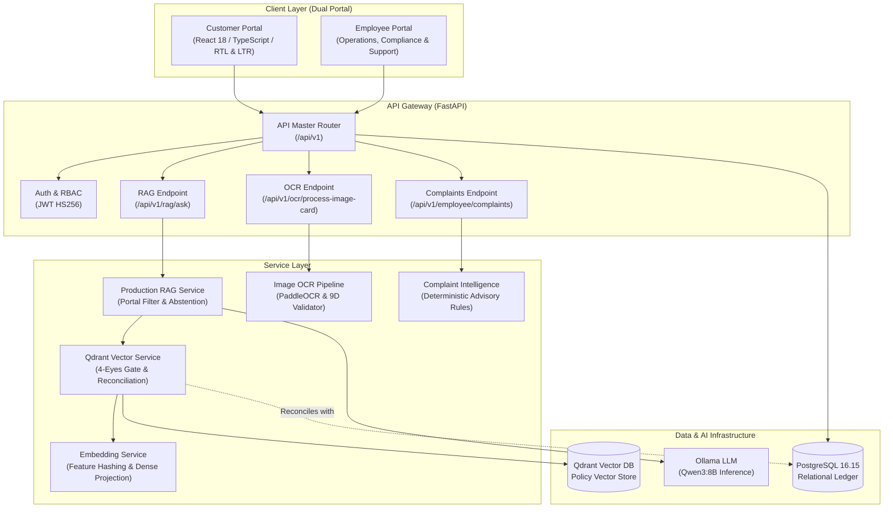

# NileOps — Intelligent Digital Banking Operations Platform

[]()
[]()
[]()
[]()
[]()
[]()
[]()

> **Fictional Simulation Identity:** NileOps Demo Bank  
> **Simulation Disclaimer:** NileOps is an enterprise-pattern digital banking operations prototype. It is **not** a licensed financial institution, is not connected to Central Bank of Egypt (CBE) or Civil Status networks, and does **not** process real financial transactions or genuine citizen identification documents. All customer profiles, account balances, and National ID numbers are 100% synthetic.

---

## Table of Contents

- [1. Project Overview & Fictional Simulation](#1-project-overview--fictional-simulation)
- [2. System Architecture](#2-system-architecture)
- [3. Technology Stack](#3-technology-stack)
- [4. Dual-Portal Banking Experience](#4-dual-portal-banking-experience)
- [5. PostgreSQL 16 & Relational Persistence](#5-postgresql-16--relational-persistence)
- [6. Qdrant & Grounded RAG Architecture](#6-qdrant--grounded-rag-architecture)
- [7. Egyptian National ID 9D Intelligence (OCR)](#7-egyptian-national-id-9d-intelligence-ocr)
- [8. Installation Prerequisites](#8-installation-prerequisites)
- [9. Native Setup Guide](#9-native-setup-guide)
- [10. Environment Configuration](#10-environment-configuration)
- [11. Service Startup Instructions](#11-service-startup-instructions)
- [12. Online Demo (Single-Port & Cloudflare Tunnel)](#12-online-demo-single-port--cloudflare-tunnel)
- [13. Running Automated Tests & Isolation](#13-running-automated-tests--isolation)
- [14. Demo Authentication & Seed Profiles](#14-demo-authentication--seed-profiles)
- [15. Transparent Architectural Limitations](#15-transparent-architectural-limitations)
- [16. User Interface & Screenshot Index](#16-user-interface--screenshot-index)
- [17. Technical Documentation & Reports](#17-technical-documentation--reports)
- [18. License](#18-license)

---

## 1. Project Overview & Fictional Simulation

**NileOps** is an intelligent, bilingual (Egyptian Arabic RTL & English LTR) digital banking operations simulation platform designed around Egyptian banking standards and regulatory patterns. 

The platform addresses core operational workflows in digital banking:
1. **Customer Self-Service:** Balance inquiries, account statement tracking, certificate of deposit yield calculators, policy assistant, customer complaint filing, account opening requests, and card requests.
2. **Operations & Compliance Workflow:** Four-eyes approval governance, complaint lifecycle operations with deterministic keyword-matched AI advisory routing, service level agreement (SLA) monitoring, and human-in-the-loop KYC inspection queues.
3. **Retrieval-Augmented Generation (RAG):** Grounded policy question answering powered by Qdrant vector retrieval with strict portal boundary isolation (customer vs. employee), dynamic vector sizing, and explicit out-of-domain abstention.
4. **Document Intelligence (OCR):** 9-dimensional deterministic validation of 14-digit Egyptian National ID structures, calendar math, governorate allowlists, review routing, and public PII masking invariants (`NOT_VERIFIED`).

---

## 2. System Architecture



---

## 3. Technology Stack

- **Frontend:**
  - React 18 SPA with TypeScript & Vite
  - Tailwind CSS for responsive styling
  - Lucide React iconography
  - Bilingual localization engine (Egyptian Arabic RTL + English LTR)
- **Backend:**
  - Python 3.11+ with FastAPI (asynchronous ASGI)
  - Pydantic v2 data validation and strict typing
  - SQLAlchemy 2.0 Async ORM with Asyncpg driver
  - Python-Jose (JWT cryptographic token handling)
  - Bcrypt secure credential hashing
- **Databases & Vector Stores:**
  - **Relational:** PostgreSQL 16.15 with `scram-sha-256` password authentication
  - **Vector Database:** Qdrant v1.12.5 (Cosine similarity metric, 384 dimensions)
  - **MVP Portable Storage:** Async SQLite (`nileops_mvp.db`) preserved as an offline fallback
- **AI & Document Intelligence:**
  - **Local LLM:** Ollama with `qwen3:8b` (extractive grounded fallback when offline/timed out)
  - **Embedding Service:** Pluggable multilingual dense semantic embeddings (`intfloat/multilingual-e5-small`, 384-d) with deterministic character feature hashing fallback
  - **OCR Engine:** PaddleOCR Arabic engine with deterministic 9-dimensional validator, statutory 7-year expiry date extraction, normalized bounding boxes `[ymin, xmin, ymax, xmax]`, and dual-document cross-verification (`backend/app/services/document_matching.py`) conforming to `docs/NATIONAL_ID_VALIDATION_SPEC.md`

---

## 4. Dual-Portal Banking Experience

NileOps enforces strict architectural and logical separation between public retail customers and authorized bank staff:

### A. Customer Portal
- Accessible to authenticated retail account holders.
- **Account Summary:** Real-time balances for Current and Savings accounts in EGP.
- **Transaction History:** Categorized debit/credit entries with timestamps and descriptions.
- **Interactive Complaint Submission:** Filing of service tickets with immediate tracking ID generation.
- **Certificates of Deposit Yield Calculator:** Simulated monthly returns based on Egyptian banking deposit rates (e.g., 23.5% annual yield).
- **Service Requests:** Submit account opening requests and card issuance requests with real-time state tracking.
- **AI Banking Assistant:** Policy question answering strictly scoped to public retail banking guidelines (`POL-RETAIL-001`).

### B. Employee Portal
- Accessible to staff members across canonical banking roles (`admin`, `operations_officer`, `customer_service`, `compliance_reviewer`, `branch_manager`).
- **Dashboard & Portfolio Search:** Inspect customer accounts, view KYC statuses, and review account activity.
- **Requests Queue:** Four-eyes review of customer account opening and debit card issuance requests.
- **Complaint Queue & Drawer:** Paginated table with server-side filters, sorting, SLA countdown, and advisory AI suggestions (deterministic category/team/priority suggestions).
- **Four-Eyes Policy Approval Workflow:** Create, review, approve, or reject bank operational policies. Creators are barred from approving their own documents.
- **KYC Document Queue:** Inspect and validate synthetic National ID cards under strict 9-dimensional compliance checks.
- **Audit Trail:** Role-scoped event logging with actor attribution and timestamps.

---

## 5. PostgreSQL 16 & Relational Persistence

The platform is natively integrated with **PostgreSQL 16.15**:
- **Application Role:** Dedicated least-privilege user `nileops_app` with schema privileges.
- **Authentication:** `scram-sha-256` configured and enforced in `pg_hba.conf`.
- **Database:** Dedicated database `nileops` with UTF-8 encoding.
- **Schema:** Relational entities (`users`, `accounts`, `transactions`, `complaints`, `policy_documents`, `kyc_verifications`, `audit_logs`, `account_opening_requests`, `card_requests`).
- **Test Database Isolation:** Test suites run strictly against `nileops_test`, protected by hard-failing guards.

---

## 6. Qdrant & Grounded RAG Architecture

The Knowledge Base and RAG pipeline provide grounded policy retrieval:
1. **Governance Before Ingestion (4-Eyes Check):**
   - Documents are ingested into Qdrant **only** after satisfying four-eyes approval (`status == 'APPROVED'`, designated approver, approver $\neq$ creator).
   - Draft, pending, or rejected documents are automatically excluded from the vector index during reconciliation.
2. **Strict Portal Boundary Filtering:**
   - **Customer Portal:** Filtered by `portal_access == 'customer'` AND `is_active == True`. Internal compliance manuals (e.g. `POL-KYC-001`) are physically excluded from search results (0.0% leakage).
   - **Employee Portal:** Retains visibility across both customer and employee operational policies.
3. **Thresholding & Explicit Abstention:**
   - Default similarity threshold is maintained at `0.15`.
   - Queries with top similarity score below `0.15` trigger standardized bilingual abstention, preventing hallucinations on out-of-domain queries.
4. **Verifiable Policy Citations:**
   - Every answer includes structured citations containing policy code, title, domain, and version.

---

## 7. Egyptian National ID 9D Intelligence (OCR)

Implements the specification defined in `docs/NATIONAL_ID_VALIDATION_SPEC.md`:

### Nine-Dimensional Evaluation Model
Every ID input or document scan is evaluated independently across 9 dimensions:
1. **Normalization (`D1`):** Normalizes Eastern Arabic digits (`٠-٩`) to Western digits (`0-9`); rejects disallowed characters.
2. **Format Validation (`D2`):** Century indicator ($C \in \{2, 3\}$), leap-year-aware calendar validation (e.g., Feb 29 on year 2000 is valid; Feb 29 on 1901 is invalid), and explicit `as_of_date` temporal boundaries.
3. **Governorate Reference (`D3`):** Validates against the 28 official Egyptian administrative governorate codes (01–35, 88).
4. **Gender Rule (`D4`):** Position 13 evaluates to Male (odd) or Female (even), classified strictly as provisional reference.
5. **Checksum Status (`D5`):** Position 14 verified as an ASCII numerical digit (no unverified government checksum formula claimed).
6. **OCR Extraction & Profile (`D6`):** Actively supports `EGY_NID_FRONT_V1`. Low confidence (<0.80) or unsupported document types trigger human review routing.
7. **Cross-Field Consistency (`D7`):** Compares OCR extracted values against user-provided onboarding form inputs.
8. **Review Routing (`D8`):** Implements Decision Tables 7.1.1 (Document AI) and 7.1.2 (Structured Intake) to emit compound statuses.
9. **Identity Verification (`D9`):** Permanent architectural invariant: `NOT_VERIFIED`.

---

## 8. Installation Prerequisites

- **Operating System:** Windows 10/11 (or Linux/macOS)
- **Python:** 3.11.x (tested on Python 3.11.9)
- **Node.js:** v20.x or v22.x LTS (with npm)
- **PostgreSQL:** Version 16.x (installed locally or via service)
- **Qdrant:** Version 1.12.x+ standalone executable or Python service (port 6333)
- **Ollama (Optional):** Running locally with `qwen3:8b` (extractive fallback operates autonomously when offline)

---

## 9. Native Setup Guide

### 1. Clone the Repository
```bash
git clone https://github.com/AbdelrhmanAkl/NileOps_V4.git
cd NileOps_V4
```

### 2. Configure Backend Virtual Environment
```bash
cd backend
python -m venv .venv
# On Windows:
.\.venv\Scripts\Activate.ps1
# On Linux/macOS:
source .venv/bin/activate

pip install -r requirements.txt
cd ..
```

### 3. Install Frontend Dependencies
```bash
cd frontend
npm install
cd ..
```

### 4. Setup Qdrant Vector Database
Run the standalone Qdrant binary or the verified pure-Python dev substitute:
```bash
# Option A: Standalone Qdrant binary or Docker (Linux / CI / macOS / standard Windows)
docker run -d -p 6333:6333 -v $(pwd)/qdrant_data:/qdrant/storage qdrant/qdrant:v1.12.0
# Or run standalone binary:
cd data/qdrant_storage && ../../bin/qdrant.exe

# Option B: Development Substitute Service (Machine-specific Windows workaround)
# On Windows hosts where unsigned binaries (qdrant.exe) or native C-extensions (.pyd)
# are blocked by Windows Smart App Control (SAC) / Code Integrity (Event 3077/3118),
# use the pure-Python in-memory dev substitute serving the identical 38-point nileops_kb collection:
python scratch/run_qdrant_service.py
```

> **Note on Windows Workarounds:** On workstations running Windows Smart App Control, two developer mitigations are documented (see `docs/RUNBOOK.md`):
> 1. `scratch/run_qdrant_service.py`: A pure-Python HTTP substitute on port 6333 matching Qdrant v1 REST API with zero native DLL dependencies.
> 2. `_PandasShimFinder`: A dynamic runtime meta-path import hook that shims `pandas` during PaddleOCR invocations when unsigned `.pyd` native extensions are blocked by OS security policy. Neither workaround is required in CI or standard Linux environments.

---

## 10. Environment Configuration

Copy `.env.example` to `.env` in both the repository root and `backend/`:
```bash
cp .env.example .env
cp .env.example backend/.env
```

Ensure configuration matches your local services:
```ini
ENVIRONMENT=development
DEBUG=true
PROJECT_NAME="NileOps Digital Banking Operations"
API_V1_PREFIX=/api/v1
SECRET_KEY=change-this-insecure-key-to-a-secure-256-bit-random-secret

# PostgreSQL 16 Connection
DATABASE_URL=postgresql+asyncpg://nileops_app:<YOUR_POSTGRES_PASSWORD>@127.0.0.1:5432/nileops

# Qdrant Vector DB
QDRANT_URL=http://127.0.0.1:6333

# Ollama LLM
OLLAMA_URL=http://127.0.0.1:11434
OLLAMA_MODEL=qwen3:8b
```

---

## 11. Service Startup Instructions

Run the complete platform natively in separate terminals:

### Terminal 1: PostgreSQL 16
```bash
postgres -D <path_to_postgres_data>
```

### Terminal 2: Qdrant Vector Store
```bash
# Production / Native binary:
cd data/qdrant_storage && ../../bin/qdrant.exe

# OR Dev-Only Substitute (if qdrant.exe is restricted by Windows Smart App Control):
python scratch/run_qdrant_service.py
```

### Terminal 3: FastAPI Backend
```bash
cd backend
python -m uvicorn app.main:app --host 127.0.0.1 --port 8000 --reload
```
- Interactive Swagger API Documentation: `http://localhost:8000/docs`
- Service Health Probe: `http://localhost:8000/health`

### Terminal 4: React Frontend
```bash
cd frontend
npm run dev
```
- User Interface: `http://localhost:5173`

---

## 12. Online Demo (Single-Port & Cloudflare Tunnel)

NileOps can be exposed to remote reviewers in **2 commands** without port forwarding or creating an account:

### 1. Launch Unified Single-Port Server (Terminal 1)
```powershell
.\scripts\start_demo.ps1
```
This script:
- Verifies Docker and starts PostgreSQL 16 & Qdrant vector database.
- Pre-flights offline AI model caches (`intfloat/multilingual-e5-small` & PaddleOCR).
- Resets and seeds the synthetic demo database and reconciles Qdrant embeddings.
- Configures an ephemeral 256-bit `SECRET_KEY` in memory with `ENVIRONMENT=production`.
- Starts the unified server at `http://127.0.0.1:8000` (serving both the React SPA and `/api/v1` backend endpoints on one port).

### 2. Launch Cloudflare Quick Tunnel (Terminal 2)
```powershell
.\scripts\start_tunnel.ps1
```
*(If `cloudflared` is not installed, the script suggests: `winget install --id Cloudflare.cloudflared`)*
The script launches a free Cloudflare tunnel and outputs a public temporary URL:
```text
https://<random-subdomain>.trycloudflare.com
```

### Self-Check & Demo Reset
- **Automated Health & Smoke Check:** Run `.\scripts\demo_selfcheck.ps1` to verify health, authentication, RAG question answering, Document AI OCR upload, Ops Assistant, and Ollama latency.
- **Demo Data Reset:** Run `.\scripts\reset_demo.ps1` at any time to return the synthetic demo database, audit logs, and uploads to their initial pristine state.

### Test Credentials
| Portal / Role | Email | Password | Allowed Capabilities |
| :--- | :--- | :--- | :--- |
| **Retail Customer** | `customer1@nileops.demo` | `Customer2026!` | View balances, transactions, submit requests, ask customer RAG |
| **Operations Officer** | `ops@nileops.demo` | `NileOps2026!` | Review queues, Ops Assistant chat, card requests |
| **Compliance Reviewer** | `compliance@nileops.demo` | `NileOps2026!` | Document AI KYC verification, audit trails, policy checks |
| **Branch Manager** | `manager@nileops.demo` | `NileOps2026!` | 4-Eyes dual approvals, high-limit overrides |
| **System Admin** | `admin@nileops.demo` | `NileOps2026!` | Configuration, role assignments, system overview |

### What is Mocked vs. Simulated vs. Real
- **Real:** PostgreSQL 16 relational ledger, Qdrant vector retrieval, multilingual E5 embeddings, PaddleOCR document intelligence with 9-dimensional Egyptian National ID math, JWT authentication, sliding-window rate limiters, and prompt injection defenses.
- **Simulated:** Digital banking operations workflows (account opening drafts, card routing, customer complaint advisory, human-in-the-loop compliance review queues).
- **Mocked / Air-Gapped:** Zero external financial network connections. Core banking ledgers, CBE clearing rails, and SMS gateways are mocked in-memory. Ollama LLM (`qwen3:8b`) runs 100% locally with an instant deterministic fallback mode when offline.

---

## 13. Running Automated Tests & Isolation

The backend test suite enforces strict isolation:
- **Relational Isolation:** All tests run against database `nileops_test`. The development database `nileops` is guarded and unreachable by tests.
- **Vector Isolation:** All tests run against collection `nileops_kb_test`. A hard-failing check in `vector_store.py` ensures tests fail immediately if the collection does not end with `_test`.

### Execute Test Suite (134 Tests)
```bash
cd backend
pytest -v -x -s --durations=10
```
Test module breakdown (134 passed / 100% pass rate):
- `tests/test_adversarial_agent.py` (29 tests): Allowlisted Ops Assistant agent, adversarial prompt injection defenses (EN/AR), forbidden tools refusal, and output guardrails (14-digit National ID, IBAN, and JWT scrubbing).
- `tests/test_complaint_intelligence.py` (6 tests): Deterministic advisory classification, SLA calculations, complaint lifecycle transitions, and employee pagination.
- `tests/test_document_matching.py` (4 tests): Dual-document cross-verification (National ID vs Utility Bill), composite name similarity, Egyptian governorate geo-matching, bill recency, and RBAC endpoint lifecycles.
- `tests/test_health.py` (4 tests): Health probes, root redirect, API v1 status, and production JWT secret key guard.
- `tests/test_iban_masking.py` (2 tests): Public IBAN masking invariants.
- `tests/test_kpi_service.py` (6 tests): Operational KPI calculation engine and employee role RBAC.
- `tests/test_kyc_document_ai.py` (9 tests): Synthetic National ID masking, review notes requirements, customer KYC update lifecycle, expiry date validation, and normalized bounding box provenance.
- `tests/test_kyc_mismatch.py` (12 tests): Cross-field KYC discrepancy checks (birthdate vs ID, governorate vs ID, low OCR confidence, missing fields).
- `tests/test_mvp.py` (6 tests): Authentication, RBAC isolation, data ownership, complaints, and four-eyes policy approval.
- `tests/test_ocr.py` (12 tests): Digit normalization, leap-year calendar validation, governorate allowlists, Decision Tables 7.1.1 & 7.1.2.
- `tests/test_ocr_phase_2_1.py` (9 tests): Address parsing, WebP validation, and security fuzzing.
- `tests/test_ocr_phase_2_2.py` (5 tests): Image quality assessment, CLAHE contrast enhancement, and deskewing.
- `tests/test_ocr_security.py` (6 tests): Image size guards, decompression bomb protection, and PII masking.
- `tests/test_production_guards.py` (10 tests): Weak secret rejection, CORS wildcard prevention, login lockout, sliding-window rate limiting, production Swagger /docs and /openapi.json disabling, trusted-peer-only client IP header forwarding guard, and SPA fallback routing.
- `tests/test_rag.py` (11 tests): Qdrant health, dense E5 embeddings, grounded answers, portal isolation, abstention, POL-TEST exclusion, and RBAC guards.
- `tests/test_simulated_requests.py` (7 tests): Account opening requests, debit card requests, and state machine validation.

### Frontend Typecheck & Build
```bash
cd frontend
npm run build
```

---

## 14. Demo Authentication & Seed Profiles

For rapid local evaluation, NileOps provides convenient **1-click quick-login buttons** on the login screen (`http://localhost:5173`) that pre-fill synthetic development credentials for each supported role:

- **Retail Customer 1:** Active checking and savings accounts; recent transaction history.
- **Retail Customer 2:** Alternate customer profile for multi-tenant data ownership verification.
- **Operations Officer:** Access to the employee operations queue and customer portfolio.
- **Customer Service:** Complaint resolution and customer ticket handling.
- **Compliance Reviewer:** First-line policy creation and KYC inspection queue.
- **Branch Manager:** Second-line policy four-eyes approver and audit manager.
- **System Administrator:** System-wide management and technical oversight.

*Note: In accordance with security practices, plaintext seed passwords are not published in public documentation. They are managed through git-ignored local environment files and local database seed routines.*

---

## 15. Transparent Architectural Limitations & Known Gaps

NileOps is designed as an architectural reference implementation and operations simulator. In the interest of engineering transparency and empirical honesty, the following technical limitations and benchmark results are explicitly documented:

> [!IMPORTANT]
> **Simulation Scope & Known Limitations Notice:**
> - **100% Synthetic Simulation:** All data within NileOps—including customer profiles, account balances, complaint tickets, transaction ledgers, and 14-digit Egyptian National IDs—is 100% synthetic mock data generated for developer simulation. The platform is an architectural prototype and is not a licensed financial institution.
> - **Legal Disclaimer on Expiry Dates:** The 7-year National ID expiration rule implemented in the Document AI extraction pipeline is a **training assumption on synthetic data, not legal advice** or official Civil Status Ministry policy.
> - **Local LLM & Deterministic Fallback:** If a local Ollama instance (`qwen3:8b`) is not running or times out (2.0s threshold), the platform automatically activates deterministic extractive quotation fallback (`fallback_used: true`). Answers are extracted verbatim from retrieved policy chunks, ensuring high availability and zero hallucinations without requiring active GPU/neural generation.

1. **RAG Grounded-Answer Hit@1 Performance (NOT MET):**
   - The platform utilizes `intfloat/multilingual-e5-small` (384 dimensions) for semantic policy retrieval in Qdrant with calibrated threshold 0.75.
   - Measured against the Egyptian Banking Handbook target ($\ge 90.0\%$ Hit@1), this target is **NOT MET** across unconstrained colloquial phrasings without question-derived keyword expansion:
     - **DEV Set (N=40, 25 in-domain):** **76.0% Hit@1**
     - **Held-Out Set 1 (N=30, 25 in-domain):** **52.0% Hit@1**
     - **Held-Out Set 2 (Colloquial / Typos / Fragments, N=30, 20 in-domain):** **45.0% Hit@1**
   - General orthographic normalization strips Arabic diacritics and collapses whitespace, but semantic drift on short fragments and colloquial queries remains a known limitation.

2. **OCR Performance & Absence of Image Preprocessing (NOT MET):**
   - The Egyptian Banking Handbook specifies a target field $F_1 \ge 90.0\%$.
   - Measured on our 40-card synthetic test set across Clean, Glare, Blur, and Shadow conditions, this target is **NOT MET** for cursive Arabic fields:
     - **National ID Field $F_1$:** **87.5%** (NOT MET)
     - **Citizen Name Field $F_1$:** **62.5%** (NOT MET)
     - **Residential Address Field $F_1$:** **50.0%** (NOT MET)
     - **Factory Code Field $F_1$:** **90.0%** (MET)
     - **Routed to Human Review:** **55.0%** of degraded cards.
   - **Statement on Preprocessing:** Advanced OCR image preprocessing (super-resolution, localized contrast equalization, or morphological binarization) was **not implemented**. Raw card images are passed to PaddleOCR, causing character recognition degradation on Arabic cursive handwriting and degraded text lines under glare and blur.

3. **Deterministic Exception Detection & Escalation (MET):**
   - **DEV Corpus (60 cards):** Exception Recall = **96.7%**, Escalation Correctness = **96.7%**, Precision = **100.0%**.
   - **HELD-OUT Corpus (60 cards, fresh seed):** Exception Recall = **100.0%**, Escalation Correctness = **100.0%**, Precision = **83.3%**, Specificity = **80.0%**, False Negatives = **0**.

4. **Permanent NOT_VERIFIED Identity Status:**
   - In accordance with CBE compliance boundaries and the absence of live MOI Civil Status network connectivity, all identity verifications remain permanently marked as `NOT_VERIFIED`.

5. **Declarative Database Initialization without Alembic:**
   - Relational schemas are initialized declaratively via SQLAlchemy `create_all` during startup. An incremental migration toolchain is not currently active for automated schema diffs.

6. **Local Native Scope — Cloud Deployment Excluded:**
   - The project is architected and verified strictly for local developer native execution (Windows/Linux with Docker). Public cloud hosting, Kubernetes clusters, and external payment network bridges are out of scope.

---

## 16. User Interface & Screenshot Index

Comprehensive visual evidence for all bilingual dual-portal workflows is indexed in [`docs/screenshots/SCREENSHOT_INDEX.md`](file:///c:/AI/NileOps_V4/docs/screenshots/SCREENSHOT_INDEX.md):

| Interface Screen | Language | Key Verification Focus |
| :--- | :---: | :--- |
| **Customer Portal Overview** | EN / AR | Dual-account balance cards, transaction ledger, CD yield calculator. |
| **Customer Complaint Filing** | EN / AR | Category selection, priority assignment, instant tracking code. |
| **AI Banking Assistant** | EN / AR | Grounded policy citations, expandable context drawer, abstention banner. |
| **Customer Requests Form** | EN / AR | Account opening and card requests with deterministic rule evaluation. |
| **Employee Dashboard** | EN / AR | KPI counters, requests review queue, customer search. |
| **Employee Complaint Queue** | EN / AR | Server-side pagination, SLA countdown timer, deterministic advisory drawer. |
| **KYC Document Queue** | EN / AR | 9D compliance inspector, mandatory reviewer notes on rejection, PII masking. |
| **Audit Trail & Governance** | EN / AR | Role-scoped event audit log with actor attribution and timestamps. |

---

## 17. Technical Documentation & Reports

Detailed technical reports and evaluation benchmarks are maintained in `docs/`:
- [`docs/CURRENT_PROJECT_STATE_REPORT.md`](file:///c:/AI/NileOps_V4/docs/CURRENT_PROJECT_STATE_REPORT.md): Complete feature implementation matrix, test metrics, and known defect audit.
- [`docs/RAG_EVALUATION.md`](file:///c:/AI/NileOps_V4/docs/RAG_EVALUATION.md): Dual-portal RAG benchmark, threshold sweep, and POL-TEST remediation.
- [`docs/OCR_IMAGE_LEVEL_EVALUATION.md`](file:///c:/AI/NileOps_V4/docs/OCR_IMAGE_LEVEL_EVALUATION.md): 40-image synthetic OCR evaluation, CER, and Handbook comparison.
- [`docs/NATIONAL_ID_VALIDATION_SPEC.md`](file:///c:/AI/NileOps_V4/docs/NATIONAL_ID_VALIDATION_SPEC.md): 9-dimensional Egyptian National ID specification and Decision Tables.
- [`docs/POSTGRESQL_IMPLEMENTATION_REPORT.md`](file:///c:/AI/NileOps_V4/docs/POSTGRESQL_IMPLEMENTATION_REPORT.md): PostgreSQL 16 migration, SCRAM-SHA-256, and isolation report.
- [`docs/screenshots/SCREENSHOT_INDEX.md`](file:///c:/AI/NileOps_V4/docs/screenshots/SCREENSHOT_INDEX.md): Index of captured visual verification evidence.

---

## 18. License

This project is licensed under the MIT License — see the [LICENSE](LICENSE) file for details.
