# NileOps — Architecture Document

> **Version:** 1.0.0  
> **Last Updated:** 2026-11-07  
> **Classification:** Internal — Engineering  
> **Status:** Living Document

---

## Table of Contents

- [1. System Overview](#1-system-overview)
- [2. Component Architecture](#2-component-architecture)
- [3. Data Flow Diagrams](#3-data-flow-diagrams)
- [4. API Architecture](#4-api-architecture)
- [5. Database Architecture](#5-database-architecture)
- [6. Security Architecture](#6-security-architecture)
- [7. AI Architecture](#7-ai-architecture)
- [8. Deployment Architecture](#8-deployment-architecture)
- [9. Directory Structure](#9-directory-structure)
- [10. Integration Points](#10-integration-points)
- [11. Configuration Management](#11-configuration-management)
- [12. Scalability Considerations](#12-scalability-considerations)

---

## 1. System Overview

**NileOps** is an enterprise-grade, AI-powered digital banking operations platform designed to streamline core banking workflows through intelligent automation. The platform combines modern full-stack engineering with production-ready AI capabilities — including local LLM inference, document OCR intelligence, retrieval-augmented generation (RAG), and autonomous agentic operations — all within a secure, auditable, and compliance-ready architecture.

### Design Principles

| Principle | Implementation |
|---|---|
| **Privacy-First AI** | All LLM inference runs locally via Ollama — zero data leaves the network |
| **Human-in-the-Loop** | Critical AI decisions require explicit human approval before execution |
| **Auditability** | Immutable event trail for every state change across the platform |
| **Bilingual-Native** | Arabic and English support at every layer — UI, LLM, OCR, search |
| **Modularity** | Each domain is an independent service module with clean API boundaries |
| **Type Safety** | Pydantic models on the backend, TypeScript on the frontend |

### High-Level Architecture Diagram

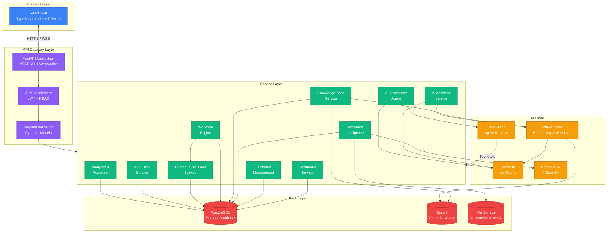

---

## 2. Component Architecture

### 2.1 Frontend Layer — React SPA

The frontend is a single-page application built with React 18, TypeScript, and Vite, styled with Tailwind CSS. It communicates exclusively through the REST API and WebSocket connections.

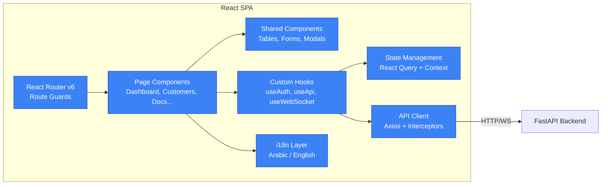

| Concern | Technology | Purpose |
|---|---|---|
| Build Tool | Vite | Fast HMR, optimized production builds |
| Styling | Tailwind CSS | Utility-first, consistent design system |
| Data Fetching | React Query (TanStack) | Server state caching, background refetch |
| Routing | React Router v6 | Nested routes, role-based guards |
| Forms | React Hook Form + Zod | Type-safe validation, performant forms |
| Internationalization | i18next | Bilingual Arabic/English with RTL support |
| HTTP Client | Axios | Request/response interceptors, JWT refresh |

### 2.2 API Gateway Layer — FastAPI

The FastAPI application serves as the single entry point for all client requests. It handles authentication, request validation, rate limiting, and route delegation to internal services.

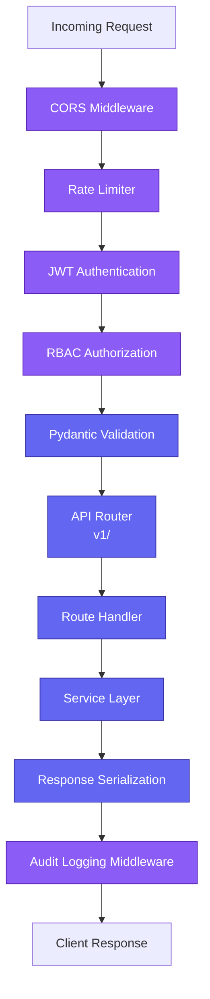

**Key design decisions:**

- **Versioned routes** — All endpoints scoped under `/api/v1/` to support future non-breaking upgrades
- **Dependency injection** — FastAPI `Depends()` for database sessions, auth context, and service instances
- **Async-first** — All I/O-bound handlers are `async def` with `asyncpg` and async HTTP clients
- **Structured error responses** — Consistent `ErrorResponse` schema across all failure modes

### 2.3 Service Layer — Business Logic

Each service module encapsulates a bounded domain context. Services are stateless, depend on repositories for data access, and emit audit events for state-changing operations.

| Service | Responsibility | Key Dependencies |
|---|---|---|
| `DashboardService` | Aggregate real-time statistics from database | PostgreSQL |
| `CustomerService` | CRUD for customers, KYC status management, account linking | PostgreSQL |
| `AccountService` | Account creation, balance queries, transaction history | PostgreSQL |
| `TransactionService` | Transaction recording, filtering, export | PostgreSQL |
| `LoanService` | Loan applications, approval workflows, repayment tracking | PostgreSQL, WorkflowEngine |
| `DocumentService` | Document upload, OCR dispatch, result storage | PaddleOCR, File Storage, PostgreSQL |
| `KnowledgeBaseService` | Document ingestion, versioning, semantic search | Qdrant, RAG Engine, PostgreSQL |
| `AssistantService` | Chat session management, LLM inference orchestration | Ollama (Qwen3), RAG Engine |
| `AgentService` | Tool-based task execution, approval queue management | LangGraph, LLM, Tool Registry |
| `WorkflowService` | State machine execution for banking processes | PostgreSQL, HITL Service |
| `HITLService` | Review queue management, approval/rejection handling | PostgreSQL, WebSocket |
| `AuditService` | Immutable event recording, trail querying | PostgreSQL |
| `AnalyticsService` | Report generation, metric aggregation, data export | PostgreSQL |

### 2.4 AI Layer

The AI layer comprises four subsystems that operate independently but compose together for intelligent banking operations.

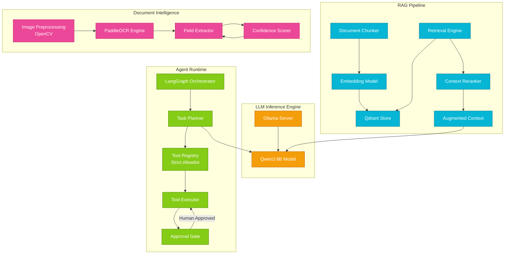

### 2.5 Data Layer

| Store | Technology | Purpose | Data Types |
|---|---|---|---|
| **Primary Database** | PostgreSQL 16 | Transactional data, relationships, audit trail | Customers, accounts, transactions, workflows, users, audit logs |
| **Vector Database** | Qdrant | Semantic similarity search for RAG | Document embeddings, metadata, collection management |
| **File Storage** | Local volume (Docker mount) | Binary document storage | Uploaded PDFs, images, OCR outputs, generated reports |

---

## 3. Data Flow Diagrams

### 3.1 Document OCR Processing Flow

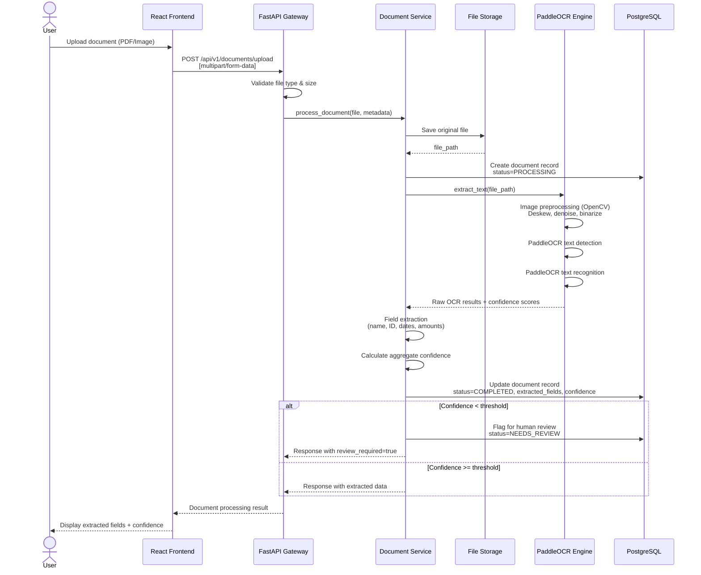

### 3.2 RAG Query Flow

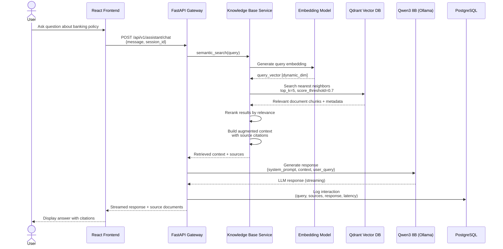

### 3.3 Agent Tool Execution Flow

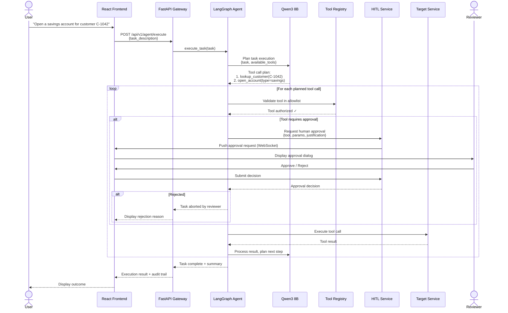

### 3.4 Workflow State Transitions

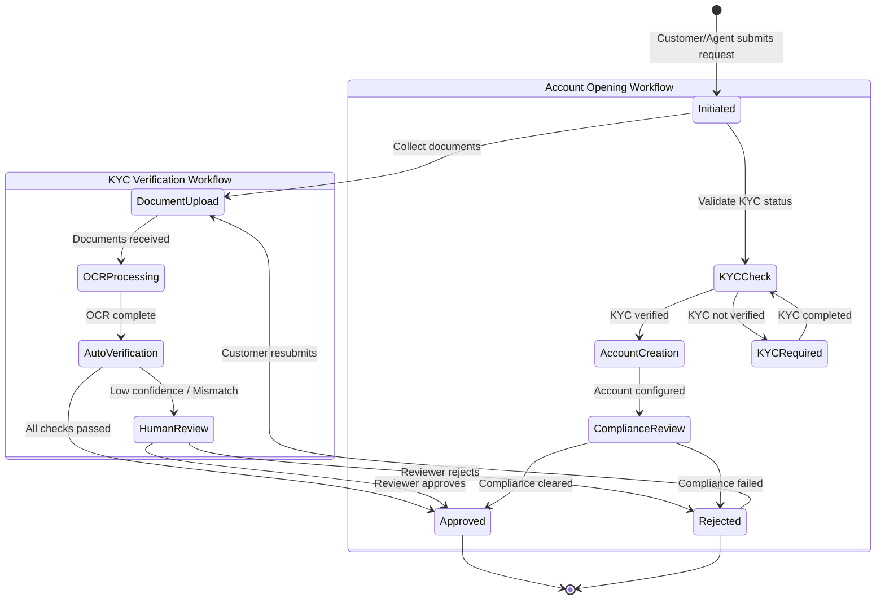

> [!NOTE]
> All four workflows (KYC Verification, Account Opening, Card Request, Complaints) follow the same state machine pattern with domain-specific states. Each transition emits an audit event and may trigger notifications.

### 3.5 Authentication Flow

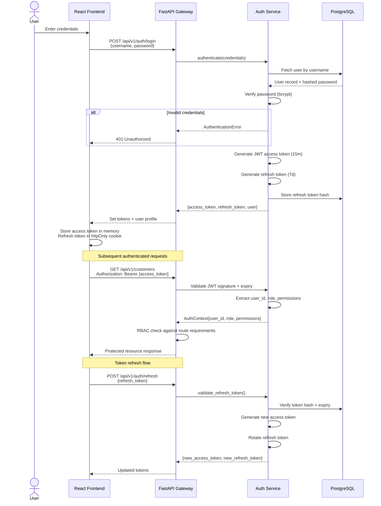

---

## 4. API Architecture

### Design Principles

| Principle | Implementation |
|---|---|
| **RESTful Resource Modeling** | Nouns for resources, HTTP verbs for actions (`GET /customers`, `POST /accounts`) |
| **API Versioning** | URI path versioning: `/api/v1/` prefix on all routes |
| **Consistent Response Envelope** | All responses follow `{data, meta, errors}` structure |
| **Pagination** | Cursor-based for large datasets, offset-based for admin views |
| **Idempotency** | `Idempotency-Key` header support on POST/PUT operations |
| **Content Negotiation** | `application/json` primary; `multipart/form-data` for file uploads |

### Route Namespace Map

```
/api/v1/
├── auth/
│   ├── POST   /login
│   ├── POST   /refresh
│   └── POST   /logout
├── dashboard/
│   └── GET    /stats
├── customers/
│   ├── GET    /                    # List with filtering
│   ├── POST   /                    # Create customer
│   ├── GET    /{id}                # Get customer detail
│   ├── PUT    /{id}                # Update customer
│   ├── GET    /{id}/accounts       # Customer accounts
│   ├── GET    /{id}/transactions   # Customer transactions
│   └── GET    /{id}/kyc            # KYC status
├── accounts/
│   ├── GET    /
│   ├── POST   /
│   └── GET    /{id}/transactions
├── transactions/
│   ├── GET    /
│   └── POST   /
├── loans/
│   ├── GET    /
│   ├── POST   /
│   ├── GET    /{id}
│   └── PATCH  /{id}/status
├── documents/
│   ├── POST   /upload
│   ├── GET    /{id}
│   ├── GET    /{id}/ocr-result
│   └── POST   /{id}/reprocess
├── knowledge-base/
│   ├── GET    /documents
│   ├── POST   /documents/ingest
│   ├── GET    /documents/{id}
│   ├── POST   /search
│   └── GET    /documents/{id}/versions
├── assistant/
│   ├── POST   /chat
│   ├── GET    /sessions
│   ├── GET    /sessions/{id}/history
│   └── DELETE /sessions/{id}
├── agent/
│   ├── POST   /execute
│   ├── GET    /tasks
│   ├── GET    /tasks/{id}
│   └── GET    /tools
├── workflows/
│   ├── GET    /
│   ├── POST   /
│   ├── GET    /{id}
│   ├── GET    /{id}/transitions
│   └── PATCH  /{id}/state
├── reviews/
│   ├── GET    /pending
│   ├── GET    /{id}
│   └── POST   /{id}/decision
├── audit/
│   ├── GET    /events
│   └── GET    /events/{entity_type}/{entity_id}
└── analytics/
    ├── GET    /reports
    ├── POST   /reports/generate
    └── GET    /metrics
```

### Error Response Schema

All errors return a consistent structure with machine-readable codes and human-readable messages:

```json
{
  "error": {
    "code": "VALIDATION_ERROR",
    "message": "Request validation failed",
    "details": [
      {
        "field": "email",
        "message": "Invalid email format",
        "code": "INVALID_FORMAT"
      }
    ],
    "request_id": "req_a1b2c3d4",
    "timestamp": "2026-11-07T20:00:00Z"
  }
}
```

### Standard HTTP Status Codes

| Code | Usage |
|---|---|
| `200` | Successful retrieval or update |
| `201` | Successful resource creation |
| `204` | Successful deletion (no body) |
| `400` | Validation error / malformed request |
| `401` | Missing or invalid authentication |
| `403` | Authenticated but insufficient permissions |
| `404` | Resource not found |
| `409` | Conflict (duplicate, state violation) |
| `422` | Semantically invalid request body |
| `429` | Rate limit exceeded |
| `500` | Internal server error |

---

## 5. Database Architecture

### Entity-Relationship Diagram

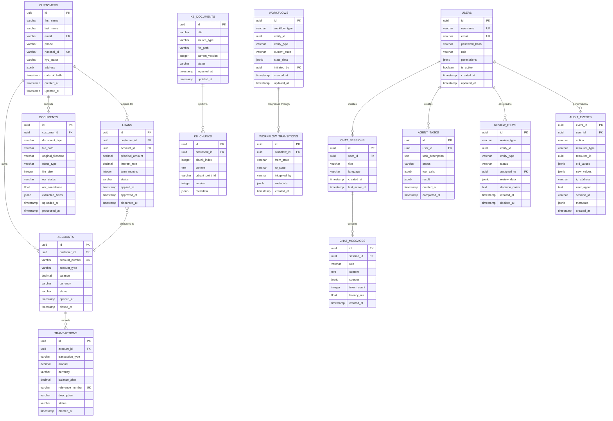

### Key Indexing Strategy

| Table | Index | Type | Purpose |
|---|---|---|---|
| `customers` | `national_id` | Unique B-tree | Fast KYC lookups |
| `accounts` | `customer_id` | B-tree | Customer account listing |
| `accounts` | `account_number` | Unique B-tree | Account lookups |
| `transactions` | `account_id, created_at` | Composite B-tree | Chronological transaction history |
| `transactions` | `reference_number` | Unique B-tree | Duplicate detection |
| `documents` | `customer_id, document_type` | Composite B-tree | Customer document queries |
| `audit_events` | `entity_type, entity_id` | Composite B-tree | Entity audit trail |
| `audit_events` | `created_at` | B-tree (BRIN) | Time-range queries on large table |
| `workflows` | `workflow_type, current_state` | Composite B-tree | Queue-based workflow processing |
| `review_items` | `status, assigned_to` | Composite B-tree | Pending review queue |

### Migration Strategy

Database migrations are managed with **Alembic** using the following conventions:

- Migrations are auto-generated from SQLAlchemy model changes
- Each migration has a descriptive message and is reviewed before application
- Down-migrations are always provided for rollback capability
- Data migrations are separated from schema migrations
- Production migrations run within transactions with automatic rollback on failure

---

## 6. Security Architecture

### RBAC Model

```mermaid
graph TD
    subgraph Roles
        ADMIN["Administrator<br/>Full system & user admin"]
        OPS["Operations Officer<br/>Workflows, intake, ops"]
        CS["Customer Service<br/>Lookup, complaints, status"]
        COMP["Compliance Reviewer<br/>KYC review, audit, approvals"]
        BM["Branch Manager<br/>Branch workflows & approvals"]
    end

    subgraph Permissions
        P1["customers:read"]
        P2["customers:write"]
        P3["accounts:read"]
        P4["accounts:write"]
        P5["transactions:read"]
        P6["transactions:write"]
        P7["documents:read"]
        P8["documents:write"]
        P9["workflows:approve"]
        P10["agent:execute"]
        P11["audit:read"]
        P12["analytics:read"]
        P13["users:manage"]
        P14["kb:manage"]
    end

    ADMIN --> P1 & P2 & P3 & P4 & P5 & P6 & P7 & P8 & P9 & P10 & P11 & P12 & P13 & P14
    BM --> P1 & P2 & P3 & P4 & P5 & P7 & P8 & P9 & P11 & P12
    OPS --> P1 & P2 & P3 & P4 & P5 & P7 & P8 & P10
    CS --> P1 & P3 & P5 & P7
    COMP --> P1 & P3 & P5 & P7 & P9 & P11 & P12 & P14

    classDef role fill:#8b5cf6,stroke:#5b21b6,color:#fff
    classDef perm fill:#6366f1,stroke:#3730a3,color:#fff
    class ADMIN,BM,OPS,CS,COMP role
    class P1,P2,P3,P4,P5,P6,P7,P8,P9,P10,P11,P12,P13,P14 perm
```

### JWT Token Architecture

| Property | Access Token | Refresh Token |
|---|---|---|
| **Lifetime** | 15 minutes | 7 days |
| **Storage** | In-memory (JavaScript variable) | httpOnly, Secure, SameSite=Strict cookie |
| **Payload** | `{sub, role, permissions, exp, iat, jti}` | `{sub, exp, iat, jti, token_family}` |
| **Rotation** | Issued on every refresh | Rotated on every use (one-time use) |
| **Revocation** | Short-lived, no explicit revocation | Hash stored in DB, deletable |

### Data Protection Layers

```mermaid
graph LR
    subgraph Transport["Transport Security"]
        TLS["TLS 1.3<br/>All HTTP traffic"]
    end

    subgraph Application["Application Security"]
        INPUT["Input Validation<br/>Pydantic + Zod"]
        SQLI["SQL Injection Prevention<br/>SQLAlchemy ORM"]
        XSS["XSS Protection<br/>React auto-escaping"]
        CSRF["CSRF Protection<br/>SameSite cookies"]
        RATE["Rate Limiting<br/>Per-user throttling"]
    end

    subgraph Data["Data-at-Rest"]
        HASH["Password Hashing<br/>bcrypt (cost=12)"]
        ENCRYPT["Sensitive Field Encryption<br/>AES-256-GCM"]
        AUDIT_LOG["Immutable Audit Log<br/>Append-only table"]
    end

    TLS --> Application
    Application --> Data

    classDef transport fill:#3b82f6,stroke:#1e40af,color:#fff
    classDef app fill:#10b981,stroke:#047857,color:#fff
    classDef data fill:#ef4444,stroke:#991b1b,color:#fff

    class TLS transport
    class INPUT,SQLI,XSS,CSRF,RATE app
    class HASH,ENCRYPT,AUDIT_LOG data
```

> [!IMPORTANT]
> The audit_events table uses an append-only pattern — no UPDATE or DELETE operations are permitted at the application level. This ensures a tamper-evident audit trail suitable for regulatory compliance.

---

## 7. AI Architecture

### Component Interaction Model

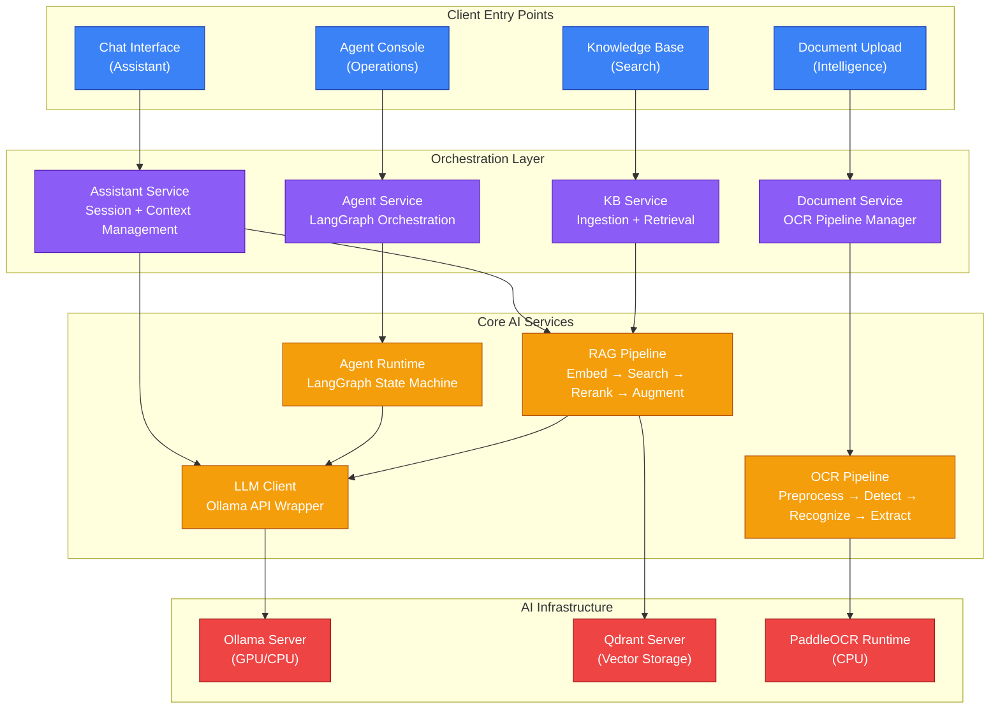

### LLM Integration — Qwen3 8B via Ollama

| Aspect | Configuration |
|---|---|
| **Model** | `qwen3:8b` — 8 billion parameter multilingual model |
| **Runtime** | Ollama (local inference, no external API calls) |
| **Context Window** | 32,768 tokens |
| **Languages** | English, Arabic (native bilingual support) |
| **Temperature** | Task-dependent: 0.1 (extraction), 0.4 (chat), 0.0 (agent planning) |
| **Streaming** | Server-Sent Events (SSE) for real-time chat responses |
| **Prompt Strategy** | System prompt per task type + few-shot examples for banking domain |

### RAG Pipeline & Policy Governance Detail

#### Dual-Portal Architecture for NileOps Demo Bank

NileOps simulates retail digital banking operations for a fictional institution, **NileOps Demo Bank** (a working simulation identity with no affiliation to or imitation of any real institution). The platform provides two distinct user interfaces sharing one approved policy knowledge base under strict authorization boundaries:

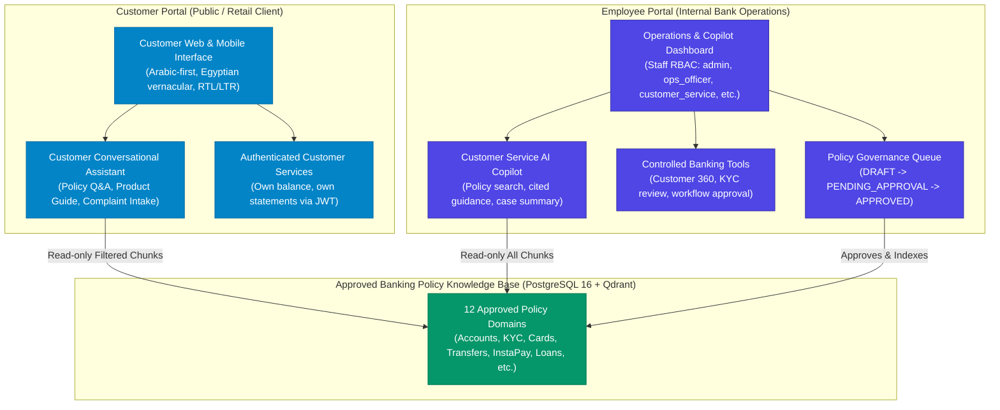

#### Mandatory Policy Approval State Machine

All knowledge base documents follow a strictly auditable state machine ensuring unapproved documents never enter active retrieval collections:

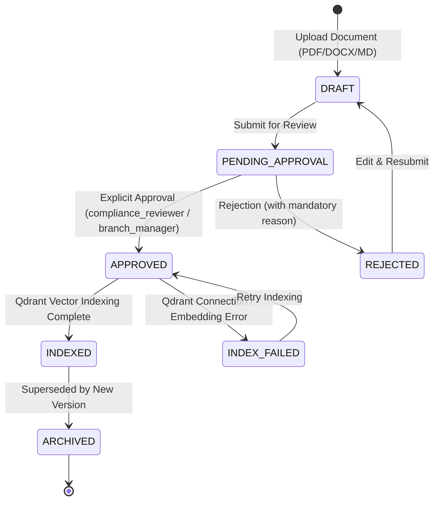

- **Separation of Duties:** The employee who uploaded a policy document (`uploaded_by`) cannot approve it (`approved_by != uploaded_by`).
- **Superseded Document Tombstoning:** Activating a new approved version deactivates all chunks belonging to older versions in Qdrant (`is_active = FALSE`).

#### 12 Synthetic Policy Domains (NileOps Demo Bank)
1. Current & Savings Accounts
2. Account Opening & Account Maintenance
3. KYC & Identity Document Requirements
4. Debit, Credit & Prepaid Cards
5. Domestic Transfers & Clearing
6. InstaPay Network Guidelines & Daily Limits
7. Investment Certificates & Term Deposits
8. Retail Loans & Financing Policies
9. Schedule of Fees, Commissions & Service Limits
10. Customer Complaints & Dispute Procedures
11. Branch Network, Working Hours & ATM Services
12. Digital Banking & Mobile Application Support

#### Ingestion & Retrieval Pipeline

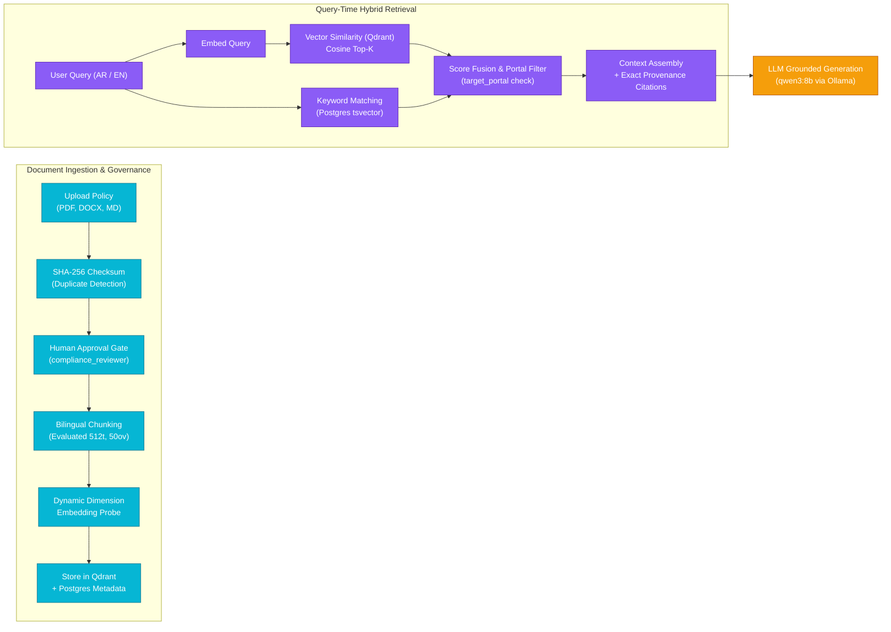

#### Grounded Generation & Escalation Rules
- **Evidence-Bound Answers:** The assistant generates responses strictly grounded in retrieved policy chunks and cites document title, version number, and section title.
- **Explicit Abstention:** If retrieved chunks fail relevance thresholds or evidence is insufficient, the assistant explicitly states: *"Based on approved NileOps Demo Bank documentation, I do not have sufficient information to answer this inquiry."*
- **Contradiction Detection:** If retrieved chunks contain conflicting provisions across different active documents, the assistant identifies the ambiguity and flags the case for compliance review.
- **Simulated Escalation Paths:** Inquiries involving customer disputes, repeated ungrounded queries, or explicit requests for human support automatically create a simulated ticket in the customer service queue (`conversations.escalation_status = 'pending_escalation'`).
- **Feedback Collection:** Every assistant response supports thumbs up/down and groundedness rating captured in `rag_feedbacks`.

### Agent Tool Registry and Permissions

The AI Operations Agent operates under a **strict tool allowlist** — the LLM can only invoke pre-registered, explicitly permitted tools. Each tool has a risk classification that determines whether human approval is required.

| Tool | Description | Risk Level | Requires Approval |
|---|---|---|---|
| `lookup_customer` | Retrieve customer details by ID | Low | No |
| `search_customers` | Search customers by criteria | Low | No |
| `get_account_balance` | Check account balance | Low | No |
| `get_transaction_history` | List recent transactions | Low | No |
| `open_account` | Create new bank account | High | **Yes** |
| `update_kyc_status` | Change customer KYC status | High | **Yes** |
| `initiate_workflow` | Start banking workflow | Medium | **Yes** |
| `approve_loan` | Approve a loan application | Critical | **Yes** |
| `search_knowledge_base` | Query banking knowledge base | Low | No |
| `generate_report` | Create analytics report | Low | No |

> [!CAUTION]
> The agent **cannot** execute arbitrary code, run shell commands, or call tools outside the registered allowlist. Any tool call not on the allowlist is rejected at the registry level before reaching execution. This is a hard security boundary, not an LLM instruction.

### LangGraph Agent State Machine

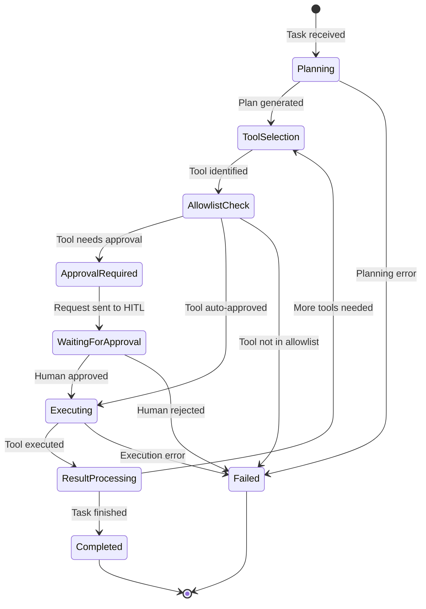

---

## 8. Deployment Architecture

### Docker Compose Services

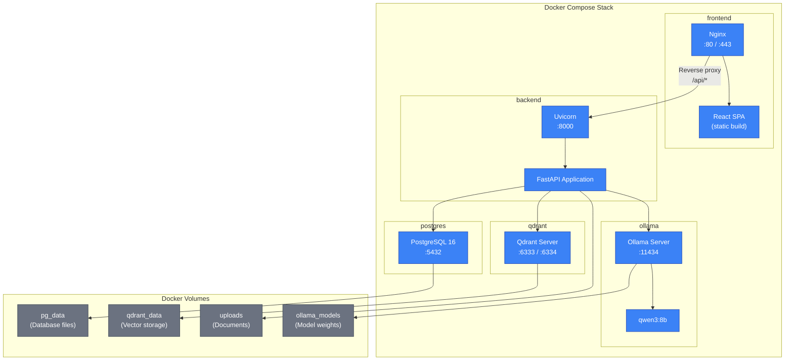

### Service Configuration Matrix

| Service | Image | Port(s) | Resources | Health Check |
|---|---|---|---|---|
| `frontend` | `node:20-alpine` (build) → `nginx:alpine` | 80, 443 | 256MB RAM | `GET /` |
| `backend` | `python:3.11-slim` | 8000 | 1GB RAM | `GET /api/v1/health` |
| `postgres` | `postgres:16-alpine` | 5432 | 512MB RAM | `pg_isready` |
| `qdrant` | `qdrant/qdrant:latest` | 6333, 6334 | 512MB RAM | `GET /healthz` |
| `ollama` | `ollama/ollama:latest` | 11434 | 8GB+ RAM / GPU | `GET /api/tags` |

### Container Dependencies

```
frontend ──depends_on──► backend (healthy)
backend  ──depends_on──► postgres (healthy)
backend  ──depends_on──► qdrant (healthy)
backend  ──depends_on──► ollama (healthy)
```

---

## 9. Directory Structure

```
NileOps_V4/
├── docker-compose.yml                  # Multi-service orchestration
├── .env.example                        # Environment variable template
├── README.md                           # Project overview and quickstart
│
├── docs/                               # Documentation
│   ├── ARCHITECTURE.md                 # This document
│   ├── API.md                          # API reference
│   └── DEPLOYMENT.md                   # Deployment guide
│
├── frontend/                           # React SPA
│   ├── Dockerfile
│   ├── nginx.conf                      # Nginx reverse proxy config
│   ├── package.json
│   ├── tsconfig.json
│   ├── vite.config.ts
│   ├── tailwind.config.ts
│   ├── index.html
│   ├── public/
│   │   └── assets/                     # Static assets
│   └── src/
│       ├── main.tsx                    # Application entry point
│       ├── App.tsx                     # Root component with routing
│       ├── api/                        # API client layer
│       │   ├── client.ts              # Axios instance + interceptors
│       │   ├── endpoints.ts           # Endpoint constants
│       │   └── types.ts              # API response types
│       ├── components/                 # Shared UI components
│       │   ├── layout/               # Shell, sidebar, header
│       │   ├── common/               # Tables, modals, forms, alerts
│       │   └── charts/               # Dashboard chart components
│       ├── pages/                     # Route-level page components
│       │   ├── Dashboard/
│       │   ├── Customers/
│       │   ├── Accounts/
│       │   ├── Transactions/
│       │   ├── Loans/
│       │   ├── Documents/
│       │   ├── KnowledgeBase/
│       │   ├── Assistant/
│       │   ├── Agent/
│       │   ├── Workflows/
│       │   ├── Reviews/
│       │   ├── AuditTrail/
│       │   └── Analytics/
│       ├── hooks/                     # Custom React hooks
│       │   ├── useAuth.ts
│       │   ├── useApi.ts
│       │   └── useWebSocket.ts
│       ├── context/                   # React contexts
│       │   ├── AuthContext.tsx
│       │   └── ThemeContext.tsx
│       ├── i18n/                      # Internationalization
│       │   ├── en.json
│       │   └── ar.json
│       ├── utils/                     # Utility functions
│       └── types/                     # TypeScript type definitions
│
├── backend/                           # FastAPI application
│   ├── Dockerfile
│   ├── requirements.txt
│   ├── pyproject.toml
│   ├── alembic.ini                    # Alembic configuration
│   ├── alembic/                       # Database migrations
│   │   ├── env.py
│   │   └── versions/
│   └── app/
│       ├── __init__.py
│       ├── main.py                    # FastAPI app factory
│       ├── config.py                  # Settings (Pydantic BaseSettings)
│       ├── dependencies.py            # Dependency injection
│       │
│       ├── api/                       # API layer
│       │   ├── __init__.py
│       │   └── v1/
│       │       ├── __init__.py
│       │       ├── router.py          # Aggregated v1 router
│       │       ├── auth.py
│       │       ├── dashboard.py
│       │       ├── customers.py
│       │       ├── accounts.py
│       │       ├── transactions.py
│       │       ├── loans.py
│       │       ├── documents.py
│       │       ├── knowledge_base.py
│       │       ├── assistant.py
│       │       ├── agent.py
│       │       ├── workflows.py
│       │       ├── reviews.py
│       │       ├── audit.py
│       │       └── analytics.py
│       │
│       ├── models/                    # SQLAlchemy ORM models
│       │   ├── __init__.py
│       │   ├── user.py
│       │   ├── customer.py
│       │   ├── account.py
│       │   ├── transaction.py
│       │   ├── loan.py
│       │   ├── document.py
│       │   ├── knowledge_base.py
│       │   ├── chat.py
│       │   ├── agent.py
│       │   ├── workflow.py
│       │   ├── review.py
│       │   └── audit.py
│       │
│       ├── schemas/                   # Pydantic request/response schemas
│       │   ├── __init__.py
│       │   ├── auth.py
│       │   ├── customer.py
│       │   ├── account.py
│       │   ├── transaction.py
│       │   ├── loan.py
│       │   ├── document.py
│       │   ├── knowledge_base.py
│       │   ├── chat.py
│       │   ├── agent.py
│       │   ├── workflow.py
│       │   ├── review.py
│       │   └── common.py              # Shared schemas (pagination, errors)
│       │
│       ├── services/                  # Business logic services
│       │   ├── __init__.py
│       │   ├── auth_service.py
│       │   ├── dashboard_service.py
│       │   ├── customer_service.py
│       │   ├── account_service.py
│       │   ├── transaction_service.py
│       │   ├── loan_service.py
│       │   ├── document_service.py
│       │   ├── knowledge_base_service.py
│       │   ├── assistant_service.py
│       │   ├── agent_service.py
│       │   ├── workflow_service.py
│       │   ├── hitl_service.py
│       │   ├── audit_service.py
│       │   └── analytics_service.py
│       │
│       ├── ai/                        # AI subsystems
│       │   ├── __init__.py
│       │   ├── llm/
│       │   │   ├── client.py          # Ollama API client
│       │   │   ├── prompts.py         # System prompts per task
│       │   │   └── streaming.py       # SSE streaming handler
│       │   ├── rag/
│       │   │   ├── embeddings.py      # Embedding model wrapper
│       │   │   ├── chunker.py         # Document chunking logic
│       │   │   ├── retriever.py       # Qdrant search + rerank
│       │   │   └── pipeline.py        # End-to-end RAG pipeline
│       │   ├── ocr/
│       │   │   ├── engine.py          # PaddleOCR wrapper
│       │   │   ├── preprocessor.py    # OpenCV image preprocessing
│       │   │   ├── extractor.py       # Field extraction logic
│       │   │   └── confidence.py      # Confidence scoring
│       │   └── agent/
│       │       ├── graph.py           # LangGraph state graph definition
│       │       ├── tools.py           # Tool implementations
│       │       ├── registry.py        # Tool allowlist + permissions
│       │       └── nodes.py           # Graph node functions
│       │
│       ├── core/                      # Cross-cutting concerns
│       │   ├── __init__.py
│       │   ├── security.py            # JWT, hashing, encryption
│       │   ├── database.py            # SQLAlchemy engine + session
│       │   ├── exceptions.py          # Custom exception hierarchy
│       │   ├── middleware.py           # CORS, rate limit, audit logging
│       │   └── events.py              # Application lifecycle events
│       │
│       └── utils/                     # Utility functions
│           ├── __init__.py
│           ├── pagination.py
│           ├── validators.py
│           └── file_utils.py
│
├── tests/                             # Test suite
│   ├── conftest.py                    # Shared fixtures
│   ├── unit/
│   │   ├── test_services/
│   │   ├── test_ai/
│   │   └── test_utils/
│   ├── integration/
│   │   ├── test_api/
│   │   └── test_database/
│   └── e2e/
│
└── scripts/                           # DevOps and utility scripts
    ├── seed_data.py                   # Database seeding
    ├── pull_models.sh                 # Ollama model download
    └── run_migrations.sh              # Alembic migration runner
```

---

## 10. Integration Points

### Internal Module Communication Map

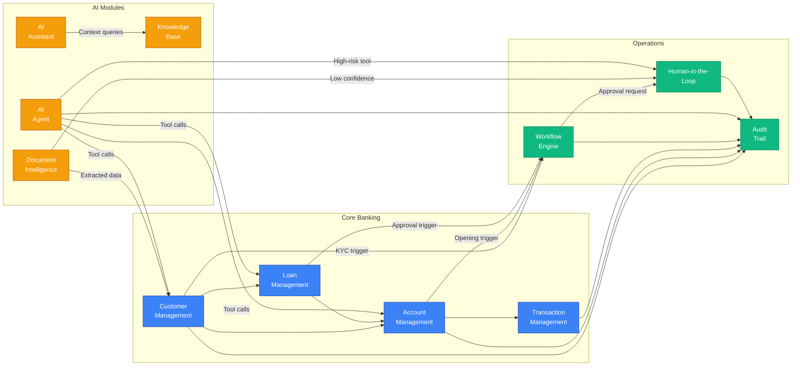

### Integration Contracts

| Producer | Consumer | Method | Data Format | Trigger |
|---|---|---|---|---|
| Document Intelligence | Customer Management | Internal service call | `ExtractedDocumentData` schema | OCR completion event |
| Workflow Engine | HITL Service | Internal service call | `ReviewRequest` schema | State transition to review |
| AI Agent | Any service module | Tool registry dispatch | Tool-specific Pydantic schema | LangGraph tool node |
| HITL Service | Workflow Engine | Callback | `ReviewDecision` schema | Human approval/rejection |
| All state-changing services | Audit Service | Middleware + explicit | `AuditEvent` schema | Post-commit hook |
| Backend | Frontend | WebSocket | JSON messages | Real-time notifications |
| KB Service | Qdrant | HTTP client | Qdrant REST API | Document ingestion/search |
| Assistant/Agent Service | Ollama | HTTP client | Ollama API format | LLM inference request |

---

## 11. Configuration Management

### Environment Variables

All configuration is driven through environment variables, loaded via Pydantic `BaseSettings` with `.env` file support.

#### Application Configuration

| Variable | Description | Default | Required |
|---|---|---|---|
| `APP_ENV` | Environment name | `development` | No |
| `APP_DEBUG` | Enable debug mode | `false` | No |
| `APP_SECRET_KEY` | JWT signing secret | — | **Yes** |
| `APP_HOST` | API bind host | `0.0.0.0` | No |
| `APP_PORT` | API bind port | `8000` | No |
| `APP_CORS_ORIGINS` | Allowed CORS origins | `["http://localhost:5173"]` | No |

#### Database Configuration

| Variable | Description | Default | Required |
|---|---|---|---|
| `DATABASE_URL` | PostgreSQL connection string | — | **Yes** |
| `DATABASE_POOL_SIZE` | Connection pool size | `10` | No |
| `DATABASE_MAX_OVERFLOW` | Pool overflow limit | `20` | No |
| `DATABASE_ECHO` | Log SQL queries | `false` | No |

#### AI / LLM Configuration

| Variable | Description | Default | Required |
|---|---|---|---|
| `OLLAMA_BASE_URL` | Ollama server URL | `http://ollama:11434` | No |
| `OLLAMA_MODEL` | LLM model name | `qwen3:8b` | No |
| `OLLAMA_TIMEOUT` | Request timeout (seconds) | `120` | No |
| `LLM_TEMPERATURE_CHAT` | Temperature for chat | `0.4` | No |
| `LLM_TEMPERATURE_AGENT` | Temperature for agent planning | `0.0` | No |
| `LLM_TEMPERATURE_EXTRACTION` | Temperature for extraction | `0.1` | No |
| `LLM_MAX_TOKENS` | Maximum generation tokens | `2048` | No |

#### RAG Configuration

| Variable | Description | Default | Required |
|---|---|---|---|
| `QDRANT_URL` | Qdrant server URL | `http://qdrant:6333` | No |
| `QDRANT_COLLECTION` | Default collection name | `nileops_kb` | No |
| `EMBEDDING_MODEL` | Embedding model identifier | `sentence-transformers/all-MiniLM-L6-v2` | No |
| `EMBEDDING_DIMENSION` | Discovered dynamically at startup via model probe | `dynamic (probed from model)` | No |
| `RAG_CHUNK_SIZE` | Chunk size in tokens | `512` | No |
| `RAG_CHUNK_OVERLAP` | Chunk overlap in tokens | `50` | No |
| `RAG_TOP_K` | Retrieval top-k results | `5` | No |
| `RAG_SCORE_THRESHOLD` | Minimum similarity score | `0.7` | No |

#### OCR Configuration

| Variable | Description | Default | Required |
|---|---|---|---|
| `OCR_LANGUAGE` | PaddleOCR language(s) | `en,ar` | No |
| `OCR_CONFIDENCE_THRESHOLD` | Minimum confidence for auto-accept | `0.85` | No |
| `OCR_MAX_FILE_SIZE_MB` | Maximum upload file size | `20` | No |

#### Security Configuration

| Variable | Description | Default | Required |
|---|---|---|---|
| `JWT_ACCESS_TOKEN_EXPIRE_MINUTES` | Access token lifetime | `15` | No |
| `JWT_REFRESH_TOKEN_EXPIRE_DAYS` | Refresh token lifetime | `7` | No |
| `JWT_ALGORITHM` | JWT signing algorithm | `HS256` | No |
| `BCRYPT_ROUNDS` | bcrypt cost factor | `12` | No |
| `RATE_LIMIT_PER_MINUTE` | API rate limit per user | `60` | No |

### Model Configuration

The LLM model is configured via Ollama's model management. System prompts are templated per task type:

| Task Type | Prompt Template | Temperature | Max Tokens |
|---|---|---|---|
| Banking Chat | `prompts/chat_system.txt` | 0.4 | 2048 |
| Document Extraction | `prompts/extraction_system.txt` | 0.1 | 1024 |
| Agent Planning | `prompts/agent_system.txt` | 0.0 | 4096 |
| RAG Augmented Response | `prompts/rag_system.txt` | 0.3 | 2048 |
| Workflow Summarization | `prompts/workflow_system.txt` | 0.2 | 1024 |

---

## 12. Scalability Considerations

### Current Architecture — Single-Node Deployment

The v1 architecture is designed for single-node Docker Compose deployment, suitable for pilot programs and branch-level operations.

### Future Scaling Paths

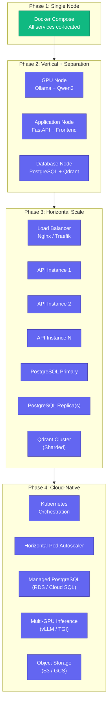

### Scaling Strategy per Component

| Component | Bottleneck | Scaling Strategy |
|---|---|---|
| **FastAPI Backend** | Request throughput | Horizontal: multiple Uvicorn workers → multiple container replicas behind load balancer |
| **PostgreSQL** | Read throughput, storage | Vertical first (more RAM, SSD) → Read replicas → Managed service with auto-scaling |
| **Qdrant** | Collection size, query throughput | Vertical (more RAM) → Sharded collections → Multi-node Qdrant cluster |
| **Ollama / LLM** | Inference latency, concurrency | GPU acceleration → Multi-GPU → Switch to vLLM or TGI for batched inference |
| **PaddleOCR** | CPU-bound processing | Worker pool (multiprocessing) → Dedicated OCR container replicas |
| **File Storage** | Disk I/O, capacity | Local volume → NFS mount → Object storage (S3-compatible) |
| **Frontend** | Static asset delivery | CDN distribution → Edge caching |

### Performance Targets

| Metric | Target (v1) | Target (Scaled) |
|---|---|---|
| API response time (p95) | < 200ms | < 100ms |
| LLM first-token latency | < 2s | < 500ms |
| OCR processing time (single page) | < 5s | < 2s |
| RAG retrieval time | < 500ms | < 200ms |
| Concurrent users | 20 | 500+ |
| Document storage | 50GB | 10TB+ |
| Audit events per day | 10,000 | 1,000,000+ |

> [!TIP]
> The most impactful performance optimization for v1 is GPU acceleration for Ollama inference. A single NVIDIA GPU (e.g., RTX 4090 with 24GB VRAM) can reduce Qwen3 8B inference latency by 5–10x compared to CPU-only execution.

---

> **Document maintained by:** NileOps Engineering Team  
> **Review cycle:** Updated with each architectural decision record (ADR)
