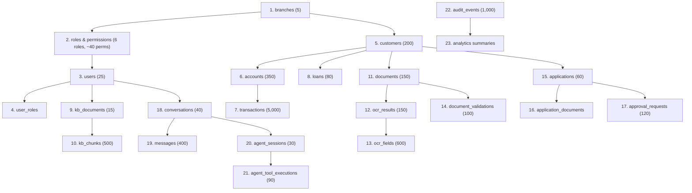

# NileOps Database Design

> **Version:** 1.0  
> **Last Updated:** 2026-11-07  
> **Database Engine:** PostgreSQL 16+  
> **Migration Tool:** Alembic (via SQLAlchemy)  
> **Schema:** `nileops`

---

## 1. Overview

NileOps is an AI-powered digital banking operations platform that combines core banking data management with intelligent document processing, conversational AI agents, and automated workflows. The database layer is the backbone of the platform, designed to support:

| Capability | Database Role |
|---|---|
| **Core Banking** | Customers, accounts, transactions, loans, branches |
| **Authentication & RBAC** | Users, roles, permissions with granular access control |
| **Document Intelligence** | OCR uploads, extraction results, field-level confidence scores |
| **Knowledge Base (RAG)** | Policy documents chunked and embedded for retrieval-augmented generation |
| **Applications & Workflow** | Multi-step approval workflows for KYC, account opening, complaints |
| **AI & Agent** | Conversation history, tool execution logs, session management |
| **Audit** | Immutable, append-only event log for regulatory compliance |
| **Analytics** | Materialized views and summary tables for dashboards |

### Design Principles

1. **UUID Primary Keys** — All tables use `UUID` primary keys (`gen_random_uuid()`) for distributed-safe ID generation.
2. **Temporal Columns** — Every mutable table includes `created_at` and `updated_at` (`TIMESTAMP WITH TIME ZONE`).
3. **Soft Deletes** — Critical entities use `deleted_at` instead of physical deletion.
4. **JSONB for Flexibility** — Semi-structured metadata stored in `JSONB` columns with GIN indexes.
5. **Immutable Audit** — The `audit_events` table is append-only; no `UPDATE` or `DELETE` permitted.
6. **PostgreSQL-Native Types** — Leverages enums, JSONB, `tsvector`, UUID, and `TIMESTAMP WITH TIME ZONE`.

---

## 2. Entity-Relationship Diagram

```mermaid
erDiagram
    %% ───── Core Banking ─────
    branches {
        UUID branch_id PK
        VARCHAR branch_name
        VARCHAR region
        UUID manager_id FK
        TIMESTAMPTZ created_at
        TIMESTAMPTZ updated_at
    }

    customers {
        UUID customer_id PK
        VARCHAR national_id UK
        VARCHAR full_name
        DATE date_of_birth
        VARCHAR phone_number
        VARCHAR email
        TEXT address
        UUID branch_id FK
        kyc_status_enum kyc_status
        TIMESTAMPTZ created_date
        TIMESTAMPTZ updated_at
        TIMESTAMPTZ deleted_at
    }

    accounts {
        UUID account_id PK
        UUID customer_id FK
        VARCHAR account_number UK
        account_type_enum account_type
        VARCHAR currency
        NUMERIC balance
        DATE open_date
        account_status_enum status
        TIMESTAMPTZ created_at
        TIMESTAMPTZ updated_at
    }

    transactions {
        UUID transaction_id PK
        UUID account_id FK
        TIMESTAMPTZ transaction_date
        txn_type_enum transaction_type
        NUMERIC amount
        VARCHAR currency
        channel_enum channel
        NUMERIC balance_after
        VARCHAR reference_number
        JSONB metadata
        TIMESTAMPTZ created_at
    }

    loans {
        UUID loan_id PK
        UUID customer_id FK
        loan_type_enum loan_type
        NUMERIC principal_amount
        NUMERIC interest_rate
        DATE start_date
        INTEGER tenure_months
        loan_status_enum status
        TIMESTAMPTZ created_at
        TIMESTAMPTZ updated_at
    }

    %% ───── Auth & RBAC ─────
    users {
        UUID user_id PK
        VARCHAR username UK
        VARCHAR email UK
        VARCHAR password_hash
        VARCHAR full_name
        UUID branch_id FK
        BOOLEAN is_active
        TIMESTAMPTZ last_login
        TIMESTAMPTZ created_at
        TIMESTAMPTZ updated_at
    }

    roles {
        UUID role_id PK
        VARCHAR role_name UK
        TEXT description
        TIMESTAMPTZ created_at
    }

    user_roles {
        UUID user_role_id PK
        UUID user_id FK
        UUID role_id FK
        TIMESTAMPTZ assigned_at
    }

    permissions {
        UUID permission_id PK
        VARCHAR permission_key UK
        VARCHAR resource
        VARCHAR action
        TEXT description
    }

    role_permissions {
        UUID role_permission_id PK
        UUID role_id FK
        UUID permission_id FK
    }

    %% ───── Document Intelligence ─────
    documents {
        UUID document_id PK
        UUID uploaded_by FK
        UUID customer_id FK
        doc_type_enum document_type
        VARCHAR file_name
        VARCHAR file_path
        VARCHAR mime_type
        BIGINT file_size_bytes
        doc_status_enum status
        JSONB metadata
        TIMESTAMPTZ created_at
        TIMESTAMPTZ updated_at
    }

    ocr_results {
        UUID ocr_result_id PK
        UUID document_id FK
        VARCHAR engine
        FLOAT overall_confidence
        JSONB raw_output
        ocr_status_enum status
        INTEGER processing_time_ms
        TIMESTAMPTZ created_at
    }

    ocr_fields {
        UUID ocr_field_id PK
        UUID ocr_result_id FK
        VARCHAR field_name
        TEXT field_value
        FLOAT confidence
        JSONB bounding_box
        BOOLEAN is_validated
    }

    document_validations {
        UUID validation_id PK
        UUID document_id FK
        UUID validated_by FK
        validation_status_enum status
        JSONB field_corrections
        TEXT rejection_reason
        TIMESTAMPTZ validated_at
    }

    %% ───── Knowledge Base ─────
    kb_documents {
        UUID kb_document_id PK
        VARCHAR title
        doc_category_enum category
        TEXT source_url
        VARCHAR file_path
        INTEGER current_version
        UUID uploaded_by FK
        BOOLEAN is_active
        TIMESTAMPTZ created_at
        TIMESTAMPTZ updated_at
    }

    kb_document_versions {
        UUID version_id PK
        UUID kb_document_id FK
        INTEGER version_number
        VARCHAR file_path
        VARCHAR checksum
        UUID uploaded_by FK
        TIMESTAMPTZ created_at
    }

    kb_chunks {
        UUID chunk_id PK
        UUID kb_document_id FK
        INTEGER chunk_index
        TEXT content
        VARCHAR qdrant_point_id
        JSONB metadata
        TSVECTOR search_vector
        TIMESTAMPTZ created_at
    }

    %% ───── Applications & Workflow ─────
    applications {
        UUID application_id PK
        VARCHAR reference_number UK
        app_type_enum application_type
        UUID customer_id FK
        UUID initiated_by FK
        app_status_enum status
        JSONB form_data
        JSONB ai_recommendation
        TIMESTAMPTZ submitted_at
        TIMESTAMPTZ resolved_at
        TIMESTAMPTZ created_at
        TIMESTAMPTZ updated_at
    }

    application_documents {
        UUID app_doc_id PK
        UUID application_id FK
        UUID document_id FK
        VARCHAR document_role
        TIMESTAMPTZ attached_at
    }

    workflow_steps {
        UUID step_id PK
        app_type_enum application_type
        INTEGER step_order
        VARCHAR step_name
        TEXT description
        UUID required_role FK
        BOOLEAN is_terminal
        TIMESTAMPTZ created_at
    }

    workflow_transitions {
        UUID transition_id PK
        UUID from_step FK
        UUID to_step FK
        VARCHAR trigger_action
        TEXT condition_expr
        TIMESTAMPTZ created_at
    }

    approval_requests {
        UUID approval_id PK
        UUID application_id FK
        UUID step_id FK
        UUID assigned_to FK
        UUID decided_by FK
        approval_status_enum status
        TEXT comments
        TIMESTAMPTZ assigned_at
        TIMESTAMPTZ decided_at
    }

    %% ───── AI & Agent ─────
    conversations {
        UUID conversation_id PK
        UUID user_id FK
        UUID customer_id FK
        VARCHAR title
        conv_status_enum status
        JSONB context
        TIMESTAMPTZ created_at
        TIMESTAMPTZ updated_at
    }

    messages {
        UUID message_id PK
        UUID conversation_id FK
        msg_role_enum role
        TEXT content
        JSONB tool_calls
        INTEGER token_count
        TIMESTAMPTZ created_at
    }

    agent_sessions {
        UUID session_id PK
        UUID user_id FK
        UUID conversation_id FK
        VARCHAR agent_type
        session_status_enum status
        JSONB session_state
        TIMESTAMPTZ started_at
        TIMESTAMPTZ ended_at
    }

    agent_tool_executions {
        UUID execution_id PK
        UUID session_id FK
        UUID message_id FK
        VARCHAR tool_name
        JSONB tool_input
        JSONB tool_output
        exec_status_enum status
        INTEGER duration_ms
        TIMESTAMPTZ executed_at
    }

    %% ───── Audit ─────
    audit_events {
        UUID event_id PK
        UUID user_id
        VARCHAR action
        VARCHAR resource_type
        UUID resource_id
        JSONB old_values
        JSONB new_values
        VARCHAR ip_address
        VARCHAR user_agent
        TIMESTAMPTZ created_at
    }

    %% ───── Analytics ─────
    daily_transaction_summary {
        UUID summary_id PK
        DATE summary_date
        UUID branch_id FK
        VARCHAR currency
        INTEGER total_count
        NUMERIC total_amount
        NUMERIC avg_amount
        JSONB channel_breakdown
        TIMESTAMPTZ computed_at
    }

    monthly_kpi_snapshot {
        UUID snapshot_id PK
        DATE month_start
        UUID branch_id FK
        INTEGER new_customers
        INTEGER new_accounts
        INTEGER active_loans
        NUMERIC total_deposits
        NUMERIC total_withdrawals
        INTEGER applications_processed
        NUMERIC avg_processing_time_hrs
        TIMESTAMPTZ computed_at
    }

    %% ───── Relationships ─────
    branches ||--o{ customers : "home branch"
    branches ||--o{ users : "assigned to"
    users ||--|{ branches : "manages"

    customers ||--o{ accounts : "owns"
    customers ||--o{ loans : "borrows"
    customers ||--o{ documents : "submitted for"
    customers ||--o{ applications : "applicant"
    customers ||--o{ conversations : "regarding"

    accounts ||--o{ transactions : "records"

    users ||--o{ user_roles : "has"
    roles ||--o{ user_roles : "assigned to"
    roles ||--o{ role_permissions : "grants"
    permissions ||--o{ role_permissions : "granted by"

    users ||--o{ documents : "uploaded by"
    documents ||--o{ ocr_results : "processed into"
    ocr_results ||--o{ ocr_fields : "contains"
    documents ||--o{ document_validations : "validated via"
    users ||--o{ document_validations : "reviewed by"

    kb_documents ||--o{ kb_document_versions : "versioned as"
    kb_documents ||--o{ kb_chunks : "chunked into"
    users ||--o{ kb_documents : "uploaded by"

    applications ||--o{ application_documents : "includes"
    documents ||--o{ application_documents : "attached to"
    applications ||--o{ approval_requests : "requires"
    workflow_steps ||--o{ approval_requests : "at step"
    workflow_steps ||--o{ workflow_transitions : "from"
    workflow_steps ||--o{ workflow_transitions : "to"
    users ||--o{ approval_requests : "assigned to"
    users ||--o{ applications : "initiated by"

    users ||--o{ conversations : "participates"
    conversations ||--o{ messages : "contains"
    conversations ||--o{ agent_sessions : "hosts"
    agent_sessions ||--o{ agent_tool_executions : "executes"
    messages ||--o{ agent_tool_executions : "triggered by"

    branches ||--o{ daily_transaction_summary : "aggregated for"
    branches ||--o{ monthly_kpi_snapshot : "measured at"
```



---

## 3. Table Definitions

### 3.1 Core Banking

#### 3.1.1 `branches`

> **Purpose:** Physical and logical bank branch locations. Reference table for customer assignment and organizational hierarchy.

| Column | Type | Constraints | Default | Description |
|---|---|---|---|---|
| `branch_id` | `UUID` | `PRIMARY KEY` | `gen_random_uuid()` | Unique branch identifier |
| `branch_name` | `VARCHAR(200)` | `NOT NULL, UNIQUE` | — | Human-readable branch name |
| `region` | `VARCHAR(100)` | `NOT NULL` | — | Geographic region (e.g., "Greater Cairo") |
| `manager_id` | `UUID` | `REFERENCES users(user_id)` | `NULL` | Branch manager (nullable for initial setup) |
| `address` | `TEXT` | — | `NULL` | Full physical address |
| `phone` | `VARCHAR(20)` | — | `NULL` | Branch phone number |
| `is_active` | `BOOLEAN` | `NOT NULL` | `TRUE` | Soft-active flag |
| `created_at` | `TIMESTAMPTZ` | `NOT NULL` | `NOW()` | Record creation time |
| `updated_at` | `TIMESTAMPTZ` | `NOT NULL` | `NOW()` | Last modification time |

**Indexes:**
- `idx_branches_region` — `region` (filter by region)
- `idx_branches_manager` — `manager_id` (lookup managed branches)

---

#### 3.1.2 `customers`

> **Purpose:** Bank customers including individuals and corporate entities. Central reference for accounts, loans, applications, and KYC workflows.

| Column | Type | Constraints | Default | Description |
|---|---|---|---|---|
| `customer_id` | `UUID` | `PRIMARY KEY` | `gen_random_uuid()` | Unique customer identifier |
| `national_id` | `VARCHAR(14)` | `NOT NULL, UNIQUE, CHECK (national_id ~ '^[23][0-9]{13}$')` | — | Government-issued Egyptian National ID (14 digits format validation only; format compliance does not constitute identity verification) |
| `full_name` | `VARCHAR(300)` | `NOT NULL` | — | Full legal name |
| `date_of_birth` | `DATE` | `NOT NULL` | — | Date of birth |
| `phone_number` | `VARCHAR(20)` | `NOT NULL` | — | Primary phone number |
| `email` | `VARCHAR(254)` | — | `NULL` | Email address |
| `address` | `TEXT` | — | `NULL` | Residential address |
| `branch_id` | `UUID` | `NOT NULL, REFERENCES branches(branch_id)` | — | Home branch |
| `kyc_status` | `kyc_status_enum` | `NOT NULL` | `'pending'` | KYC verification state |
| `risk_score` | `SMALLINT` | `CHECK (risk_score BETWEEN 0 AND 100)` | `NULL` | AI-computed risk score |
| `metadata` | `JSONB` | — | `'{}'` | Extensible metadata (nationality, employer, etc.) |
| `created_date` | `TIMESTAMPTZ` | `NOT NULL` | `NOW()` | Onboarding date |
| `updated_at` | `TIMESTAMPTZ` | `NOT NULL` | `NOW()` | Last modification |
| `deleted_at` | `TIMESTAMPTZ` | — | `NULL` | Soft-delete timestamp |

**Indexes:**
- `idx_customers_national_id` — `national_id` (unique lookup)
- `idx_customers_branch` — `branch_id` (branch-level queries)
- `idx_customers_kyc_status` — `kyc_status` (filter pending KYC)
- `idx_customers_name_trgm` — `full_name gin_trgm_ops` (fuzzy name search)
- `idx_customers_phone` — `phone_number` (contact lookup)
- `idx_customers_not_deleted` — `customer_id WHERE deleted_at IS NULL` (partial index)

---

#### 3.1.3 `accounts`

> **Purpose:** Bank accounts linked to customers. Supports savings, current, fixed deposit, and other account types with multi-currency support.

| Column | Type | Constraints | Default | Description |
|---|---|---|---|---|
| `account_id` | `UUID` | `PRIMARY KEY` | `gen_random_uuid()` | Unique account identifier |
| `customer_id` | `UUID` | `NOT NULL, REFERENCES customers(customer_id)` | — | Owning customer |
| `account_number` | `VARCHAR(20)` | `NOT NULL, UNIQUE` | — | Bank account number |
| `account_type` | `account_type_enum` | `NOT NULL` | — | Account type (savings, current, fixed_deposit) |
| `currency` | `VARCHAR(3)` | `NOT NULL` | `'EGP'` | ISO 4217 currency code |
| `balance` | `NUMERIC(18,2)` | `NOT NULL, CHECK (balance >= 0)` | `0.00` | Current balance |
| `open_date` | `DATE` | `NOT NULL` | `CURRENT_DATE` | Account opening date |
| `status` | `account_status_enum` | `NOT NULL` | `'active'` | Account lifecycle state |
| `metadata` | `JSONB` | — | `'{}'` | Additional attributes |
| `created_at` | `TIMESTAMPTZ` | `NOT NULL` | `NOW()` | Record creation time |
| `updated_at` | `TIMESTAMPTZ` | `NOT NULL` | `NOW()` | Last modification time |

**Indexes:**
- `idx_accounts_customer` — `customer_id` (list customer accounts)
- `idx_accounts_number` — `account_number` (unique lookup)
- `idx_accounts_type_status` — `(account_type, status)` (filtered queries)
- `idx_accounts_currency` — `currency` (currency-based reporting)

---

#### 3.1.4 `transactions`

> **Purpose:** Immutable record of all financial transactions. Core table for statement generation, analytics, and fraud detection.

| Column | Type | Constraints | Default | Description |
|---|---|---|---|---|
| `transaction_id` | `UUID` | `PRIMARY KEY` | `gen_random_uuid()` | Unique transaction identifier |
| `account_id` | `UUID` | `NOT NULL, REFERENCES accounts(account_id)` | — | Associated account |
| `transaction_date` | `TIMESTAMPTZ` | `NOT NULL` | `NOW()` | When the transaction occurred |
| `transaction_type` | `txn_type_enum` | `NOT NULL` | — | Transaction type |
| `amount` | `NUMERIC(18,2)` | `NOT NULL, CHECK (amount > 0)` | — | Transaction amount (always positive) |
| `currency` | `VARCHAR(3)` | `NOT NULL` | `'EGP'` | ISO 4217 currency code |
| `channel` | `channel_enum` | `NOT NULL` | — | Originating channel |
| `balance_after` | `NUMERIC(18,2)` | `NOT NULL` | — | Account balance post-transaction |
| `reference_number` | `VARCHAR(50)` | `UNIQUE` | — | External reference / receipt number |
| `description` | `TEXT` | — | `NULL` | Human-readable description |
| `metadata` | `JSONB` | — | `'{}'` | Channel-specific data (ATM ID, merchant, etc.) |
| `created_at` | `TIMESTAMPTZ` | `NOT NULL` | `NOW()` | Record insertion time |

> [!IMPORTANT]
> This table is **append-only** in production. Transactions are never updated or deleted — corrections are modeled as reversal transactions.

**Indexes:**
- `idx_txn_account_date` — `(account_id, transaction_date DESC)` (statement queries)
- `idx_txn_date` — `transaction_date` (time-range analytics)
- `idx_txn_type` — `transaction_type` (type filtering)
- `idx_txn_channel` — `channel` (channel analytics)
- `idx_txn_reference` — `reference_number` (receipt lookup)

**Partitioning:**
- Consider range-partitioning by `transaction_date` (monthly) for tables exceeding 10M rows.

---

#### 3.1.5 `loans`

> **Purpose:** Loan products issued to customers. Tracks principal, interest, tenure, and repayment status.

| Column | Type | Constraints | Default | Description |
|---|---|---|---|---|
| `loan_id` | `UUID` | `PRIMARY KEY` | `gen_random_uuid()` | Unique loan identifier |
| `customer_id` | `UUID` | `NOT NULL, REFERENCES customers(customer_id)` | — | Borrowing customer |
| `loan_type` | `loan_type_enum` | `NOT NULL` | — | Loan product type |
| `principal_amount` | `NUMERIC(18,2)` | `NOT NULL, CHECK (principal_amount > 0)` | — | Original loan amount |
| `interest_rate` | `NUMERIC(5,4)` | `NOT NULL, CHECK (interest_rate >= 0)` | — | Annual interest rate (e.g., 0.1250 = 12.50%) |
| `start_date` | `DATE` | `NOT NULL` | — | Loan disbursement date |
| `tenure_months` | `INTEGER` | `NOT NULL, CHECK (tenure_months > 0)` | — | Loan duration in months |
| `outstanding_balance` | `NUMERIC(18,2)` | `CHECK (outstanding_balance >= 0)` | `NULL` | Current outstanding balance |
| `status` | `loan_status_enum` | `NOT NULL` | `'pending'` | Loan lifecycle state |
| `metadata` | `JSONB` | — | `'{}'` | Collateral info, guarantor, etc. |
| `created_at` | `TIMESTAMPTZ` | `NOT NULL` | `NOW()` | Record creation time |
| `updated_at` | `TIMESTAMPTZ` | `NOT NULL` | `NOW()` | Last modification time |

**Indexes:**
- `idx_loans_customer` — `customer_id` (customer loan portfolio)
- `idx_loans_status` — `status` (active/overdue loan monitoring)
- `idx_loans_type_status` — `(loan_type, status)` (product-level analytics)

---

### 3.2 Authentication & Authorization

#### 3.2.1 `users`

> **Purpose:** Internal platform users (bank employees, admins, agents). Separated from `customers` — users operate the platform; customers are served by it.

| Column | Type | Constraints | Default | Description |
|---|---|---|---|---|
| `user_id` | `UUID` | `PRIMARY KEY` | `gen_random_uuid()` | Unique user identifier |
| `username` | `VARCHAR(50)` | `NOT NULL, UNIQUE` | — | Login username |
| `email` | `VARCHAR(254)` | `NOT NULL, UNIQUE` | — | Corporate email |
| `password_hash` | `VARCHAR(255)` | `NOT NULL` | — | bcrypt/argon2 hashed password |
| `full_name` | `VARCHAR(200)` | `NOT NULL` | — | Employee full name |
| `branch_id` | `UUID` | `REFERENCES branches(branch_id)` | `NULL` | Assigned branch (NULL for HQ staff) |
| `is_active` | `BOOLEAN` | `NOT NULL` | `TRUE` | Account active flag |
| `last_login` | `TIMESTAMPTZ` | — | `NULL` | Last successful login |
| `failed_login_count` | `SMALLINT` | `NOT NULL` | `0` | Consecutive failed login attempts |
| `locked_until` | `TIMESTAMPTZ` | — | `NULL` | Account lock expiry (brute-force protection) |
| `created_at` | `TIMESTAMPTZ` | `NOT NULL` | `NOW()` | Record creation time |
| `updated_at` | `TIMESTAMPTZ` | `NOT NULL` | `NOW()` | Last modification time |

**Indexes:**
- `idx_users_username` — `username` (login lookup)
- `idx_users_email` — `email` (email-based lookup)
- `idx_users_branch` — `branch_id` (branch staff listing)
- `idx_users_active` — `user_id WHERE is_active = TRUE` (partial index)

---

#### 3.2.2 `roles`

> **Purpose:** Named roles for RBAC. Enforces strictly the five standardized canonical roles: `admin`, `operations_officer`, `customer_service`, `compliance_reviewer`, and `branch_manager`.

| Column | Type | Constraints | Default | Description |
|---|---|---|---|---|
| `role_id` | `UUID` | `PRIMARY KEY` | `gen_random_uuid()` | Unique role identifier |
| `role_name` | `VARCHAR(50)` | `NOT NULL, UNIQUE` | — | Role name (snake_case) |
| `description` | `TEXT` | — | `NULL` | Human-readable description |
| `is_system` | `BOOLEAN` | `NOT NULL` | `FALSE` | System-managed role (cannot be deleted) |
| `created_at` | `TIMESTAMPTZ` | `NOT NULL` | `NOW()` | Record creation time |

---

#### 3.2.3 `user_roles`

> **Purpose:** Junction table mapping users to roles (many-to-many). A user can have multiple roles.

| Column | Type | Constraints | Default | Description |
|---|---|---|---|---|
| `user_role_id` | `UUID` | `PRIMARY KEY` | `gen_random_uuid()` | Surrogate key |
| `user_id` | `UUID` | `NOT NULL, REFERENCES users(user_id) ON DELETE CASCADE` | — | User reference |
| `role_id` | `UUID` | `NOT NULL, REFERENCES roles(role_id) ON DELETE CASCADE` | — | Role reference |
| `assigned_at` | `TIMESTAMPTZ` | `NOT NULL` | `NOW()` | Assignment timestamp |
| `assigned_by` | `UUID` | `REFERENCES users(user_id)` | `NULL` | Who assigned the role |

**Constraints:**
- `UNIQUE (user_id, role_id)` — Prevent duplicate assignments.

**Indexes:**
- `idx_user_roles_user` — `user_id`
- `idx_user_roles_role` — `role_id`

---

#### 3.2.4 `permissions`

> **Purpose:** Fine-grained permission definitions following `resource:action` pattern (e.g., `customers:read`, `loans:approve`).

| Column | Type | Constraints | Default | Description |
|---|---|---|---|---|
| `permission_id` | `UUID` | `PRIMARY KEY` | `gen_random_uuid()` | Unique permission identifier |
| `permission_key` | `VARCHAR(100)` | `NOT NULL, UNIQUE` | — | Permission key (`resource:action`) |
| `resource` | `VARCHAR(50)` | `NOT NULL` | — | Target resource (e.g., `customers`) |
| `action` | `VARCHAR(50)` | `NOT NULL` | — | Permitted action (e.g., `read`, `write`, `delete`, `approve`) |
| `description` | `TEXT` | — | `NULL` | Human-readable description |

**Constraints:**
- `UNIQUE (resource, action)` — No duplicate resource-action pairs.

---

#### 3.2.5 `role_permissions`

> **Purpose:** Junction table mapping roles to permissions (many-to-many).

| Column | Type | Constraints | Default | Description |
|---|---|---|---|---|
| `role_permission_id` | `UUID` | `PRIMARY KEY` | `gen_random_uuid()` | Surrogate key |
| `role_id` | `UUID` | `NOT NULL, REFERENCES roles(role_id) ON DELETE CASCADE` | — | Role reference |
| `permission_id` | `UUID` | `NOT NULL, REFERENCES permissions(permission_id) ON DELETE CASCADE` | — | Permission reference |

**Constraints:**
- `UNIQUE (role_id, permission_id)` — No duplicate grants.

**Indexes:**
- `idx_role_permissions_role` — `role_id`

---

### 3.3 Document Intelligence

#### 3.3.1 `documents`

> **Purpose:** Uploaded document files (national IDs, utility bills, salary certificates, etc.) submitted by or on behalf of customers for KYC and application processing.

| Column | Type | Constraints | Default | Description |
|---|---|---|---|---|
| `document_id` | `UUID` | `PRIMARY KEY` | `gen_random_uuid()` | Unique document identifier |
| `uploaded_by` | `UUID` | `NOT NULL, REFERENCES users(user_id)` | — | User who uploaded the document |
| `customer_id` | `UUID` | `REFERENCES customers(customer_id)` | `NULL` | Associated customer (NULL for internal docs) |
| `document_type` | `doc_type_enum` | `NOT NULL` | — | Document classification |
| `file_name` | `VARCHAR(500)` | `NOT NULL` | — | Original file name |
| `file_path` | `VARCHAR(1000)` | `NOT NULL` | — | Storage path (S3 key or local path) |
| `mime_type` | `VARCHAR(100)` | `NOT NULL` | — | MIME type (e.g., `image/jpeg`, `application/pdf`) |
| `file_size_bytes` | `BIGINT` | `NOT NULL, CHECK (file_size_bytes > 0)` | — | File size in bytes |
| `checksum` | `VARCHAR(64)` | — | `NULL` | SHA-256 file hash for integrity |
| `status` | `doc_status_enum` | `NOT NULL` | `'uploaded'` | Processing lifecycle state |
| `metadata` | `JSONB` | — | `'{}'` | Additional attributes (page count, dimensions) |
| `created_at` | `TIMESTAMPTZ` | `NOT NULL` | `NOW()` | Upload timestamp |
| `updated_at` | `TIMESTAMPTZ` | `NOT NULL` | `NOW()` | Last status change |

**Indexes:**
- `idx_documents_customer` — `customer_id` (customer document portfolio)
- `idx_documents_uploaded_by` — `uploaded_by` (uploader history)
- `idx_documents_type_status` — `(document_type, status)` (processing queues)
- `idx_documents_created` — `created_at DESC` (recent uploads)

---

#### 3.3.2 `ocr_results`

> **Purpose:** Results from OCR/AI extraction pipelines. Each document may have multiple OCR runs (retries, different engines).

| Column | Type | Constraints | Default | Description |
|---|---|---|---|---|
| `ocr_result_id` | `UUID` | `PRIMARY KEY` | `gen_random_uuid()` | Unique result identifier |
| `document_id` | `UUID` | `NOT NULL, REFERENCES documents(document_id)` | — | Source document |
| `engine` | `VARCHAR(50)` | `NOT NULL` | — | OCR engine used (e.g., `tesseract`, `azure_di`, `gpt4_vision`) |
| `engine_version` | `VARCHAR(20)` | — | `NULL` | Engine version string |
| `overall_confidence` | `FLOAT` | `CHECK (overall_confidence BETWEEN 0 AND 1)` | `NULL` | Aggregate confidence score |
| `raw_output` | `JSONB` | — | `NULL` | Full engine response (for debugging/reprocessing) |
| `structured_data` | `JSONB` | — | `'{}'` | Cleaned, structured extraction output |
| `status` | `ocr_status_enum` | `NOT NULL` | `'processing'` | Processing state |
| `error_message` | `TEXT` | — | `NULL` | Error details on failure |
| `processing_time_ms` | `INTEGER` | — | `NULL` | Processing duration in milliseconds |
| `created_at` | `TIMESTAMPTZ` | `NOT NULL` | `NOW()` | Run timestamp |

**Indexes:**
- `idx_ocr_results_document` — `document_id` (results per document)
- `idx_ocr_results_status` — `status` (monitor pending/failed)

---

#### 3.3.3 `ocr_fields`

> **Purpose:** Individual extracted fields from an OCR result with per-field confidence scores. Enables field-level validation and correction workflows.

| Column | Type | Constraints | Default | Description |
|---|---|---|---|---|
| `ocr_field_id` | `UUID` | `PRIMARY KEY` | `gen_random_uuid()` | Unique field identifier |
| `ocr_result_id` | `UUID` | `NOT NULL, REFERENCES ocr_results(ocr_result_id) ON DELETE CASCADE` | — | Parent OCR result |
| `field_name` | `VARCHAR(100)` | `NOT NULL` | — | Field identifier (e.g., `full_name`, `national_id`, `date_of_birth`) |
| `field_value` | `TEXT` | — | `NULL` | Extracted value |
| `confidence` | `FLOAT` | `CHECK (confidence BETWEEN 0 AND 1)` | `NULL` | Per-field confidence score |
| `bounding_box` | `JSONB` | — | `NULL` | `{"x", "y", "width", "height"}` on source image |
| `page_number` | `SMALLINT` | — | `1` | Page number in multi-page documents |
| `is_validated` | `BOOLEAN` | `NOT NULL` | `FALSE` | Whether a human has validated this field |
| `corrected_value` | `TEXT` | — | `NULL` | Human-corrected value (if different from extracted) |

**Indexes:**
- `idx_ocr_fields_result` — `ocr_result_id` (fields per result)
- `idx_ocr_fields_name` — `field_name` (cross-document field analysis)
- `idx_ocr_fields_low_confidence` — `ocr_result_id WHERE confidence < 0.8` (partial index for review queues)

---

#### 3.3.4 `document_validations`

> **Purpose:** Human review records for document verification. Captures approval/rejection decisions and any field corrections applied.

| Column | Type | Constraints | Default | Description |
|---|---|---|---|---|
| `validation_id` | `UUID` | `PRIMARY KEY` | `gen_random_uuid()` | Unique validation identifier |
| `document_id` | `UUID` | `NOT NULL, REFERENCES documents(document_id)` | — | Validated document |
| `validated_by` | `UUID` | `NOT NULL, REFERENCES users(user_id)` | — | Reviewer user |
| `status` | `validation_status_enum` | `NOT NULL` | — | Validation decision |
| `field_corrections` | `JSONB` | — | `NULL` | `{"field_name": {"old": "...", "new": "..."}}` |
| `rejection_reason` | `TEXT` | — | `NULL` | Reason for rejection (required if status = rejected) |
| `notes` | `TEXT` | — | `NULL` | Reviewer notes |
| `validated_at` | `TIMESTAMPTZ` | `NOT NULL` | `NOW()` | Decision timestamp |

**Indexes:**
- `idx_doc_validations_document` — `document_id`
- `idx_doc_validations_user` — `validated_by`
- `idx_doc_validations_status` — `status`

---

### 3.4 Knowledge Base & Policy Governance (RAG)

#### 3.4.1 `kb_documents`

> **Purpose:** Policy documents, banking procedures, regulatory circulars, and FAQs that form the approved knowledge base for RAG-powered AI assistance across both the Customer Portal and Employee Portal. Enforces a strict approval state machine: `DRAFT → PENDING_APPROVAL → APPROVED → INDEXED` (or `REJECTED`). Unapproved documents are never indexed or queried.

| Column | Type | Constraints | Default | Description |
|---|---|---|---|---|
| `kb_document_id` | `UUID` | `PRIMARY KEY` | `gen_random_uuid()` | Unique KB document identifier |
| `title` | `VARCHAR(500)` | `NOT NULL` | — | Document title |
| `category` | `doc_category_enum` | `NOT NULL` | — | Document domain category (e.g., policy, procedure, circular) |
| `description` | `TEXT` | — | `NULL` | Brief summary of content |
| `source_url` | `TEXT` | — | `NULL` | Original source or reference link |
| `file_path` | `VARCHAR(1000)` | — | `NULL` | Storage path to original file |
| `mime_type` | `VARCHAR(100)` | — | `NULL` | File MIME type (application/pdf, docx, etc.) |
| `content_sha256` | `VARCHAR(64)` | `NOT NULL` | — | SHA-256 content hash for duplicate detection |
| `status` | `kb_status_enum` | `NOT NULL` | `'draft'` | Lifecycle state (`draft`, `pending_approval`, `approved`, `indexed`, `rejected`, `archived`) |
| `target_portal` | `VARCHAR(20)` | `NOT NULL` | `'shared'` | Portal visibility (`customer_portal`, `employee_portal`, `shared`) |
| `current_version` | `INTEGER` | `NOT NULL` | `1` | Latest approved/active version number |
| `total_chunks` | `INTEGER` | — | `0` | Number of active chunks in vector index |
| `uploaded_by` | `UUID` | `NOT NULL, REFERENCES users(user_id)` | — | Employee who submitted document |
| `approved_by` | `UUID` | `REFERENCES users(user_id)` | `NULL` | Approver (separation of duties: `approved_by != uploaded_by`) |
| `approval_decision` | `VARCHAR(20)` | — | `NULL` | Decision (`approved`, `rejected`) |
| `rejection_reason` | `TEXT` | — | `NULL` | Required explanation if rejected |
| `approved_at` | `TIMESTAMPTZ` | — | `NULL` | Timestamp of formal approval |
| `indexing_status` | `kb_index_status_enum` | `NOT NULL` | `'not_indexed'` | Vector status (`not_indexed`, `indexing`, `indexed`, `index_failed`) |
| `indexing_error` | `TEXT` | — | `NULL` | Detailed error trace if vector indexing fails |
| `indexed_at` | `TIMESTAMPTZ` | — | `NULL` | Timestamp when Qdrant points were confirmed indexed |
| `effective_date` | `DATE` | — | `NULL` | Policy start date |
| `expiration_date` | `DATE` | — | `NULL` | Policy sunset/expiry date |
| `superseded_by` | `UUID` | `REFERENCES kb_documents(kb_document_id)` | `NULL` | Pointer to replacement document |
| `is_active` | `BOOLEAN` | `NOT NULL` | `FALSE` | Active in RAG retrieval (TRUE only when status = 'indexed') |
| `created_at` | `TIMESTAMPTZ` | `NOT NULL` | `NOW()` | Submission timestamp |
| `updated_at` | `TIMESTAMPTZ` | `NOT NULL` | `NOW()` | Last modification |

**Constraints:**
- `CHECK (uploaded_by != approved_by)` — Mandatory separation of duties; an employee cannot approve their own policy document.
- `CHECK (status != 'indexed' OR is_active = TRUE)` — Active search status implies indexed state.

**Indexes:**
- `idx_kb_docs_category` — `category` (filter by category)
- `idx_kb_docs_status` — `status` (workflow queue management)
- `idx_kb_docs_active_portal` — `(is_active, target_portal)` (RAG retrieval filter)
- `idx_kb_docs_sha256` — `content_sha256` (duplicate document detection)
- `idx_kb_docs_title_trgm` — `title gin_trgm_ops` (fuzzy title search)

---

#### 3.4.2 `kb_document_versions`

> **Purpose:** Complete version history for knowledge base documents. Updating an approved policy creates a new version requiring independent review and approval. Old policy chunks are deactivated or tombstoned when a new approved version is indexed.

| Column | Type | Constraints | Default | Description |
|---|---|---|---|---|
| `version_id` | `UUID` | `PRIMARY KEY` | `gen_random_uuid()` | Unique version identifier |
| `kb_document_id` | `UUID` | `NOT NULL, REFERENCES kb_documents(kb_document_id) ON DELETE CASCADE` | — | Parent document |
| `version_number` | `INTEGER` | `NOT NULL` | — | Sequential version number |
| `file_path` | `VARCHAR(1000)` | `NOT NULL` | — | Storage path for this version |
| `content_sha256` | `VARCHAR(64)` | `NOT NULL` | — | SHA-256 hash of this version |
| `change_summary` | `TEXT` | — | `NULL` | Summary of policy changes |
| `version_status` | `kb_status_enum` | `NOT NULL` | `'pending_approval'` | Status of this specific version |
| `uploaded_by` | `UUID` | `NOT NULL, REFERENCES users(user_id)` | — | Version submitter |
| `approved_by` | `UUID` | `REFERENCES users(user_id)` | `NULL` | Approver for this version |
| `approved_at` | `TIMESTAMPTZ` | — | `NULL` | Timestamp of version approval |
| `effective_date` | `DATE` | — | `NULL` | Version effective start date |
| `expiration_date` | `DATE` | — | `NULL` | Version expiration date |
| `is_superseded` | `BOOLEAN` | `NOT NULL` | `FALSE` | TRUE when superseded by newer active version |
| `created_at` | `TIMESTAMPTZ` | `NOT NULL` | `NOW()` | Version creation timestamp |

**Constraints:**
- `UNIQUE (kb_document_id, version_number)` — No duplicate version numbers per document.

**Indexes:**
- `idx_kb_versions_document` — `kb_document_id`
- `idx_kb_versions_active` — `(kb_document_id, is_superseded)`

---

#### 3.4.3 `kb_chunks`

> **Purpose:** Text chunks derived from approved knowledge base documents for retrieval-augmented generation (RAG). Text content and document metadata are persisted in PostgreSQL, while vector embeddings are stored exclusively in **Qdrant** referenced by `qdrant_point_id`. Chunks for superseded document versions are tombstoned (`is_active = FALSE`).

| Column | Type | Constraints | Default | Description |
|---|---|---|---|---|
| `chunk_id` | `UUID` | `PRIMARY KEY` | `gen_random_uuid()` | Unique chunk identifier |
| `kb_document_id` | `UUID` | `NOT NULL, REFERENCES kb_documents(kb_document_id) ON DELETE CASCADE` | — | Source document |
| `version_number` | `INTEGER` | `NOT NULL` | — | Document version this chunk was derived from |
| `chunk_index` | `INTEGER` | `NOT NULL` | — | Ordering index within the document |
| `content` | `TEXT` | `NOT NULL` | — | Chunk text content |
| `token_count` | `INTEGER` | — | `NULL` | Token count (for LLM context budgeting) |
| `qdrant_point_id` | `VARCHAR(100)` | `NOT NULL` | — | Corresponding point ID in Qdrant vector database |
| `qdrant_collection_name`| `VARCHAR(100)` | `NOT NULL` | `'nileops_kb'` | Target Qdrant collection |
| `metadata` | `JSONB` | — | `'{}'` | Source page, section heading, policy category, effective date |
| `target_portal` | `VARCHAR(20)` | `NOT NULL` | `'shared'` | Filter flag (`customer_portal`, `employee_portal`, `shared`) |
| `is_active` | `BOOLEAN` | `NOT NULL` | `TRUE` | Active chunk flag (FALSE when document version superseded) |
| `search_vector` | `TSVECTOR` | — | — | PostgreSQL full-text search vector for hybrid keyword search |
| `created_at` | `TIMESTAMPTZ` | `NOT NULL` | `NOW()` | Chunk creation timestamp |

> [!NOTE]
> Vector embeddings are managed exclusively in **Qdrant**. Storing embeddings in PostgreSQL is eliminated to avoid dual-store synchronization overhead and model dimension mismatch. The Qdrant vector dimension is determined dynamically by the instantiated local embedding model during startup.

**Indexes:**
- `idx_kb_chunks_document` — `(kb_document_id, version_number, chunk_index)`
- `idx_kb_chunks_qdrant` — `qdrant_point_id` (lookup by Qdrant point)
- `idx_kb_chunks_active_portal` — `(is_active, target_portal)` (fast pre-filtering for RAG)
- `idx_kb_chunks_search` — `search_vector` using GIN (full-text keyword search)

---

### 3.5 Applications & Workflow

#### 3.5.1 `applications`

> **Purpose:** Multi-purpose application records covering KYC reviews, account opening requests, card requests, complaints, and other workflow-driven processes.

| Column | Type | Constraints | Default | Description |
|---|---|---|---|---|
| `application_id` | `UUID` | `PRIMARY KEY` | `gen_random_uuid()` | Unique application identifier |
| `reference_number` | `VARCHAR(30)` | `NOT NULL, UNIQUE` | — | Human-readable reference (e.g., `APP-2026-00042`) |
| `application_type` | `app_type_enum` | `NOT NULL` | — | Application category |
| `customer_id` | `UUID` | `REFERENCES customers(customer_id)` | `NULL` | Associated customer (NULL for internal requests) |
| `initiated_by` | `UUID` | `NOT NULL, REFERENCES users(user_id)` | — | User who created the application |
| `assigned_to` | `UUID` | `REFERENCES users(user_id)` | `NULL` | Currently assigned processor |
| `status` | `app_status_enum` | `NOT NULL` | `'draft'` | Application lifecycle state |
| `priority` | `app_priority_enum` | `NOT NULL` | `'normal'` | Processing priority |
| `current_step_id` | `UUID` | `REFERENCES workflow_steps(step_id)` | `NULL` | Current workflow step |
| `form_data` | `JSONB` | — | `'{}'` | Application-type-specific form fields |
| `ai_recommendation` | `JSONB` | — | `NULL` | AI-generated recommendation (`{"decision", "confidence", "reasoning"}`) |
| `submitted_at` | `TIMESTAMPTZ` | — | `NULL` | Submission timestamp |
| `resolved_at` | `TIMESTAMPTZ` | — | `NULL` | Resolution timestamp |
| `due_date` | `DATE` | — | `NULL` | SLA target date |
| `created_at` | `TIMESTAMPTZ` | `NOT NULL` | `NOW()` | Record creation time |
| `updated_at` | `TIMESTAMPTZ` | `NOT NULL` | `NOW()` | Last modification time |

**Indexes:**
- `idx_applications_reference` — `reference_number` (lookup by reference)
- `idx_applications_customer` — `customer_id` (customer application history)
- `idx_applications_type_status` — `(application_type, status)` (queue management)
- `idx_applications_assigned` — `assigned_to WHERE status NOT IN ('approved', 'rejected', 'cancelled')` (active workload)
- `idx_applications_submitted` — `submitted_at DESC` (chronological queue)

---

#### 3.5.2 `application_documents`

> **Purpose:** Junction table linking applications to their supporting documents (many-to-many).

| Column | Type | Constraints | Default | Description |
|---|---|---|---|---|
| `app_doc_id` | `UUID` | `PRIMARY KEY` | `gen_random_uuid()` | Surrogate key |
| `application_id` | `UUID` | `NOT NULL, REFERENCES applications(application_id) ON DELETE CASCADE` | — | Application reference |
| `document_id` | `UUID` | `NOT NULL, REFERENCES documents(document_id)` | — | Document reference |
| `document_role` | `VARCHAR(50)` | `NOT NULL` | — | Role of document in application (e.g., `proof_of_identity`, `proof_of_address`, `salary_slip`) |
| `is_required` | `BOOLEAN` | `NOT NULL` | `TRUE` | Whether this document is mandatory |
| `attached_at` | `TIMESTAMPTZ` | `NOT NULL` | `NOW()` | Attachment timestamp |

**Constraints:**
- `UNIQUE (application_id, document_id)` — No duplicate document attachments.

**Indexes:**
- `idx_app_docs_application` — `application_id`
- `idx_app_docs_document` — `document_id`

---

#### 3.5.3 `workflow_steps`

> **Purpose:** Defines the steps in each workflow template. Each application type has a sequence of steps that must be completed.

| Column | Type | Constraints | Default | Description |
|---|---|---|---|---|
| `step_id` | `UUID` | `PRIMARY KEY` | `gen_random_uuid()` | Unique step identifier |
| `application_type` | `app_type_enum` | `NOT NULL` | — | Which application type this step belongs to |
| `step_order` | `INTEGER` | `NOT NULL` | — | Sequential order within the workflow |
| `step_name` | `VARCHAR(100)` | `NOT NULL` | — | Step name (e.g., `document_upload`, `kyc_review`, `manager_approval`) |
| `description` | `TEXT` | — | `NULL` | Step description |
| `required_role_id` | `UUID` | `REFERENCES roles(role_id)` | `NULL` | Role required to process this step |
| `sla_hours` | `INTEGER` | — | `NULL` | SLA for this step in hours |
| `is_terminal` | `BOOLEAN` | `NOT NULL` | `FALSE` | Whether this is a final step |
| `auto_assign` | `BOOLEAN` | `NOT NULL` | `FALSE` | Whether to auto-assign to available staff |
| `created_at` | `TIMESTAMPTZ` | `NOT NULL` | `NOW()` | Record creation time |

**Constraints:**
- `UNIQUE (application_type, step_order)` — No duplicate step orders per workflow.

**Indexes:**
- `idx_workflow_steps_type` — `application_type` (steps per workflow)

---

#### 3.5.4 `workflow_transitions`

> **Purpose:** Defines valid transitions between workflow steps, including conditions and trigger actions. Forms a directed graph of the workflow.

| Column | Type | Constraints | Default | Description |
|---|---|---|---|---|
| `transition_id` | `UUID` | `PRIMARY KEY` | `gen_random_uuid()` | Unique transition identifier |
| `from_step_id` | `UUID` | `NOT NULL, REFERENCES workflow_steps(step_id)` | — | Source step |
| `to_step_id` | `UUID` | `NOT NULL, REFERENCES workflow_steps(step_id)` | — | Target step |
| `trigger_action` | `VARCHAR(50)` | `NOT NULL` | — | Action that triggers transition (e.g., `approve`, `reject`, `escalate`, `return`) |
| `condition_expr` | `TEXT` | — | `NULL` | Optional JSONPath or Python expression for conditional transitions |
| `created_at` | `TIMESTAMPTZ` | `NOT NULL` | `NOW()` | Record creation time |

**Constraints:**
- `UNIQUE (from_step_id, trigger_action)` — Only one target per action per step.
- `CHECK (from_step_id != to_step_id)` — No self-loops.

**Indexes:**
- `idx_wf_transitions_from` — `from_step_id` (outgoing transitions)

---

#### 3.5.5 `approval_requests`

> **Purpose:** Individual approval/review tasks generated by workflows. Each time an application reaches a step requiring review, an approval request is created and assigned.

| Column | Type | Constraints | Default | Description |
|---|---|---|---|---|
| `approval_id` | `UUID` | `PRIMARY KEY` | `gen_random_uuid()` | Unique approval identifier |
| `application_id` | `UUID` | `NOT NULL, REFERENCES applications(application_id)` | — | Parent application |
| `step_id` | `UUID` | `NOT NULL, REFERENCES workflow_steps(step_id)` | — | Workflow step this approval is for |
| `assigned_to` | `UUID` | `REFERENCES users(user_id)` | `NULL` | Assigned reviewer |
| `decided_by` | `UUID` | `REFERENCES users(user_id)` | `NULL` | User who made the decision |
| `status` | `approval_status_enum` | `NOT NULL` | `'pending'` | Approval state |
| `decision` | `VARCHAR(20)` | — | `NULL` | Decision taken (e.g., `approve`, `reject`, `return`) |
| `comments` | `TEXT` | — | `NULL` | Reviewer comments |
| `assigned_at` | `TIMESTAMPTZ` | `NOT NULL` | `NOW()` | Assignment timestamp |
| `decided_at` | `TIMESTAMPTZ` | — | `NULL` | Decision timestamp |
| `due_at` | `TIMESTAMPTZ` | — | `NULL` | SLA deadline |

**Indexes:**
- `idx_approvals_application` — `application_id` (approval history per application)
- `idx_approvals_assigned` — `assigned_to WHERE status = 'pending'` (active queue per user)
- `idx_approvals_status` — `status` (dashboard counts)

---

### 3.6 AI & Agent

#### 3.6.1 `conversations`

> **Purpose:** Chat conversation sessions across both the **Customer Portal** and the **Employee Portal**. Maintains strict context isolation between customer self-service dialogues and employee copilot operations, while supporting simulated escalation to human customer service queues.

| Column | Type | Constraints | Default | Description |
|---|---|---|---|---|
| `conversation_id` | `UUID` | `PRIMARY KEY` | `gen_random_uuid()` | Unique conversation identifier |
| `portal_source` | `portal_source_enum`| `NOT NULL` | `'employee_portal'`| Originating portal (`customer_portal`, `employee_portal`) |
| `user_id` | `UUID` | `REFERENCES users(user_id)` | `NULL` | Employee user (for Employee Portal sessions) |
| `customer_id` | `UUID` | `REFERENCES customers(customer_id)` | `NULL` | Customer context or authenticated customer user |
| `title` | `VARCHAR(200)` | — | `NULL` | Conversation title (auto-generated or user-set) |
| `status` | `conv_status_enum` | `NOT NULL` | `'active'` | Conversation state (`active`, `archived`, `deleted`) |
| `escalation_status` | `escalation_status_enum` | `NOT NULL` | `'none'` | Escalation state (`none`, `pending_escalation`, `escalated_to_agent`, `resolved`) |
| `escalated_to_role` | `VARCHAR(50)` | — | `NULL` | Assigned role queue (`customer_service`, `operations_officer`) |
| `escalation_reason` | `VARCHAR(50)` | — | `NULL` | Reason (`insufficient_evidence`, `contradictory_policies`, `customer_dispute`, `human_requested`, `repeated_failure`) |
| `escalated_at` | `TIMESTAMPTZ` | — | `NULL` | Timestamp when conversation was escalated to human agent |
| `context` | `JSONB` | — | `'{}'` | Contextual metadata (language, active screen, intent) |
| `message_count` | `INTEGER` | `NOT NULL` | `0` | Cached message count |
| `created_at` | `TIMESTAMPTZ` | `NOT NULL` | `NOW()` | Conversation start time |
| `updated_at` | `TIMESTAMPTZ` | `NOT NULL` | `NOW()` | Last message time |

**Constraints:**
- `CHECK ((portal_source = 'employee_portal' AND user_id IS NOT NULL) OR (portal_source = 'customer_portal'))` — Employee conversations must have a linked employee user.

**Indexes:**
- `idx_conversations_user` — `user_id` (employee conversation history)
- `idx_conversations_customer` — `customer_id` (conversations about/by a customer)
- `idx_conversations_escalation` — `(escalation_status, escalated_to_role)` (active human queue)
- `idx_conversations_updated` — `updated_at DESC` (recent conversations)

---

#### 3.6.2 `messages`

> **Purpose:** Individual messages within a conversation. Stores the full message content, role, model identity, and any tool call references.

| Column | Type | Constraints | Default | Description |
|---|---|---|---|---|
| `message_id` | `UUID` | `PRIMARY KEY` | `gen_random_uuid()` | Unique message identifier |
| `conversation_id` | `UUID` | `NOT NULL, REFERENCES conversations(conversation_id) ON DELETE CASCADE` | — | Parent conversation |
| `role` | `msg_role_enum` | `NOT NULL` | — | Message sender role (`system`, `user`, `assistant`, `tool`) |
| `content` | `TEXT` | — | `NULL` | Message text content (NULL for pure tool-call messages) |
| `tool_calls` | `JSONB` | — | `NULL` | LLM-requested tool calls (`[{"name", "arguments"}]`) |
| `tool_call_id` | `VARCHAR(100)` | — | `NULL` | Tool call ID (for tool response messages) |
| `model` | `VARCHAR(50)` | — | `NULL` | LLM model used (e.g., `qwen3:8b`) |
| `token_count` | `INTEGER` | — | `NULL` | Token count for this message |
| `created_at` | `TIMESTAMPTZ` | `NOT NULL` | `NOW()` | Message timestamp |

**Indexes:**
- `idx_messages_conversation` — `(conversation_id, created_at)` (message thread)
- `idx_messages_role` — `role` (filter by role)

---

#### 3.6.3 `agent_sessions`

> **Purpose:** Tracks individual AI agent session instances, including the agent type, state, and lifecycle.

| Column | Type | Constraints | Default | Description |
|---|---|---|---|---|
| `session_id` | `UUID` | `PRIMARY KEY` | `gen_random_uuid()` | Unique session identifier |
| `user_id` | `UUID` | `REFERENCES users(user_id)` | `NULL` | Internal employee user (NULL for pure customer portal sessions) |
| `customer_id` | `UUID` | `REFERENCES customers(customer_id)` | `NULL` | Customer context |
| `conversation_id` | `UUID` | `REFERENCES conversations(conversation_id)` | `NULL` | Linked conversation |
| `agent_type` | `VARCHAR(50)` | `NOT NULL` | — | Agent type (e.g., `customer_service_agent`, `kyc_agent`, `loan_agent`) |
| `status` | `session_status_enum` | `NOT NULL` | `'active'` | Session state |
| `session_state` | `JSONB` | — | `'{}'` | Serialized agent state (memory, plan, context) |
| `total_tool_calls` | `INTEGER` | `NOT NULL` | `0` | Count of tool executions |
| `total_tokens` | `INTEGER` | `NOT NULL` | `0` | Total tokens consumed |
| `error_count` | `INTEGER` | `NOT NULL` | `0` | Number of errors encountered |
| `started_at` | `TIMESTAMPTZ` | `NOT NULL` | `NOW()` | Session start time |
| `ended_at` | `TIMESTAMPTZ` | — | `NULL` | Session end time |

**Indexes:**
- `idx_agent_sessions_user` — `user_id` (user session history)
- `idx_agent_sessions_conversation` — `conversation_id`
- `idx_agent_sessions_active` — `session_id WHERE status = 'active'` (partial index)

---

#### 3.6.4 `agent_tool_executions`

> **Purpose:** Detailed log of every tool invocation by an AI agent. Critical for debugging, cost tracking, and performance monitoring.

| Column | Type | Constraints | Default | Description |
|---|---|---|---|---|
| `execution_id` | `UUID` | `PRIMARY KEY` | `gen_random_uuid()` | Unique execution identifier |
| `session_id` | `UUID` | `NOT NULL, REFERENCES agent_sessions(session_id) ON DELETE CASCADE` | — | Parent agent session |
| `message_id` | `UUID` | `REFERENCES messages(message_id)` | `NULL` | Triggering message |
| `tool_name` | `VARCHAR(100)` | `NOT NULL` | — | Tool/function name invoked |
| `tool_input` | `JSONB` | `NOT NULL` | — | Input parameters passed to the tool |
| `tool_output` | `JSONB` | — | `NULL` | Output returned by the tool |
| `status` | `exec_status_enum` | `NOT NULL` | `'pending'` | Execution outcome |
| `error_message` | `TEXT` | — | `NULL` | Error details on failure |
| `duration_ms` | `INTEGER` | — | `NULL` | Execution time in milliseconds |
| `executed_at` | `TIMESTAMPTZ` | `NOT NULL` | `NOW()` | Execution timestamp |

**Indexes:**
- `idx_tool_exec_session` — `session_id` (executions per session)
- `idx_tool_exec_tool` — `tool_name` (analytics per tool)

---

#### 3.6.5 `rag_feedbacks`

> **Purpose:** Collects end-user and employee feedback on RAG-generated answers. Tracks answer quality, groundedness failures, and perceived usefulness across both portals to support continuous evaluation.

| Column | Type | Constraints | Default | Description |
|---|---|---|---|---|
| `feedback_id` | `UUID` | `PRIMARY KEY` | `gen_random_uuid()` | Unique feedback identifier |
| `message_id` | `UUID` | `NOT NULL, REFERENCES messages(message_id) ON DELETE CASCADE` | — | Rated assistant message |
| `conversation_id` | `UUID` | `NOT NULL, REFERENCES conversations(conversation_id) ON DELETE CASCADE` | — | Parent conversation |
| `portal_source` | `portal_source_enum`| `NOT NULL` | — | Source portal (`customer_portal`, `employee_portal`) |
| `user_id` | `UUID` | `REFERENCES users(user_id)` | `NULL` | Employee rater (if in Employee Portal) |
| `customer_id` | `UUID` | `REFERENCES customers(customer_id)` | `NULL` | Customer rater (if in Customer Portal) |
| `feedback_type` | `feedback_type_enum`| `NOT NULL` | — | Type (`positive`, `negative`, `rating_1_5`) |
| `rating_score` | `SMALLINT` | `CHECK (rating_score BETWEEN 1 AND 5)` | `NULL` | 1-5 numerical rating |
| `is_grounded` | `BOOLEAN` | — | `NULL` | User assessment: Is the answer supported by cited policy? |
| `comment` | `TEXT` | — | `NULL` | User feedback comments / notes |
| `created_at` | `TIMESTAMPTZ` | `NOT NULL` | `NOW()` | Feedback timestamp |

**Indexes:**
- `idx_rag_feedbacks_message` — `message_id` (lookup by message)
- `idx_rag_feedbacks_portal` — `(portal_source, feedback_type)` (quality metrics by portal)
- `idx_rag_feedbacks_grounded` — `is_grounded WHERE is_grounded = FALSE` (audit ungrounded responses)
- `idx_tool_exec_status` — `status` (failure monitoring)
- `idx_tool_exec_date` — `executed_at DESC` (recent executions)

---

### 3.7 Audit

#### 3.7.1 `audit_events`

> **Purpose:** Immutable, append-only audit log for all significant system actions. Designed for regulatory compliance, security investigations, and operational transparency.

| Column | Type | Constraints | Default | Description |
|---|---|---|---|---|
| `event_id` | `UUID` | `PRIMARY KEY` | `gen_random_uuid()` | Unique event identifier |
| `user_id` | `UUID` | — | `NULL` | Acting user (NULL for system events) |
| `action` | `VARCHAR(50)` | `NOT NULL` | — | Action performed (e.g., `CREATE`, `UPDATE`, `DELETE`, `LOGIN`, `APPROVE`) |
| `resource_type` | `VARCHAR(50)` | `NOT NULL` | — | Target entity type (e.g., `customer`, `loan`, `application`) |
| `resource_id` | `UUID` | — | `NULL` | Target entity ID |
| `old_values` | `JSONB` | — | `NULL` | Previous state (for UPDATE events) |
| `new_values` | `JSONB` | — | `NULL` | New state (for CREATE/UPDATE events) |
| `ip_address` | `INET` | — | `NULL` | Client IP address |
| `user_agent` | `TEXT` | — | `NULL` | Client user-agent string |
| `session_id` | `VARCHAR(100)` | — | `NULL` | HTTP session or JWT ID |
| `metadata` | `JSONB` | — | `'{}'` | Additional context |
| `created_at` | `TIMESTAMPTZ` | `NOT NULL` | `NOW()` | Event timestamp |

> [!CAUTION]
> This table is **STRICTLY APPEND-ONLY**. No `UPDATE` or `DELETE` operations are permitted. Enforce this via database triggers or row-level security policies. This is a regulatory requirement for banking audit trails.

**Indexes:**
- `idx_audit_user` — `user_id` (user activity history)
- `idx_audit_resource` — `(resource_type, resource_id)` (entity audit trail)
- `idx_audit_action` — `action` (action-type filtering)
- `idx_audit_created` — `created_at DESC` (chronological browsing)
- `idx_audit_created_brin` — `created_at` using BRIN (efficient range scans on time-ordered data)

**Partitioning:**
- Range-partition by `created_at` (monthly) recommended for retention management and query performance.

---

### 3.8 Analytics

#### 3.8.1 `daily_transaction_summary`

> **Purpose:** Pre-aggregated daily transaction metrics per branch and currency. Refreshed nightly via scheduled job to power dashboards without querying the high-volume `transactions` table.

| Column | Type | Constraints | Default | Description |
|---|---|---|---|---|
| `summary_id` | `UUID` | `PRIMARY KEY` | `gen_random_uuid()` | Surrogate key |
| `summary_date` | `DATE` | `NOT NULL` | — | Aggregation date |
| `branch_id` | `UUID` | `NOT NULL, REFERENCES branches(branch_id)` | — | Branch reference |
| `currency` | `VARCHAR(3)` | `NOT NULL` | — | Currency code |
| `total_count` | `INTEGER` | `NOT NULL` | `0` | Total transaction count |
| `total_amount` | `NUMERIC(18,2)` | `NOT NULL` | `0` | Total transaction amount |
| `avg_amount` | `NUMERIC(18,2)` | — | `NULL` | Average transaction amount |
| `min_amount` | `NUMERIC(18,2)` | — | `NULL` | Minimum transaction amount |
| `max_amount` | `NUMERIC(18,2)` | — | `NULL` | Maximum transaction amount |
| `channel_breakdown` | `JSONB` | — | `'{}'` | `{"atm": {"count": N, "amount": N}, ...}` |
| `type_breakdown` | `JSONB` | — | `'{}'` | `{"deposit": {"count": N, "amount": N}, ...}` |
| `computed_at` | `TIMESTAMPTZ` | `NOT NULL` | `NOW()` | When this summary was computed |

**Constraints:**
- `UNIQUE (summary_date, branch_id, currency)` — One row per date-branch-currency.

**Indexes:**
- `idx_daily_txn_date` — `summary_date DESC`
- `idx_daily_txn_branch_date` — `(branch_id, summary_date DESC)`

---

#### 3.8.2 `monthly_kpi_snapshot`

> **Purpose:** Monthly key performance indicator snapshots per branch. Captures business metrics for trend analysis and management reporting.

| Column | Type | Constraints | Default | Description |
|---|---|---|---|---|
| `snapshot_id` | `UUID` | `PRIMARY KEY` | `gen_random_uuid()` | Surrogate key |
| `month_start` | `DATE` | `NOT NULL` | — | First day of the month |
| `branch_id` | `UUID` | `NOT NULL, REFERENCES branches(branch_id)` | — | Branch reference |
| `new_customers` | `INTEGER` | `NOT NULL` | `0` | Customers onboarded this month |
| `new_accounts` | `INTEGER` | `NOT NULL` | `0` | Accounts opened this month |
| `active_loans` | `INTEGER` | `NOT NULL` | `0` | Loans in active status |
| `total_deposits` | `NUMERIC(18,2)` | `NOT NULL` | `0` | Total deposit amount |
| `total_withdrawals` | `NUMERIC(18,2)` | `NOT NULL` | `0` | Total withdrawal amount |
| `applications_received` | `INTEGER` | `NOT NULL` | `0` | Applications submitted |
| `applications_processed` | `INTEGER` | `NOT NULL` | `0` | Applications resolved |
| `avg_processing_time_hrs` | `NUMERIC(10,2)` | — | `NULL` | Average application processing time |
| `customer_satisfaction_avg` | `NUMERIC(3,2)` | — | `NULL` | Average CSAT score (1-5 scale) |
| `computed_at` | `TIMESTAMPTZ` | `NOT NULL` | `NOW()` | Computation timestamp |

**Constraints:**
- `UNIQUE (month_start, branch_id)` — One row per month-branch.

**Indexes:**
- `idx_monthly_kpi_date` — `month_start DESC`
- `idx_monthly_kpi_branch` — `(branch_id, month_start DESC)`

---

## 4. Indexes Strategy

### Index Categories

| Category | Purpose | Technique |
|---|---|---|
| **Primary Key** | Unique row identification | B-Tree (automatic) |
| **Foreign Key** | Join performance | B-Tree on FK columns |
| **Search** | Text lookup and fuzzy matching | `pg_trgm` GIN indexes |
| **Full-Text** | Knowledge base content search | `tsvector` GIN indexes |
| **Vector Similarity** | RAG semantic retrieval | Handled exclusively in Qdrant Vector Store (HNSW index) |
| **Filtered Queues** | Active workload queries | Partial indexes (`WHERE status = ...`) |
| **Time-Series** | Range scans on temporal data | BRIN indexes on timestamp columns |
| **Composite** | Multi-column filter/sort | B-Tree on `(col1, col2)` |
| **JSONB** | Semi-structured data queries | GIN on JSONB columns |

### Key Partial Indexes

```sql
-- Active users only
CREATE INDEX idx_users_active ON users (user_id) WHERE is_active = TRUE;

-- Non-deleted customers
CREATE INDEX idx_customers_not_deleted ON customers (customer_id) WHERE deleted_at IS NULL;

-- Pending approvals per user (hot path for work queues)
CREATE INDEX idx_approvals_pending ON approval_requests (assigned_to) WHERE status = 'pending';

-- Active agent sessions
CREATE INDEX idx_agent_sessions_active ON agent_sessions (session_id) WHERE status = 'active';

-- Low-confidence OCR fields needing review
CREATE INDEX idx_ocr_fields_low_confidence ON ocr_fields (ocr_result_id) WHERE confidence < 0.8;

-- Open applications (not yet resolved)
CREATE INDEX idx_applications_open ON applications (assigned_to, created_at)
    WHERE status NOT IN ('approved', 'rejected', 'cancelled');
```

### Required PostgreSQL Extensions

```sql
CREATE EXTENSION IF NOT EXISTS "uuid-ossp";       -- UUID generation (fallback)
CREATE EXTENSION IF NOT EXISTS "pgcrypto";         -- gen_random_uuid() in PG < 13
CREATE EXTENSION IF NOT EXISTS "pg_trgm";          -- Trigram fuzzy search
```

---

## 5. Data Types & Constraints

### 5.1 PostgreSQL Enum Types

```sql
-- Core Banking
CREATE TYPE kyc_status_enum AS ENUM ('pending', 'in_review', 'verified', 'rejected', 'expired');
CREATE TYPE account_type_enum AS ENUM ('savings', 'current', 'fixed_deposit', 'loan_account');
CREATE TYPE account_status_enum AS ENUM ('active', 'dormant', 'frozen', 'closed');
CREATE TYPE txn_type_enum AS ENUM ('deposit', 'withdrawal', 'transfer_in', 'transfer_out', 'fee', 'interest', 'reversal', 'adjustment');
CREATE TYPE channel_enum AS ENUM ('branch', 'atm', 'mobile', 'internet', 'pos', 'agent', 'api');
CREATE TYPE loan_type_enum AS ENUM ('personal', 'mortgage', 'auto', 'business', 'education', 'microfinance');
CREATE TYPE loan_status_enum AS ENUM ('pending', 'approved', 'active', 'overdue', 'defaulted', 'closed', 'rejected');

-- Document Intelligence
CREATE TYPE doc_type_enum AS ENUM ('national_id', 'passport', 'utility_bill', 'salary_certificate', 'bank_statement', 'tax_return', 'commercial_register', 'other');
CREATE TYPE doc_status_enum AS ENUM ('uploaded', 'processing', 'processed', 'failed', 'validated', 'rejected');
CREATE TYPE ocr_status_enum AS ENUM ('processing', 'completed', 'failed', 'partial');
CREATE TYPE validation_status_enum AS ENUM ('approved', 'rejected', 'needs_correction');

-- Knowledge Base (RAG & Governance)
CREATE TYPE doc_category_enum AS ENUM ('policy', 'procedure', 'regulation', 'faq', 'product_guide', 'compliance', 'training', 'circular');
CREATE TYPE kb_status_enum AS ENUM ('draft', 'pending_approval', 'approved', 'indexed', 'rejected', 'archived');
CREATE TYPE kb_index_status_enum AS ENUM ('not_indexed', 'indexing', 'indexed', 'index_failed');

-- Applications & Workflow
CREATE TYPE app_type_enum AS ENUM ('kyc_review', 'account_opening', 'card_request', 'loan_application', 'complaint', 'address_change', 'account_closure');
CREATE TYPE app_status_enum AS ENUM ('draft', 'submitted', 'in_review', 'pending_documents', 'pending_approval', 'approved', 'rejected', 'cancelled', 'escalated');
CREATE TYPE app_priority_enum AS ENUM ('low', 'normal', 'high', 'urgent');
CREATE TYPE approval_status_enum AS ENUM ('pending', 'approved', 'rejected', 'returned', 'escalated', 'expired');

-- AI & Agent
CREATE TYPE portal_source_enum AS ENUM ('customer_portal', 'employee_portal', 'shared');
CREATE TYPE escalation_status_enum AS ENUM ('none', 'pending_escalation', 'escalated_to_agent', 'resolved');
CREATE TYPE feedback_type_enum AS ENUM ('positive', 'negative', 'rating_1_5');
CREATE TYPE conv_status_enum AS ENUM ('active', 'archived', 'deleted');
CREATE TYPE msg_role_enum AS ENUM ('system', 'user', 'assistant', 'tool');
CREATE TYPE session_status_enum AS ENUM ('active', 'completed', 'failed', 'timeout');
CREATE TYPE exec_status_enum AS ENUM ('pending', 'success', 'failure', 'timeout');
```

### 5.2 Check Constraints Summary

| Table | Constraint | Expression |
|---|---|---|
| `accounts` | Positive balance | `CHECK (balance >= 0)` |
| `transactions` | Positive amount | `CHECK (amount > 0)` |
| `loans` | Positive principal | `CHECK (principal_amount > 0)` |
| `loans` | Non-negative rate | `CHECK (interest_rate >= 0)` |
| `loans` | Positive tenure | `CHECK (tenure_months > 0)` |
| `loans` | Non-negative balance | `CHECK (outstanding_balance >= 0)` |
| `customers` | Risk score range | `CHECK (risk_score BETWEEN 0 AND 100)` |
| `documents` | Positive file size | `CHECK (file_size_bytes > 0)` |
| `ocr_results` | Confidence range | `CHECK (overall_confidence BETWEEN 0 AND 1)` |
| `ocr_fields` | Confidence range | `CHECK (confidence BETWEEN 0 AND 1)` |
| `workflow_transitions` | No self-loops | `CHECK (from_step_id != to_step_id)` |

### 5.3 Triggers

```sql
-- Auto-update updated_at timestamp
CREATE OR REPLACE FUNCTION update_updated_at()
RETURNS TRIGGER AS $$
BEGIN
    NEW.updated_at = NOW();
    RETURN NEW;
END;
$$ LANGUAGE plpgsql;

-- Apply to all mutable tables
CREATE TRIGGER trg_customers_updated_at BEFORE UPDATE ON customers
    FOR EACH ROW EXECUTE FUNCTION update_updated_at();
CREATE TRIGGER trg_accounts_updated_at BEFORE UPDATE ON accounts
    FOR EACH ROW EXECUTE FUNCTION update_updated_at();
CREATE TRIGGER trg_loans_updated_at BEFORE UPDATE ON loans
    FOR EACH ROW EXECUTE FUNCTION update_updated_at();
CREATE TRIGGER trg_users_updated_at BEFORE UPDATE ON users
    FOR EACH ROW EXECUTE FUNCTION update_updated_at();
CREATE TRIGGER trg_documents_updated_at BEFORE UPDATE ON documents
    FOR EACH ROW EXECUTE FUNCTION update_updated_at();
CREATE TRIGGER trg_kb_documents_updated_at BEFORE UPDATE ON kb_documents
    FOR EACH ROW EXECUTE FUNCTION update_updated_at();
CREATE TRIGGER trg_applications_updated_at BEFORE UPDATE ON applications
    FOR EACH ROW EXECUTE FUNCTION update_updated_at();
CREATE TRIGGER trg_conversations_updated_at BEFORE UPDATE ON conversations
    FOR EACH ROW EXECUTE FUNCTION update_updated_at();
CREATE TRIGGER trg_branches_updated_at BEFORE UPDATE ON branches
    FOR EACH ROW EXECUTE FUNCTION update_updated_at();

-- Prevent mutations on audit_events
CREATE OR REPLACE FUNCTION prevent_audit_mutation()
RETURNS TRIGGER AS $$
BEGIN
    RAISE EXCEPTION 'audit_events table is append-only. UPDATE and DELETE operations are prohibited.';
END;
$$ LANGUAGE plpgsql;

CREATE TRIGGER trg_audit_no_update BEFORE UPDATE ON audit_events
    FOR EACH ROW EXECUTE FUNCTION prevent_audit_mutation();
CREATE TRIGGER trg_audit_no_delete BEFORE DELETE ON audit_events
    FOR EACH ROW EXECUTE FUNCTION prevent_audit_mutation();
```

---

## 6. Migration Strategy

### Alembic Configuration

NileOps uses **Alembic** (via SQLAlchemy) for all database schema migrations.

```
backend/
├── alembic/
│   ├── env.py                  # Migration environment config
│   ├── script.py.mako          # Migration template
│   └── versions/
│       ├── 001_initial_schema.py
│       ├── 002_seed_roles_permissions.py
│       ├── 003_add_fts_indexes.py
│       └── ...
├── alembic.ini
└── app/
    └── models/                 # SQLAlchemy ORM models
        ├── __init__.py
        ├── core.py             # customers, accounts, transactions, loans, branches
        ├── auth.py             # users, roles, permissions
        ├── documents.py        # documents, ocr_results, ocr_fields
        ├── knowledge.py        # kb_documents, kb_chunks
        ├── workflow.py         # applications, workflow_steps, approvals
        ├── agent.py            # conversations, messages, sessions
        └── audit.py            # audit_events
```

### Migration Principles

1. **Forward-Only** — Never edit a migration that has been applied to any shared environment.
2. **Reversible** — Every migration includes both `upgrade()` and `downgrade()` functions.
3. **Small & Focused** — Each migration addresses a single logical change.
4. **Data Migrations Separate** — Schema changes and data changes are in separate migration files.
5. **Idempotent Seeds** — Seed data migrations use `INSERT ... ON CONFLICT DO NOTHING`.

### Migration Sequence

```mermaid
flowchart LR
    A["001: Extensions & Enums"] --> B["002: Core Banking Tables"]
    B --> C["003: Auth & RBAC Tables"]
    C --> D["004: Document Intelligence"]
    D --> E["005: Knowledge Base & Full-Text Search"]
    E --> F["006: Workflow & Applications"]
    F --> G["007: AI & Agent Tables"]
    G --> H["008: Audit & Analytics"]
    H --> I["009: Indexes & Triggers"]
    I --> J["010: Seed Roles & Permissions"]
    J --> K["011: Seed Workflow Templates"]
    K --> L["012: Seed Branches"]
```



### Key Commands

```bash
# Generate a new migration
alembic revision --autogenerate -m "description"

# Apply all pending migrations
alembic upgrade head

# Rollback last migration
alembic downgrade -1

# Show current revision
alembic current

# Show migration history
alembic history --verbose
```

---

## 7. Synthetic Data Plan

> [!TIP]
> Synthetic data should be generated using a dedicated seed script (`scripts/seed_data.py`) that respects foreign key ordering and creates realistic, internally-consistent data.

### Generation Order (Respects FK Dependencies)



### Per-Table Specifications

| Table | Qty | Key Scenarios |
|---|---|---|
| `branches` | 5 | Cairo HQ, Alexandria, Giza, Luxor, Aswan — cover multiple regions |
| `roles` | 5 | `admin`, `operations_officer`, `customer_service`, `compliance_reviewer`, `branch_manager` |
| `permissions` | ~40 | CRUD for each resource + special actions (`approve`, `export`) |
| `users` | 25 | 5 per branch; mix of roles; 1 admin; include inactive user |
| `customers` | 200 | Mix of KYC statuses; ages 18-75; varied risk scores; 10 soft-deleted |
| `accounts` | 350 | 1-3 per customer; savings/current/fixed; include dormant and closed |
| `transactions` | 5,000 | 6 months of history; realistic amounts; all channels; all types |
| `loans` | 80 | All loan types; mix of statuses; realistic rates (8%-25%) |
| `documents` | 150 | National IDs, utility bills, salary certs; mix of processing states |
| `ocr_results` | 150 | 1 per document; varied confidence (0.65-0.99); include failures |
| `ocr_fields` | 600 | ~4 fields per result; some low-confidence; some corrected |
| `document_validations` | 100 | Mix of approved/rejected; include field corrections |
| `kb_documents` | 15 | Policies, procedures, product guides, FAQs, compliance docs |
| `kb_document_versions` | 20 | Some documents with 2-3 versions |
| `kb_chunks` | 500 | ~30-40 chunks per document; varied token counts (100-500) |
| `applications` | 60 | All application types; various statuses; include AI recommendations |
| `application_documents` | 120 | 2-3 documents per application |
| `workflow_steps` | 25 | 4-5 steps per application type |
| `workflow_transitions` | 40 | Approve/reject/escalate paths per step |
| `approval_requests` | 120 | 2 per application average; mix of outcomes |
| `conversations` | 40 | Varied lengths; some with customer context |
| `messages` | 400 | ~10 messages per conversation; all roles |
| `agent_sessions` | 30 | `kyc_agent`, `loan_agent`, `general_assistant` |
| `agent_tool_executions` | 90 | ~3 per session; include timeouts and failures |
| `rag_feedbacks` | 100 | Feedback ratings from customer and employee portals |
| `audit_events` | 1,000 | All action types; system and user events; 6-month history |
| `daily_transaction_summary` | 900 | ~180 days × 5 branches |
| `monthly_kpi_snapshot` | 30 | 6 months × 5 branches |

### Data Quality Rules

- **Referential integrity** — All FKs point to existing records.
- **Temporal consistency** — `created_at` ≤ `updated_at`; transaction dates in chronological order.
- **Balance consistency** — `balance_after` in transactions reflects running balance.
- **Realistic distributions** — Transaction amounts follow log-normal distribution; most customers are verified.
- **Egyptian context** — Egyptian names, EGP currency, Egyptian national ID format (14 digits), Egyptian phone numbers (+20...).

---

## 8. Data Retention

### Retention Policies

| Data Category | Retention Period | Action | Rationale |
|---|---|---|---|
| **Audit Events** | 7 years | Archive to cold storage, then delete | Banking regulatory requirement |
| **Transactions** | 7 years | Archive to cold storage, then delete | Financial record-keeping regulation |
| **Uploaded Documents (files)** | 1 year after resolution | Move to archive storage | Storage cost management |
| **OCR Raw Output** | 90 days | Purge `raw_output` JSONB field | Large payloads, needed only for reprocessing |
| **Agent Sessions** | 6 months | Delete completed sessions | Operational data, not regulatory |
| **Agent Tool Executions** | 6 months | Delete with parent session | Operational data |
| **Conversations & Messages** | 1 year | Soft-delete, then hard-delete | User data; may be needed for dispute resolution |
| **KB Chunks (old versions)** | Until next version | Delete chunks of superseded versions | Only latest version embeddings needed |
| **Analytics Summaries** | 3 years | Retain (small volume) | Trend analysis |
| **Temporary Upload Files** | 24 hours | Auto-delete from temp storage | Prevent temp directory bloat |
| **Expired Sessions (auth)** | 30 days | Hard-delete | Security hygiene |
| **Soft-Deleted Customers** | 90 days | Hard-delete (after confirmation) | GDPR-like data minimization |

### Implementation

```sql
-- Example: Partition audit_events by month for easy retention management
CREATE TABLE audit_events (
    -- ... columns ...
) PARTITION BY RANGE (created_at);

-- Create monthly partitions
CREATE TABLE audit_events_2026_01 PARTITION OF audit_events
    FOR VALUES FROM ('2026-01-01') TO ('2026-02-01');
-- ... repeat for each month ...

-- Drop old partitions for retention (much faster than DELETE)
-- ALTER TABLE audit_events DETACH PARTITION audit_events_2019_01;
-- DROP TABLE audit_events_2019_01;
```

> [!WARNING]
> Always verify regulatory requirements with the compliance team before implementing any data deletion. Banking regulations in Egypt (CBE directives) may require longer retention for specific record types.

### Scheduled Cleanup Jobs

| Job | Schedule | Description |
|---|---|---|
| `cleanup_temp_uploads` | Daily 02:00 | Delete files in temp upload directory older than 24h |
| `purge_ocr_raw_output` | Weekly Sunday 03:00 | NULL out `raw_output` in `ocr_results` older than 90 days |
| `archive_old_sessions` | Daily 04:00 | Delete `agent_sessions` and child records older than 6 months |
| `refresh_daily_summary` | Daily 01:00 | Compute `daily_transaction_summary` for previous day |
| `refresh_monthly_kpi` | Monthly 1st 05:00 | Compute `monthly_kpi_snapshot` for previous month |
| `detach_old_partitions` | Monthly 1st 06:00 | Detach audit/transaction partitions beyond retention period |

---

## Appendix A: Table Count Summary

| Domain | Tables | Description |
|---|---|---|
| Core Banking | 5 | `branches`, `customers`, `accounts`, `transactions`, `loans` |
| Authentication & RBAC | 5 | `users`, `roles`, `user_roles`, `permissions`, `role_permissions` |
| Document Intelligence | 4 | `documents`, `ocr_results`, `ocr_fields`, `document_validations` |
| Knowledge Base | 3 | `kb_documents`, `kb_document_versions`, `kb_chunks` |
| Applications & Workflow | 5 | `applications`, `application_documents`, `workflow_steps`, `workflow_transitions`, `approval_requests` |
| AI & Agent | 5 | `conversations`, `messages`, `agent_sessions`, `agent_tool_executions`, `rag_feedbacks` |
| Audit | 1 | `audit_events` |
| Analytics | 2 | `daily_transaction_summary`, `monthly_kpi_snapshot` |
| **Total** | **30** | |

---

## Appendix B: Connection Configuration

```python
# backend/app/core/config.py
DATABASE_URL = "postgresql+asyncpg://{user}:{password}@{host}:{port}/{dbname}"

# Connection pool settings (for production)
POOL_SIZE = 20
MAX_OVERFLOW = 10
POOL_TIMEOUT = 30
POOL_RECYCLE = 1800  # 30 minutes
POOL_PRE_PING = True

# Schema
DB_SCHEMA = "nileops"
```

```python
# backend/app/core/database.py
from sqlalchemy.ext.asyncio import create_async_engine, AsyncSession
from sqlalchemy.orm import sessionmaker

engine = create_async_engine(
    DATABASE_URL,
    pool_size=POOL_SIZE,
    max_overflow=MAX_OVERFLOW,
    pool_timeout=POOL_TIMEOUT,
    pool_recycle=POOL_RECYCLE,
    pool_pre_ping=POOL_PRE_PING,
)

AsyncSessionLocal = sessionmaker(engine, class_=AsyncSession, expire_on_commit=False)
```
