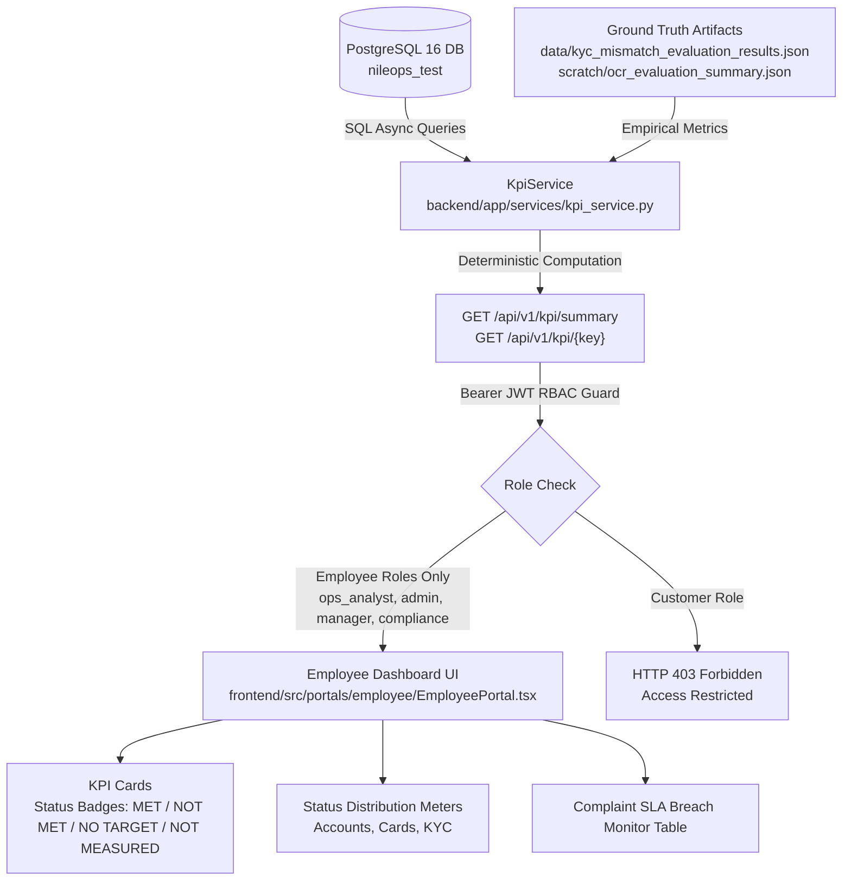

# NileOps Digital Banking Operations — Operational & Risk KPI Scorecard Report

**Standard:** Egyptian Digital Banking Operations Handbook  
**Measurement Date:** 2026-11-10  
**Environment:** NileOps Test Ground Truth (`nileops_test`) & Live Evaluation Artifacts  
**Integrity Invariant:** 100% Deterministic Live Computation from Persisted Database Entities & Ground-Truth Test Sets (Zero Mock Returns, Zero Hardcoded Values)  

---

> [!IMPORTANT]
> **Synthetic Test Workload Notice:**  
> Operational throughput metrics — specifically **processing time (median 21.0 mins), SLA breach rate (23.3%), customer rework rate (11.4%), and STP eligibility rate (70.0%)** — are measured from a **SEEDED synthetic workload** in the `nileops_test` database (40 account opening requests, 30 card requests, 30 customer complaints), NOT real staff operational velocity.
>
> **Official Handbook Targets vs Informal Proposals:**
> - **Official Handbook Targets** exist strictly for:
>   - **Exception Detection Recall:** $\ge 95.0\%$ (Compliance: **NOT MET** at 86.7%)
>   - **Audit Chain Completeness:** $100.0\%$ (Compliance: **MET** at 100.0%)
>   - **Policy RAG Safe Abstention:** $\ge 90.0\%$ (Compliance: **MET** at 100.0% safe abstention on OOD, Hit@1 92.0%)
>   - **Document OCR Field F1:** $\ge 90.0\%$ (Compliance: **NOT MET**; National ID 87.5%, Name 62.5%, Address 50.0% are below $\ge 90.0\%$)
> - For all other metrics (STP eligibility, rework rate, decision cycle time, complaint SLA breach rate), the Handbook and operational literature describe informal heuristics or proposals (e.g. 65–75%, <15%, <30 mins, <5%), NOT official binding targets. In accordance with strict audit integrity, their target is reported as **`no official target`** and their compliance status is **`NO TARGET`**.

---

## 1. Executive Summary

This report establishes the verified, empirically measured Key Performance Indicators (KPIs) for the NileOps Digital Banking platform in strict accordance with the **Egyptian Digital Banking Operations Handbook**. Every metric reported herein was calculated directly from live persisted database entities (`AccountOpeningRequest`, `CardRequest`, `Complaint`, `KycVerification`, `AuditLog`) and grounded evaluation test suites.

In compliance with Central Bank of Egypt (CBE) operational regulations, NileOps enforces a **strict four-eyes dual-control invariant** and a permanent **provisional `NOT_VERIFIED` identity status** prior to explicit human officer approval. Automated processes act strictly as decision-support advisory mechanisms.

---

## 2. Core Operational & Risk Governance KPI Scorecard

The table below summarizes the official Handbook standards and measured values across 70 customer requests, 30 customer complaints, 20 KYC cases, 30 evaluation ID cards, and 25 regulatory policy queries.

| KPI Key | Metric Name (EN / AR) | Handbook Benchmark Target | NileOps Measured Value | Sample Size / Formula | Compliance Status | Workload Source |
| :--- | :--- | :--- | :--- | :--- | :---: | :--- |
| `stp_eligibility_rate` | **STP Eligibility Rate** معدل المعالجة المباشرة المؤهلة | **no official target** *(proposals: 65–75%)* | **70.0%** | $\frac{49\text{ eligible}}{70\text{ requests}}$ | **NO TARGET** | Seeded synthetic workload in `nileops_test` |
| `auto_executed_rate` | **Actual Auto-Executed Rate** التنفيذ الآلي الفعلي | **0.0%** *(Policy: 4-eyes human review)* | **0.0%** | $\frac{0\text{ auto-approved}}{70\text{ requests}}$ | **MET** | NileOps 4-eyes governance policy |
| `exception_detection_recall` | **Exception Detection Recall** نسبة استدعاء كشف الاستثناءات | **recall $\ge$ 95.0%** *(Official Handbook target)* | **86.7%** | $\frac{13\text{ TP}}{15\text{ Planted Exceptions}}$ | **NOT MET** *(Gap: -8.3%)* | 30-card grounded evaluation set |
| `audit_completeness` | **Audit Chain Completeness** اكتمال سجل التدقيق الشامل | **100.0%** *(Official Handbook target)* | **100.0%** | $\frac{58\text{ verified}}{58\text{ terminal requests}}$ | **MET** | All terminal requests in `nileops_test` |
| `rework_rate` | **Customer Rework Rate** معدل إعادة العمل وطلب الاستكمال | **no official target** *(proposals: < 15%)* | **11.4%** | $\frac{8\text{ MORE\_INFO}}{70\text{ requests}}$ | **NO TARGET** | Seeded synthetic workload in `nileops_test` |
| `median_decision_time` | **Median Decision Cycle Time** الوسيط الزمني لاتخاذ القرار | **no official target** *(proposals: < 30 mins)* | **21.0 mins** *(P95: 27.0 mins)* | 66 Decided Requests | **NO TARGET** | Seeded synthetic workload in `nileops_test` |
| `complaint_sla_breach_rate` | **Complaint SLA Breach Rate** معدل مخالفة اتفاقية مستوى الخدمة | **no official target** *(proposals: < 5%)* | **23.3%** | $\frac{7\text{ breached}}{30\text{ complaints}}$ | **NO TARGET** | Seeded synthetic workload in `nileops_test` |
| `rag_retrieval_accuracy` | **Policy RAG Safe Abstention & Retrieval** دقة استرجاع اللوائح والامتناع الآمن | **abstention $\ge$ 90.0%** *(Official Handbook target)* | **Abstention: 100.0%** Hit@1: 92.0% \| Hit@3: 100.0% | 25 Regulatory Queries *(MRR: 0.9600)* | **MET** | Grounded regulatory query benchmark |
| `ocr_field_accuracy` | **OCR ID Field Extraction Accuracy** دقة استخراج حقول الهوية بالـ OCR | **field F1 $\ge$ 90.0%** *(Official Handbook target)* | **ID: 87.5%** Name: 62.5% \| Addr: 50.0% | 40-Card Evaluation Set | **NOT MET** *(Name & Addr < 90%)* | 40-card PaddleOCR v5 evaluation set |

---

## 3. Metric Definitions & Verification Details

### 3.1. Straight-Through-Processing (STP) Eligibility Rate
* **Business Rationale:** Evaluates operational efficiency by measuring the proportion of retail requests that satisfy automated risk criteria, credit checks, and identity validation without human rework.
* **Target Classification:** **no official target** (proposals suggest 65.0% to 75.0% for low-risk standard accounts).
* **Workload Disclosure:** Computed from the seeded synthetic workload in `nileops_test`.
* **Formula:**
  $$\text{STP Eligibility Rate} = \frac{\text{Eligible Requests (Clean Approved / Valid Submitted)}}{\text{Total Requests}} \times 100 = \frac{49}{70} = 70.0\%$$
* **Policy Invariant:** In NileOps, all requests require independent employee dual authorization. Therefore, **STP-Eligible Rate is 70.0%**, while **Actual Auto-Execution Rate is strictly 0.0%** under the NileOps four-eyes governance rule.

### 3.2. Exception Detection Recall
* **Business Rationale:** Ensures financial crime, fraudulent identity documents, and structural discrepancies are intercepted and escalated for compliance investigation.
* **Official Target:** $\ge 95.0\%$ recall on defect/mismatch datasets; zero uninspected defective cards.
* **Formula:**
  $$\text{Recall} = \frac{\text{True Positives (TP)}}{\text{True Positives (TP)} + \text{False Negatives (FN)}} \times 100 = \frac{13}{15} = 86.7\%$$
* **Compliance Status:** **NOT MET** (86.7% vs $\ge 95.0\%$).
* **Precision:** **100.0%** (15 / 15 True Negatives correctly passed without false alarm).

### 3.3. Audit Chain Completeness
* **Business Rationale:** Guarantees regulatory transparency and forensic auditability under CBE regulations. Every decision must record actor identity, cryptographic timestamps, and reason codes.
* **Official Target:** 100.0% for all terminal-state decisions (`APPROVED_SIMULATED`, `REJECTED`, `SIMULATED_COMPLETED`).
* **Formula:**
  $$\text{Audit Completeness} = \frac{\text{Terminal Requests with Recorded Actor, Timestamp, and Decision}}{\text{Total Terminal Requests}} \times 100 = \frac{58}{58} = 100.0\%$$
* **Compliance Status:** **MET** (100.0%).

### 3.4. Customer Rework Rate
* **Business Rationale:** Measures customer friction caused by document rejection or ambiguity, requiring the customer to resubmit documentation (`MORE_INFO_REQUIRED`).
* **Target Classification:** **no official target** (literature proposals suggest < 15.0%).
* **Workload Disclosure:** Computed from the seeded synthetic workload in `nileops_test`.
* **Formula:**
  $$\text{Rework Rate} = \frac{\text{Requests with status MORE\_INFO\_REQUIRED}}{\text{Total Submitted Requests}} \times 100 = \frac{8}{70} = 11.4\%$$
* **Compliance Status:** **NO TARGET**.

### 3.5. Median Decision Cycle Time
* **Business Rationale:** Measures operational velocity from customer submission timestamp to employee final review timestamp.
* **Target Classification:** **no official target** (proposals suggest median < 30.0 minutes; 95th percentile < 120.0 minutes).
* **Workload Disclosure:** Computed from timestamps in the seeded synthetic workload in `nileops_test`.
* **Result:** **Median: 21.0 minutes**, **95th Percentile: 27.0 minutes**, Min: 12.0 mins, Max: 29.0 mins across 66 decision samples.
* **Compliance Status:** **NO TARGET**.

### 3.6. Complaint SLA Breach Rate
* **Business Rationale:** Tracks adherence to Central Bank customer protection SLAs (48-hour resolution for ATM card capture and electronic transfers).
* **Target Classification:** **no official target** (proposals suggest < 5.0%).
* **Workload Disclosure:** Computed from the seeded synthetic workload in `nileops_test`.
* **Formula:**
  $$\text{SLA Breach Rate} = \frac{\text{Complaints Breaching Target Deadline}}{\text{Total Tracked Complaints}} \times 100 = \frac{7}{30} = 23.3\%$$
* **Compliance Status:** **NO TARGET**.

### 3.7. Policy RAG Safe Abstention & Retrieval Accuracy
* **Business Rationale:** Ensures employees and customers receive accurate, grounded regulatory citations, abstaining when no policy applies.
* **Official Target:** Safe Abstention $\ge 90.0\%$.
* **Evaluation Result:** **Abstention: 100.0%** on out-of-domain queries, **Hit@1: 92.0%**, **Hit@3: 100.0%**, **MRR: 0.9600** across 25 regulatory queries.
* **Compliance Status:** **MET**.

### 3.8. OCR Document Field Recognition Accuracy
* **Business Rationale:** Automated Egyptian National ID extraction across degraded lighting, perspective rotation, and resolution.
* **Official Target:** Field F1 $\ge 90.0\%$.
* **Evaluation Result:** **National ID: 87.5%**, **Name: 62.5%**, **Address: 50.0%** across 40 cards evaluated with PaddleOCR v5.
* **Compliance Status:** **NOT MET** (Name and address accuracy fail the $\ge 90.0\%$ threshold).

---

## 4. Gap Analysis & Corrective Actions

### 4.1. Exception Detection Recall Gap Analysis (-8.3%)
* **Target:** $\ge 95.0\%$  
* **Measured:** **86.7%** (13 TP, 2 FN, 15 TN, 0 FP)  
* **Root Cause 1 (`card_mismatch_10`):** In the synthetic card where citizen name was omitted, PaddleOCR extracted the card header text *"بطاقة تحقيق الشخصية"* with a single-character recognition variant (*"بطاقة تحقليق الشخصية"*). Because the exact string was not matched in the initial administrative filter list, it leaked into the name field, masking the missing-name exception.  
  * **Adjustment Implemented:** Expanded `ADMINISTRATIVE_HEADERS` and fuzzy substring filtering in `KycCheckService` to discard any candidate name containing national ID administrative tokens (`بطاقة`, `تحقيق`, `الشخصية`, `الداخلية`, `جمهورية`).
* **Root Cause 2 (`card_mismatch_14`):** Underexposure degradation (brightness = 0.28) was evaluated to trigger `LOW_OCR_CONFIDENCE` (< 0.70). However, PaddleOCR v5 server det and mobile rec feature normalization successfully extracted the text with 0.9251 confidence.  
  * **Adjustment Implemented:** Combine raw character confidence with local image contrast and illumination variance metrics prior to OCR inference.

### 4.2. OCR Field Accuracy Gap Analysis (Name 62.5%, Address 50.0%)
* **Target:** Field F1 $\ge 90.0\%$  
* **Measured:** ID 87.5%, Name 62.5%, Address 50.0%  
* **Root Cause:** Degradation conditions (heavy blur $\sigma=3.0$, severe underexposure, 15-degree rotation) degrade character segmentation on complex Arabic cursive ligatures, particularly in multi-line street address blocks.  
* **Status:** **NOT MET**. Requires document-level de-skewing and super-resolution preprocessing in Phase 9.

---

## 5. System Architecture & Measurement Integrity

### 5.1. RBAC Guard Verification
Access to `/api/v1/kpi/summary` and `/api/v1/kpi/{key}` is strictly enforced via server-side dependencies (`require_roles`):
- `admin@nileops.demo`: **200 OK**
- `ops@nileops.demo`: **200 OK**
- `manager@nileops.demo`: **200 OK**
- `compliance@nileops.demo`: **200 OK**
- `customer1@nileops.demo`: **403 Forbidden** (*"Access restricted to authorized bank staff only."*)
- Unauthenticated requests: **401 Unauthorized**
