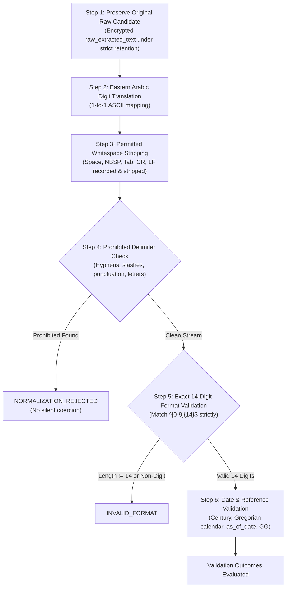

# NileOps — Egyptian National ID Validation & OCR Proof of Concept Specification

> **Document Version:** 1.2.4  
> **Date:** 2026-11-07  
> **Status:** Specification Baseline — Pending Owner Approval  
> **Classification:** Engineering Specification & Security Boundary  
> **Target System:** NileOps — Document Intelligence Subsystem (PoC Track)  

---

## 1. Objective & Scope

This specification defines the deterministic validation rules, data protection safeguards, document profile schemas, and multi-dimensional result architecture for processing Egyptian National ID cards within an isolated proof-of-concept (PoC) environment.

### 1.1 Core Objectives
1. Perform isolated, deterministic validation of 14-digit Egyptian National ID structures without reliance on external services, cloud endpoints, or LLM interpretations.
2. Establish strict architectural decoupling between character normalization, syntactic format validation, provisional working-reference matching, profile-driven OCR extraction, cross-field semantic consistency, review routing, and legal identity verification.
3. Protect customer personally identifiable information (PII) through authenticated cryptographic standards, comprehensive log sanitization across all digital channels, and defensive ephemeral storage lifecycle management.

### 1.2 Absolute System Boundaries
- **No Official Identity Verification:** NileOps possesses no integration with the Egyptian Ministry of Interior, the Civil Status Organization (*قطاع مصلحة الأحوال المدنية*), the Central Bank of Egypt (CBE), or live Core Banking systems.
- **No Autonomous Approvals:** Passing deterministic format, working-reference, or cross-field consistency checks **never** constitutes proof of identity, physical document authenticity, or automated KYC approval.
- **Synthetic-Only Repository Boundary:** Real citizen identification documents, authentic photographs, and genuine national numbers are strictly prohibited from entering the NileOps repository, its test fixtures, documentation examples, or Git history. All fixtures and card samples must be fabricated synthetically. Any separate local personal-document experiment that may be authorized in the future by the system owner must remain in an isolated, external, gitignored sandbox and must not be committed or merged into NileOps.
- **Mandatory Human-in-the-Loop (HITL):** Any anomaly, low OCR confidence, unrecognized layout, reference mismatch, or missing required field immediately routes the processing case to human operational review.

---

## 2. 14-Digit National ID Structure & Validation Rules

The Egyptian National ID comprises 14 numeric digits structured from left to right:

$$\underbrace{C}_{1}\;\underbrace{YY}_{2..3}\;\underbrace{MM}_{4..5}\;\underbrace{DD}_{6..7}\;\underbrace{GG}_{8..9}\;\underbrace{SSSS}_{10..13}\;\underbrace{K}_{14}$$

### 2.1 Century Indicator ($C$ — Position 1)
- **Rule:** Identifies the century of birth.
  - `2`: Born between January 1, 1900 and December 31, 1999 ($1900 + YY$).
  - `3`: Born between January 1, 2000 and December 31, 2099 ($2000 + YY$).
  - Any other value (`0`, `1`, `4`–`9`) triggers `INVALID_FORMAT`.

### 2.2 Date of Birth ($YY \cdot MM \cdot DD$ — Positions 2–7)
- **Year Calculation:** $\text{Full Year} = 1700 + (C \times 100) + YY$.
- **Calendar Validity:** Evaluated as an exact Gregorian calendar date:
  - Month must be in range `01` to `12`.
  - Day must be in valid range for the given month and year (including leap year validation for February 29th; e.g., year 2000 is a valid leap year, while years 1900 and 2001 are not).
- **Injected `as_of_date` Temporal Boundary:**
  - Date validation functions must mandate an explicit `as_of_date: datetime.date` parameter rather than reading the non-deterministic system clock.
  - If $\text{Date of Birth} > \text{as\_of\_date}$, the date is flagged as `INVALID_DATE`.

### 2.3 Governorate Code Reference ($GG$ — Positions 8–9)
- **Evidence Baseline:** Classified as `REFERENCE_PENDING_AUTHORITATIVE_VERIFICATION`. The table reflects standard Egyptian administrative and banking working references, pending primary gazette-level citation.
- **Accepted Working Reference Codes:**
  - Metropolitan: Cairo (`01`), Alexandria (`02`), Port Said (`03`), Suez (`04`).
  - Lower Egypt: Damietta (`11`), Dakahlia (`12`), Ash Sharqia (`13`), Al Qalyubia (`14`), Kafr El Sheikh (`15`), Al Gharbia (`16`), Al Monufia (`17`), Beheira (`18`), Ismailia (`19`).
  - Upper Egypt: Giza (`21`), Beni Suef (`22`), Faiyum (`23`), Minya (`24`), Asyut (`25`), Sohag (`26`), Qena (`27`), Aswan (`28`), Luxor (`29`).
  - Frontier: Red Sea (`31`), New Valley (`32`), Matrouh (`33`), North Sinai (`34`), South Sinai (`35`).
  - Citizens Born Abroad / Overseas Registrations: (`88`).
- **Standardized Status Outcomes:**
  - `GOVERNORATE_REFERENCE_MATCHED`: Code exists in the working reference table. This denotes conformance with provisional reference data only and does not imply official statutory verification.
  - `GOVERNORATE_REFERENCE_UNMATCHED`: Code is not present in the working reference table. This triggers human review routing without making definitive claims regarding statutory invalidity.
  - `GOVERNORATE_AUTHORITATIVE_VERIFIED`: Reserved strictly for future use if an official gazette decree is formally integrated.

### 2.4 Serial Sequence & Derived Gender ($SSSS$ — Positions 10–13)
- **Positions 10–12:** `Serial / Registration Sequence (Reference Pending Verification)`. The internal assignment rules and daily registration semantics remain unverified by authoritative public sources.
- **Position 13 (Gender Indicator):**
  - Odd (`1`, `3`, `5`, `7`, `9`): Derived as Male.
  - Even (`0`, `2`, `4`, `6`, `8`): Derived as Female.
  - **Gender Reference Confidence:** Classified strictly as:
    ```python
    gender_rule_status = "REFERENCE_PENDING_AUTHORITATIVE_VERIFICATION"
    ```
  - Derived gender is informational and subject to human confirmation; it is **never** presented as an authoritative legal fact.

### 2.5 Verification Checksum Digit ($K$ — Position 14)
- **Policy Statement:**
  > *"The project has not established an authoritative, publicly available checksum specification. The existence and implementation of any internal government verification algorithm are outside the project's verified knowledge."*
- **Implementation Status:**
  ```python
  checksum_status = "NOT_IMPLEMENTED_UNVERIFIED_SPECIFICATION"
  ```
  Position 14 is validated solely to confirm it contains an ASCII numerical digit `[0-9]`. No algorithmic checksum routine is executed or claimed.

---

## 3. Disentangled Nine-Dimensional Result Model

Outcomes must never be collapsed into a single status enum. NileOps evaluates results across **nine independent, orthogonal dimensions**, each with an explicit architectural owner:

```mermaid
graph TD
    subgraph D1["1. Normalization (Character Normalizer)"]
        N1["NORMALIZATION_PASSED"]
        N2["NORMALIZATION_REJECTED"]
        N3["NORMALIZATION_NOT_RUN"]
    end

    subgraph D2["2. Format Validation (NationalIDValidator)"]
        F1["FORMAT_VALID"]
        F2["INVALID_FORMAT"]
        F3["INVALID_DATE"]
    end

    subgraph D3["3. Governorate Reference (NationalIDValidator)"]
        G1["GOVERNORATE_REFERENCE_MATCHED"]
        G2["GOVERNORATE_REFERENCE_UNMATCHED"]
        G3["GOVERNORATE_AUTHORITATIVE_VERIFIED (Reserved)"]
    end

    subgraph D4["4. Gender Reference (NationalIDValidator)"]
        GR1["REFERENCE_PENDING_AUTHORITATIVE_VERIFICATION"]
    end

    subgraph D5["5. Checksum Status (NationalIDValidator)"]
        K1["NOT_IMPLEMENTED_UNVERIFIED_SPECIFICATION"]
    end

    subgraph D6["6. OCR Extraction & Profile Resolution (DocumentService / OCR Pipeline)"]
        O1["OCR_SUCCESS"]
        O2["OCR_LOW_CONFIDENCE"]
        O3["OCR_EXTRACTION_FAILED"]
        O4["DOCUMENT_PROFILE_UNSUPPORTED"]
        O5["OCR_NOT_RUN"]
    end

    subgraph D7["7. Cross-Field Consistency (DocumentService)"]
        C1["CONSISTENCY_PASSED"]
        C2["DATA_MISMATCH"]
        C3["CONSISTENCY_NOT_EVALUATED"]
    end

    subgraph D8["8. Human Review Routing (WorkflowEngine / HITL)"]
        R1["NO_REVIEW_REQUIRED"]
        R2["REQUIRES_HUMAN_REVIEW"]
        R3["UNDER_HUMAN_REVIEW"]
        R4["REVIEW_COMPLETED"]
    end

    subgraph D9["9. Identity Verification (NileOps Identity Boundary Layer)"]
        I1["NOT_VERIFIED (Permanent Invariant)"]
    end
```



### 3.1 Complete Pydantic Schema Specification

The schemas model all internal evaluation states, classification outcomes, failure reasons, and response boundaries:

```python
from enum import Enum
from typing import Optional, List, Dict, Any
from pydantic import BaseModel, Field
import datetime

# --- Context Specification ---
class WorkflowContext(str, Enum):
    DOCUMENT_AI = "DOCUMENT_AI"
    STRUCTURED_INTAKE = "STRUCTURED_INTAKE"

# --- Dimension 1: Normalization ---
class NormalizationStatus(str, Enum):
    NORMALIZATION_PASSED = "NORMALIZATION_PASSED"
    NORMALIZATION_REJECTED = "NORMALIZATION_REJECTED"
    NORMALIZATION_NOT_RUN = "NORMALIZATION_NOT_RUN"

# --- Dimension 2: Format Validation ---
class FormatValidationStatus(str, Enum):
    FORMAT_VALID = "FORMAT_VALID"
    INVALID_FORMAT = "INVALID_FORMAT"
    INVALID_DATE = "INVALID_DATE"

# --- Dimension 3: Governorate Reference ---
class GovernorateReferenceStatus(str, Enum):
    GOVERNORATE_REFERENCE_MATCHED = "GOVERNORATE_REFERENCE_MATCHED"
    GOVERNORATE_REFERENCE_UNMATCHED = "GOVERNORATE_REFERENCE_UNMATCHED"
    GOVERNORATE_AUTHORITATIVE_VERIFIED = "GOVERNORATE_AUTHORITATIVE_VERIFIED"  # Reserved

# --- Dimension 4: Gender Reference ---
class GenderRuleStatus(str, Enum):
    REFERENCE_PENDING_AUTHORITATIVE_VERIFICATION = "REFERENCE_PENDING_AUTHORITATIVE_VERIFICATION"

# --- Dimension 5: Checksum Status ---
class ChecksumValidationStatus(str, Enum):
    NOT_IMPLEMENTED_UNVERIFIED_SPECIFICATION = "NOT_IMPLEMENTED_UNVERIFIED_SPECIFICATION"

# --- Dimension 6: OCR Extraction & Profile Resolution ---
class OCRExtractionStatus(str, Enum):
    OCR_SUCCESS = "OCR_SUCCESS"
    OCR_LOW_CONFIDENCE = "OCR_LOW_CONFIDENCE"
    OCR_EXTRACTION_FAILED = "OCR_EXTRACTION_FAILED"
    DOCUMENT_PROFILE_UNSUPPORTED = "DOCUMENT_PROFILE_UNSUPPORTED"
    OCR_NOT_RUN = "OCR_NOT_RUN"

class ProfileResolutionStatus(str, Enum):
    PROFILE_RESOLVED = "PROFILE_RESOLVED"
    DOCUMENT_PROFILE_UNSUPPORTED = "DOCUMENT_PROFILE_UNSUPPORTED"
    DOCUMENT_LAYOUT_UNRECOGNIZED = "DOCUMENT_LAYOUT_UNRECOGNIZED"

class EngineFailureReason(str, Enum):
    NONE = "NONE"
    IMAGE_DECODE_ERROR = "IMAGE_DECODE_ERROR"
    ENGINE_RUNTIME_ERROR = "ENGINE_RUNTIME_ERROR"

class FieldExtractionStatus(str, Enum):
    ALL_REQUIRED_EXTRACTED = "ALL_REQUIRED_EXTRACTED"
    REQUIRED_FIELDS_LOW_CONFIDENCE = "REQUIRED_FIELDS_LOW_CONFIDENCE"
    REQUIRED_FIELDS_MISSING = "REQUIRED_FIELDS_MISSING"
    OPTIONAL_FIELDS_MISSING = "OPTIONAL_FIELDS_MISSING"

class FieldExtractionOutcome(str, Enum):
    EXTRACTED_ABOVE_THRESHOLD = "EXTRACTED_ABOVE_THRESHOLD"
    EXTRACTED_BELOW_THRESHOLD = "EXTRACTED_BELOW_THRESHOLD"
    FIELD_ABSENT = "FIELD_ABSENT"

# --- Dimension 7: Cross-Field Consistency ---
class ConsistencyStatus(str, Enum):
    CONSISTENCY_PASSED = "CONSISTENCY_PASSED"
    DATA_MISMATCH = "DATA_MISMATCH"
    CONSISTENCY_NOT_EVALUATED = "CONSISTENCY_NOT_EVALUATED"

class ConsistencyEvaluationReason(str, Enum):
    NONE = "NONE"
    NO_COMPARABLE_FIELD_AVAILABLE = "NO_COMPARABLE_FIELD_AVAILABLE"
    COMPARISON_INPUT_MISSING = "COMPARISON_INPUT_MISSING"
    OCR_INPUT_UNAVAILABLE = "OCR_INPUT_UNAVAILABLE"
    COMPARISON_NOT_SUPPORTED = "COMPARISON_NOT_SUPPORTED"

# --- Dimension 8: Review Routing ---
class ReviewRoutingStatus(str, Enum):
    NO_REVIEW_REQUIRED = "NO_REVIEW_REQUIRED"
    REQUIRES_HUMAN_REVIEW = "REQUIRES_HUMAN_REVIEW"
    UNDER_HUMAN_REVIEW = "UNDER_HUMAN_REVIEW"
    REVIEW_COMPLETED = "REVIEW_COMPLETED"

# --- Dimension 9: Identity Verification (Permanent Invariant) ---
class IdentityVerificationStatus(str, Enum):
    NOT_VERIFIED = "NOT_VERIFIED"

# --- Document Compound Status ---
class CompoundStatus(str, Enum):
    NONE = "NONE"
    PROVISIONAL_FORMAT_AND_CONSISTENCY_PASSED = "PROVISIONAL_FORMAT_AND_CONSISTENCY_PASSED"
    PROVISIONAL_FORMAT_PASSED_CONSISTENCY_UNCHECKED = "PROVISIONAL_FORMAT_PASSED_CONSISTENCY_UNCHECKED"

# --- Field Extraction Sub-Record ---
class FieldExtractionRecord(BaseModel):
    field_name: str
    outcome: FieldExtractionOutcome
    confidence_score: float = Field(0.0, ge=0.0, le=1.0)
    is_required: bool = True
    # raw value strictly isolated to internal processing
    raw_value_encrypted_token: Optional[str] = Field(None, exclude=True)

# --- Internal Processing Model (Backend & Reviewer Scope) ---
class NationalIDValidationInternalResult(BaseModel):
    case_id: str
    masked_national_id: str
    workflow_context: WorkflowContext
    
    # Profile & Resolution Metadata
    profile_resolution_status: ProfileResolutionStatus
    profile_id: Optional[str] = None
    layout_version: Optional[str] = None
    classification_confidence: Optional[float] = Field(None, ge=0.0, le=1.0)
    
    # Engine & Extraction Metadata
    engine_failure_reason: EngineFailureReason = EngineFailureReason.NONE
    field_extraction_status: Optional[FieldExtractionStatus] = None
    field_records: Dict[str, FieldExtractionRecord] = Field(default_factory=dict)
    
    # 9 Dimension Outcomes
    normalization_status: NormalizationStatus
    format_status: FormatValidationStatus
    governorate_status: GovernorateReferenceStatus
    gender_status: GenderRuleStatus
    checksum_status: ChecksumValidationStatus
    ocr_status: OCRExtractionStatus
    consistency_status: ConsistencyStatus
    review_status: ReviewRoutingStatus
    identity_verification_status: IdentityVerificationStatus = IdentityVerificationStatus.NOT_VERIFIED
    
    # Consistency Detail & Compound Status
    consistency_evaluation_reason: ConsistencyEvaluationReason = ConsistencyEvaluationReason.NONE
    compound_status: CompoundStatus = CompoundStatus.NONE
    
    # Derived Metadata (Classified as PII under Egyptian Law 151/2020)
    derived_birth_date: Optional[datetime.date] = None
    derived_governorate_name_en: Optional[str] = None
    derived_governorate_name_ar: Optional[str] = None
    derived_gender: Optional[str] = None

# --- Public API Response Model (Client & General User Scope) ---
class NationalIDValidationPublicResponse(BaseModel):
    case_id: str
    masked_national_id: str  # e.g. "2950****1234"
    workflow_context: WorkflowContext
    
    # Macro Outcomes
    normalization_status: NormalizationStatus
    format_status: FormatValidationStatus
    governorate_status: GovernorateReferenceStatus
    ocr_status: OCRExtractionStatus
    consistency_status: ConsistencyStatus
    review_status: ReviewRoutingStatus
    identity_verification_status: IdentityVerificationStatus = IdentityVerificationStatus.NOT_VERIFIED
    compound_status: CompoundStatus
    
    # Informational derived values (Masked or confirmed for display)
    derived_governorate: Optional[str] = None
    derived_gender: Optional[str] = None
    # Raw extracted strings, internal tokens, and field confidences are EXCLUDED
```

---

## 4. OCR Document Profiles, Profile Resolution & Semantic Consistency

### 4.1 Active Document Profiles & Scope Boundaries

To prevent OCR failures caused by unverified layouts, OCR processing is governed by explicit **Document Profiles**.

#### Active Supported Profile Specification
In this isolated proof of concept, **exactly one document profile is actively supported**:

| Attribute | Specification for Active Profile |
|---|---|
| `profile_id` | `EGY_NID_FRONT_V1` |
| `document_type` | `NATIONAL_ID` |
| `image_scope` | `FRONT` (Cropped card front only) |
| `layout_version` | `PROVISIONAL_EGY_NID_FRONT_LAYOUT` (Working reference layout; does not assert statutory card-manufacturing specifications) |
| `required_fields` | `["national_id"]` (Must be extracted with confidence $\ge \text{PROVISIONAL_OCR_THRESHOLD}$) |
| `optional_fields` | `["full_name", "residential_address", "serial_number", "factory_code"]` |

#### Architectural Extensions (Unsupported in Current PoC)
The following profiles are architecturally recognized as future extensions but are **unsupported in the current PoC**:
- `EGY_NID_BACK_V1`: `image_scope: BACK`. (Unsupported pending authoritative reverse-side layout and barcode evidence).
- `EGY_PASSPORT_V1`: `document_type: PASSPORT`.
- `EGY_UTILITY_BILL_V1`: `document_type: UTILITY_BILL`.
- `FULL_PAGE` Image Scope: Marked as **merely reserved** (unsupported; documents must be pre-cropped to card boundaries).

> Submission of any document outside `EGY_NID_FRONT_V1` must immediately emit `DOCUMENT_PROFILE_UNSUPPORTED`.

### 4.2 Deterministic Profile Resolution Contract

Profile resolution is the mandatory gateway before any profile-driven field extraction is executed. **Profile-driven OCR extraction must never be executed prior to successful profile resolution (`PROFILE_RESOLVED`).**

```
+-------------------------------------------------------------------------------+
|                       DOCUMENT INGESTION & DISPATCH                           |
+-------------------------------------------------------------------------------+
                                    |
                    Validate Input & Decode Image
                                    |
                    Did image decoding succeed?
                                    |
                        +-----------+-----------+
                        |                       |
                       YES                      NO
                        |                       |
                        |            engine_failure_reason = IMAGE_DECODE_ERROR
                        |            ocr_status = OCR_EXTRACTION_FAILED
                        |            review_status = REQUIRES_HUMAN_REVIEW
                        |
                        v
        Step A: Document Category Classification
      (Scan broad category anchors & aspect ratios)
                        |
        +---------------+---------------+
        |                               |
  High Confidence                 Low Confidence / Ambiguous
  (>= PROVISIONAL_CATEGORY_        (< PROVISIONAL_CATEGORY_
   THRESHOLD)                       THRESHOLD)
        |                               |
  Is Category "EGY_NID_FRONT"?          v
        |                        profile_resolution_status =
   +----+----+                   DOCUMENT_LAYOUT_UNRECOGNIZED
  YES        NO                  ocr_status = OCR_EXTRACTION_FAILED
   |          |                  review_status = REQUIRES_HUMAN_REVIEW
   |          v
   |     profile_resolution_status =
   |     DOCUMENT_PROFILE_UNSUPPORTED
   |     ocr_status = DOCUMENT_PROFILE_UNSUPPORTED
   |     review_status = REQUIRES_HUMAN_REVIEW
   v
 Step B: Layout Matching against EGY_NID_FRONT_V1
 (Validate geometry, eagle seal, text anchors)
   |
   +--------------------+
   |                    |
 Layout Matched       Layout Mismatch / Distorted
 (>= PROVISIONAL_     (< PROVISIONAL_LAYOUT_THRESHOLD)
  LAYOUT_THRESHOLD)     |
   |                    v
   |             profile_resolution_status = DOCUMENT_LAYOUT_UNRECOGNIZED
   |             ocr_status = OCR_EXTRACTION_FAILED
   |             review_status = REQUIRES_HUMAN_REVIEW
   v
profile_resolution_status = PROFILE_RESOLVED
Execute Profile-Driven OCR Extraction
```

#### Deterministic Resolution Rules
1. **Mutually Exclusive Outcomes:**
   - `PROFILE_RESOLVED`: Document is classified as an Egyptian National ID card front with confidence $\ge \text{PROVISIONAL_CATEGORY_THRESHOLD}$, and visual anchors match the registered `EGY_NID_FRONT_V1` geometry with confidence $\ge \text{PROVISIONAL_LAYOUT_THRESHOLD}$.
   - `DOCUMENT_PROFILE_UNSUPPORTED`: Document is confidently classified ($\ge \text{PROVISIONAL_CATEGORY_THRESHOLD}$) as a recognized document type that is outside the active scope (e.g., Passport, Utility Bill, or National ID Back).
   - `DOCUMENT_LAYOUT_UNRECOGNIZED`: The document cannot be confidently classified, or is a candidate National ID whose layout geometry or visual anchors cannot be verified against `EGY_NID_FRONT_V1`.
2. **Ambiguity Default Rule:** Low-confidence classification ($< \text{PROVISIONAL_CATEGORY_THRESHOLD}$) must **never** arbitrarily select `DOCUMENT_PROFILE_UNSUPPORTED`; it must deterministically evaluate to `DOCUMENT_LAYOUT_UNRECOGNIZED`.
3. **Execution Gating:** If `profile_resolution_status != PROFILE_RESOLVED`, all subsequent OCR field segmentation is halted.

### 4.3 Refined Failure & Omission Taxonomy

The system separates input validation, engine runtime, profile resolution, and field-level extraction outcomes:

| Failure / Outcome Condition | `ocr_status` | Detailed Sub-Status / Reason | `review_status` | Description |
|---|:---:|:---:|:---:|---|
| **Image Decode Error** | `OCR_EXTRACTION_FAILED` | `engine_failure_reason = IMAGE_DECODE_ERROR` | `REQUIRES_HUMAN_REVIEW` | Corrupt image bytes, unsupported file format, or zero-byte payload. |
| **Engine Runtime Error** | `OCR_EXTRACTION_FAILED` | `engine_failure_reason = ENGINE_RUNTIME_ERROR` | `REQUIRES_HUMAN_REVIEW` | Internal OCR engine memory fault, process termination, or unhandled library exception. |
| **Unsupported Profile** | `DOCUMENT_PROFILE_UNSUPPORTED` | `profile_resolution_status = DOCUMENT_PROFILE_UNSUPPORTED` | `REQUIRES_HUMAN_REVIEW` | Confidently classified document type outside active PoC scope. |
| **Unrecognized Layout** | `OCR_EXTRACTION_FAILED` | `profile_resolution_status = DOCUMENT_LAYOUT_UNRECOGNIZED` | `REQUIRES_HUMAN_REVIEW` | Ambiguous classification or failure to match visual layout anchors. |
| **Missing Required Field** | `OCR_EXTRACTION_FAILED` | `field_extraction_status = REQUIRED_FIELDS_MISSING` | `REQUIRES_HUMAN_REVIEW` | Profile resolved, but mandatory `national_id` could not be extracted. |
| **Low Confidence Field** | `OCR_LOW_CONFIDENCE` | `field_extraction_status = REQUIRED_FIELDS_LOW_CONFIDENCE` | `REQUIRES_HUMAN_REVIEW` | Mandatory `national_id` extracted, but confidence $< \text{PROVISIONAL_OCR_THRESHOLD}$. |
| **Missing Optional Field** | `OCR_SUCCESS` | `field_extraction_status = OPTIONAL_FIELDS_MISSING` | Conditional on downstream | Mandatory `national_id` extracted cleanly; optional field (e.g. `factory_code`) marked `FIELD_ABSENT`. |
| **Clean Extraction** | `OCR_SUCCESS` | `field_extraction_status = ALL_REQUIRED_EXTRACTED` | Conditional on downstream | All required fields extracted with confidence $\ge \text{PROVISIONAL_OCR_THRESHOLD}$. |

> [!NOTE]
> **Provisional Thresholds:** The baseline thresholds (`PROVISIONAL_OCR_THRESHOLD = 0.80`, `PROVISIONAL_CATEGORY_THRESHOLD = 0.85`, `PROVISIONAL_LAYOUT_THRESHOLD = 0.85`) are **provisional and environment-configurable**. They represent initial engineering baselines, pending empirical calibration against synthetic card datasets.

### 4.4 Semantic Cross-Field Consistency Boundaries

Cross-field consistency checks must compare fields representing the **identical semantic attribute** across verified data sources.

#### Critical Semantic Distinction: Birth Governorate vs. Current Residential Address
- **Encoded Governorate Code ($GG$ — Positions 8–9):** Represents the administrative division where the citizen's birth was registered at the Civil Registry.
- **Printed Residential Address (*العنوان*):** Represents the citizen's current place of residence at the time of card issuance or update.
- **Rule of Non-Contradiction:** An Egyptian citizen born in Luxor (`29`) commonly resides in Cairo (`01`), Alexandria (`02`), or abroad. A difference between the encoded birth governorate and the printed residential address is an expected real-world occurrence and **must NEVER be treated as a contradiction or trigger `DATA_MISMATCH`**.

#### Consistency Evaluation Reasons (`consistency_evaluation_reason`)
- `NO_COMPARABLE_FIELD_AVAILABLE`: The document profile or data model has no semantically equivalent second field for the encoded attribute (e.g., card front contains residential address but no printed birth governorate; or card front contains no verified standalone birth date).
- `COMPARISON_INPUT_MISSING`: A comparable field is expected from customer onboarding input (e.g., customer-declared birth date), but was omitted from the intake payload.
- `OCR_INPUT_UNAVAILABLE`: A secondary comparison field was defined in the profile, but OCR extraction on that field failed or yielded low confidence.
- `COMPARISON_NOT_SUPPORTED`: Comparison logic for the requested field pair is not supported.

---

## 5. National ID Normalization & Validation Sequence

Physical Egyptian National IDs present numbers in Eastern Arabic (`٠١٢٣٤٥٦٧٨٩`) or Western Arabic (`0123456789`) numerals.

### 5.1 Strict 6-Step Processing Sequence
All National ID candidate inputs must pass through a deterministic, strictly ordered 6-step sequence:



### 5.2 Translation & Normalization Rules
1. **Eastern Arabic Mapping Table:**
   ```
   ٠ (U+0660) -> 0 (U+0030)    ٥ (U+0665) -> 5 (U+0035)
   ١ (U+0661) -> 1 (U+0031)    ٦ (U+0666) -> 6 (U+0036)
   ٢ (U+0662) -> 2 (U+0032)    ٧ (U+0667) -> 7 (U+0037)
   ٣ (U+0663) -> 3 (U+0033)    ٨ (U+0668) -> 8 (U+0038)
   ٤ (U+0664) -> 4 (U+0034)    ٩ (U+0669) -> 9 (U+0039)
   ```
2. **Explicit Permitted Whitespace:** Standard ASCII space (`U+0020`), non-breaking space (`U+00A0`), horizontal tab (`\t` / `U+0009`), newline (`\n` / `U+000A`), and carriage return (`\r` / `U+000D`). These permitted characters are stripped during candidate formation.
3. **Strict Allowlist for Normalized Candidate Formation:**
   The candidate stream permits **strictly and exclusively**:
   - Western Arabic digits: `0`–`9` (`U+0030` to `U+0039`)
   - Eastern Arabic digits: `٠`–`٩` (`U+0660` to `U+0669`)
   - Permitted whitespace codepoints listed in Rule 2
   **Any other Unicode codepoint** (including Persian/Urdu digits `۱۲۳۴۵۶`, Latin or Arabic alphabet letters, hyphens, slashes, punctuation, diacritics, or emojis) is prohibited and immediately triggers `normalization_status = NORMALIZATION_REJECTED`.
4. **Explicit `[0-9]` Character Class:** Syntactic validation must enforce regular expressions using explicit ASCII `^[0-9]{14}$`. The system must **never** rely on Unicode-inclusive `\d` semantics, which match non-ASCII digits in various engine configurations.
5. **No Silent Coercion:** Ambiguous glyphs, broken contours, or unmapped characters are never guessed or coerced.

---

## 6. Security, Cryptography & PII Lifecycle Safeguards

### 6.1 Authenticated Encryption at Rest (AES-256-GCM) & NIST Wording Alignment
- **Algorithm:** Authenticated symmetric encryption using **AES-256-GCM**.
- **NIST SP 800-38D RBG-Based IV Construction (Section 8.2.2 & 8.3):**
  - NileOps generates 96-bit initialization vectors (IVs / nonces) using an OS-level Random Bit Generator (RBG / CSPRNG via `os.urandom(12)`).
  - Under NIST SP 800-38D Section 8.3, for RBG-based random 96-bit IVs, the maximum number of invocations of the authenticated encryption function under any single key **shall not exceed $2^{32}$** to ensure that the probability of an IV collision does not exceed $2^{-32}$.
  - This random construction is distinct from the deterministic IV construction (NIST SP 800-38D Section 8.2.1), which utilizes a fixed field and an invocation counter supporting up to $2^{64}$ invocations.
  - Nonces generated by CSPRNG are **probabilistically unique, not mathematically unique**.
- **NileOps Operational Rekey Threshold:**
  - As a **project defense-in-depth policy choice** (not a statutory NIST requirement), NileOps mandates an operational key rotation trigger at **$2^{28}$ invocations**, providing a substantial safety margin below the $2^{32}$ NIST bound.
- **Concurrent Workers & Process Safety:**
  - In multi-process architectures (e.g., Celery task workers, Gunicorn worker pools), workers must invoke kernel-level CSPRNG (`os.urandom`) for every encryption to prevent fork-state duplication.
  - **Zero Nonce Reuse:** A nonce must never be reused with the same key. Nonce reuse under AES-GCM destroys confidentiality and authenticity.

### 6.2 Raw OCR Handling, Ephemeral Retention & Cryptographic Erasure
- **`raw_extracted_text` Retention Policy:**
  - Raw OCR candidate text is **not retained for general audit convenience**.
  - It is retained strictly as ephemeral working state for the minimum duration required to complete the operational session or human verification task.
  - **Hard Maximum Backstop TTL:** `TEMP_UPLOAD_RETENTION_HOURS = 24` is defined strictly as an **absolute hard backstop maximum**. Under standard operating procedures, raw OCR records and decrypted images must be **purged immediately** upon case review approval, case rejection, or user session logout. A scheduled background sweeper permanently purges any orphan records exceeding 24 hours.
- **Strengthened Least-Privilege Access Controls:**
  - Raw extracted text and full National ID digits are inaccessible through ordinary public API endpoints.
  - Access to unmasked raw OCR strings is restricted to authenticated users holding `compliance_reviewer` or `operations_officer` roles, and exclusively on actively assigned cases through an administrative endpoint (`/api/v1/compliance/cases/{case_id}/raw-inspection`).
  - **Just-in-Time (JIT) Controls:** Invocation of raw inspection requires:
    1. A mandatory business justification code (`reason_code`) recorded in the audit event.
    2. Ephemeral, time-bounded access tokens (15-minute maximum lifetime).
    3. Velocity rate limiting (>10 inspections per hour by a single user triggers an automated security alert to `admin`).
- **Audit Logs Contain Zero Raw PII:** Structured audit event records store only operational event metadata and masked identifiers (`2950****1234`). Raw extracted text, unmasked IDs, and customer addresses are strictly barred from audit logs.
- **Storage Overwrite Limitations & Cryptographic Erasure:**
  - On modern solid-state drives (SSDs), wear-leveling controllers, copy-on-write filesystems (ZFS, Btrfs), and container overlay filesystems, block overwrite tools (`shred`, byte overwriting) do not guarantee physical block eradication.
  - True secure deletion is achieved by **cryptographic erasure**: encrypting ephemeral documents with per-case keys and destroying the key across key caches and key-wrapping layers.
  - *Key Destruction Limitations Acknowledged:* Key destruction is effective only if unencrypted plaintext copies, intermediate memory buffers, temporary swap files, or core dumps do not persist across the infrastructure.

### 6.3 Comprehensive Multi-Channel PII Masking & Serialization Safeguards
- **Masking Standards:**
  - Western Arabic: `2950****1234`.
  - Eastern Arabic: `٢٩٥٠****١٢٣٤`.
  - Whitespace-separated: Normalized and masked to standard format.
- **Serialization & Error Safeguards:**
  - Public response schemas (`NationalIDValidationPublicResponse`) exclude raw extraction strings and confidence scores.
  - Custom FastAPI exception handlers for `RequestValidationError` and `HTTPException` strip request parameters, payload bodies, and stack trace locals to prevent leaking 14-digit strings in error responses.
  - Derived fields (Date of Birth, Governorate, Gender) are treated as personal data under Egyptian Law 151/2020 and redacted from telemetry and diagnostic logs.

---

## 7. Compound Status & Review Routing Decision Logic

To eliminate ambiguity and prevent conflation with official verification, NileOps defines two distinct compound statuses:
- `PROVISIONAL_FORMAT_AND_CONSISTENCY_PASSED`
- `PROVISIONAL_FORMAT_PASSED_CONSISTENCY_UNCHECKED`

The evaluation logic is partitioned by **mandatory `workflow_context`**, eliminating cross-workflow precedence conflicts.

### 7.1.1 Document AI Processing Workflow (`workflow_context == DOCUMENT_AI`)

In this workflow, an identity card document was uploaded and physical document extraction is mandatory:

| Condition Row | Normalization (`D1`) | Format (`D2`) | Governorate Reference (`D3`) | OCR Status (`D6`) | Consistency Status (`D7`) | Consistency Reason | Emitted Compound Status | Review Routing (`D8`) |
|:---:|:---:|:---:|:---:|:---:|:---:|:---:|:---:|:---:|
| **DAI-01** | `PASSED` | `FORMAT_VALID` | `REFERENCE_MATCHED` | `OCR_SUCCESS` | `CONSISTENCY_PASSED` | `NONE` | `PROVISIONAL_FORMAT_AND_CONSISTENCY_PASSED` | `NO_REVIEW_REQUIRED` |
| **DAI-02** | `PASSED` | `FORMAT_VALID` | `REFERENCE_MATCHED` | `OCR_SUCCESS` | `CONSISTENCY_NOT_EVALUATED` | `NO_COMPARABLE_FIELD_AVAILABLE` | `PROVISIONAL_FORMAT_PASSED_CONSISTENCY_UNCHECKED` | `NO_REVIEW_REQUIRED` |
| **DAI-03** | `PASSED` | `FORMAT_VALID` | `REFERENCE_MATCHED` | `OCR_SUCCESS` | `CONSISTENCY_NOT_EVALUATED` | `COMPARISON_INPUT_MISSING` | `NONE` | `REQUIRES_HUMAN_REVIEW` |
| **DAI-04** | `PASSED` | `FORMAT_VALID` | `REFERENCE_MATCHED` | `OCR_SUCCESS` | `CONSISTENCY_NOT_EVALUATED` | `OCR_INPUT_UNAVAILABLE` | `NONE` | `REQUIRES_HUMAN_REVIEW` |
| **DAI-05** | `PASSED` | `FORMAT_VALID` | `REFERENCE_MATCHED` | `OCR_SUCCESS` | `CONSISTENCY_NOT_EVALUATED` | `COMPARISON_NOT_SUPPORTED` | `NONE` | `REQUIRES_HUMAN_REVIEW` |
| **DAI-06** | `PASSED` | `FORMAT_VALID` | `REFERENCE_MATCHED` | `OCR_SUCCESS` | `DATA_MISMATCH` | Any | `NONE` | `REQUIRES_HUMAN_REVIEW` |
| **DAI-07** | `PASSED` | `FORMAT_VALID` | `REFERENCE_MATCHED` | `OCR_LOW_CONFIDENCE` | Any | Any | `NONE` | `REQUIRES_HUMAN_REVIEW` |
| **DAI-08** | `PASSED` | `FORMAT_VALID` | `REFERENCE_MATCHED` | `OCR_EXTRACTION_FAILED` | Any | Any | `NONE` | `REQUIRES_HUMAN_REVIEW` |
| **DAI-09** | `PASSED` | `FORMAT_VALID` | `REFERENCE_MATCHED` | `DOCUMENT_PROFILE_UNSUPPORTED`| Any | Any | `NONE` | `REQUIRES_HUMAN_REVIEW` |
| **DAI-10** | Any | Any | Any | `OCR_NOT_RUN` | Any | Any | `NONE` | `REQUIRES_HUMAN_REVIEW` |
| **DAI-11** | `PASSED` | `FORMAT_VALID` | `REFERENCE_UNMATCHED` | Any | Any | Any | `NONE` | `REQUIRES_HUMAN_REVIEW` |
| **DAI-12** | `PASSED` | `INVALID_FORMAT` or `INVALID_DATE` | Any | Any | Any | Any | `NONE` | `REQUIRES_HUMAN_REVIEW` |
| **DAI-13** | `REJECTED` or `NOT_RUN` | Any | Any | Any | Any | Any | `NONE` | `REQUIRES_HUMAN_REVIEW` |

### 7.1.2 Direct Structured Intake Workflow (`workflow_context == STRUCTURED_INTAKE`)

In this workflow, 14-digit customer input was entered directly via a structured core banking or onboarding form (no document image provided). In this context, `OCR_NOT_RUN` is normal and expected, and document-level compound statuses are not emitted:

| Condition Row | Normalization (`D1`) | Format (`D2`) | Governorate Reference (`D3`) | OCR Status (`D6`) | Consistency Status (`D7`) | Emitted Compound Status | Review Routing (`D8`) |
|:---:|:---:|:---:|:---:|:---:|:---:|:---:|:---:|
| **STR-01** | `PASSED` | `FORMAT_VALID` | `REFERENCE_MATCHED` | `OCR_NOT_RUN` | `CONSISTENCY_PASSED` | `NONE` (No doc processed) | `NO_REVIEW_REQUIRED` |
| **STR-02** | `PASSED` | `FORMAT_VALID` | `REFERENCE_MATCHED` | `OCR_NOT_RUN` | `CONSISTENCY_NOT_EVALUATED` | `NONE` (No doc processed) | `NO_REVIEW_REQUIRED` |
| **STR-03** | `PASSED` | `FORMAT_VALID` | `REFERENCE_MATCHED` | `OCR_NOT_RUN` | `DATA_MISMATCH` | `NONE` | `REQUIRES_HUMAN_REVIEW` |
| **STR-04** | `PASSED` | `FORMAT_VALID` | `REFERENCE_UNMATCHED` | `OCR_NOT_RUN` | Any | `NONE` | `REQUIRES_HUMAN_REVIEW` |
| **STR-05** | `PASSED` | `INVALID_FORMAT` or `INVALID_DATE` | Any | `OCR_NOT_RUN` | Any | `NONE` | `REQUIRES_HUMAN_REVIEW` |
| **STR-06** | `REJECTED` or `NOT_RUN` | Any | Any | `OCR_NOT_RUN` | Any | `NONE` | `REQUIRES_HUMAN_REVIEW` |

### 7.2 Strict Prerequisites for Compound Statuses

#### Mathematical Formulation: `PROVISIONAL_FORMAT_AND_CONSISTENCY_PASSED`
Emitted **only** when all five conditions are simultaneously met:

$$\begin{aligned}
\text{Condition 1:} & \quad \text{normalization\_status} == \text{NORMALIZATION\_PASSED} \\
\text{Condition 2:} & \quad \text{format\_status} == \text{FORMAT\_VALID} \\
\text{Condition 3:} & \quad \text{governorate\_status} == \text{GOVERNORATE\_REFERENCE\_MATCHED} \\
\text{Condition 4:} & \quad \text{ocr\_status} == \text{OCR\_SUCCESS} \\
\text{Condition 5:} & \quad \text{consistency\_status} == \text{CONSISTENCY\_PASSED}
\end{aligned}$$

#### Mathematical Formulation: `PROVISIONAL_FORMAT_PASSED_CONSISTENCY_UNCHECKED`
Emitted **only** when:

$$\begin{aligned}
\text{Condition 1:} & \quad \text{normalization\_status} == \text{NORMALIZATION\_PASSED} \\
\text{Condition 2:} & \quad \text{format\_status} == \text{FORMAT\_VALID} \\
\text{Condition 3:} & \quad \text{governorate\_status} == \text{GOVERNORATE\_REFERENCE\_MATCHED} \\
\text{Condition 4:} & \quad \text{ocr\_status} == \text{OCR\_SUCCESS} \\
\text{Condition 5:} & \quad \text{consistency\_status} == \mathbf{CONSISTENCY\_NOT\_EVALUATED} \\
\text{Condition 6:} & \quad \text{consistency\_evaluation\_reason} == \mathbf{NO\_COMPARABLE\_FIELD\_AVAILABLE}
\end{aligned}$$

> [!IMPORTANT]
> **Prohibition Against Erroneous Compound Emission:**  
> `PROVISIONAL_FORMAT_PASSED_CONSISTENCY_UNCHECKED` must **never** be emitted merely because OCR failed, confidence was low, or comparison inputs were missing (`COMPARISON_INPUT_MISSING`, `OCR_INPUT_UNAVAILABLE`). In those failure modes, compound status evaluates to `NONE` and human review is mandatory.

### 7.3 Review-Routing Decision Logic

1. **Separation of Isolated Component Tests from Full-Workflow Decisions:**  
   Unit tests evaluating isolated components (e.g., structural validator, character normalizer) test only that single dimension. An isolated passing structure test does **not** evaluate OCR extraction or consistency, and therefore must not assign a premature full-workflow `NO_REVIEW_REQUIRED`.
2. **Context A: Direct Structured Input Workflow (e.g., Core Banking Manual Entry):**  
   - In this workflow, `ocr_status = OCR_NOT_RUN` is normal and expected.
   - If normalization passed, format is valid, governorate reference matched, and intake consistency passed, the intake stage evaluates to `NO_REVIEW_REQUIRED`.
   - However, no document compound status (`PROVISIONAL_FORMAT_*`) is emitted because no physical document was processed.
3. **Context B: Document AI / OCR Processing Workflow:**  
   - In this workflow, document image extraction is mandatory.
   - If `ocr_status` is `OCR_NOT_RUN`, `OCR_LOW_CONFIDENCE`, `OCR_EXTRACTION_FAILED`, or `DOCUMENT_PROFILE_UNSUPPORTED`, the workflow **always requires human review** (`review_status = REQUIRES_HUMAN_REVIEW`).
   - If any structural check fails (`INVALID_FORMAT`, `INVALID_DATE`, `GOVERNORATE_REFERENCE_UNMATCHED`, `NORMALIZATION_REJECTED`), the workflow routes to human review.

### 7.4 Permanent Identity Invariant
Neither compound status certifies legal identity, legitimate issuance, physical document authenticity, or official KYC verification. The identity verification dimension remains permanently:  
$$\text{identity\_verification\_status} = \text{"NOT\_VERIFIED"}$$

---

## 8. Complete Test Matrix Specification

All date calculations evaluated against an injected `as_of_date = 2026-11-07`:

### 8.1 National ID Structural Test Cases (TC-01 to TC-14)

> [!CAUTION]
> **Synthetic Fixture Boundary Notice:**  
> The 14-digit strings in TC-01 to TC-14 are algorithmically synthesized mock vectors generated solely for offline structural algorithm testing. While constructed using valid century, date, and governorate syntax, they do not represent real persons. NileOps makes no claim regarding whether any arbitrary 14-digit combination might coincidentally correspond to an actual Egyptian citizen. Under no circumstances may these test vectors be queried against external registries or deployed to production environments.

*Scope: Evaluates format, calendar date, governorate working reference, and informational gender rules in isolation. In structural tests, full-workflow review status is not evaluated.*

| Test ID | Input String (14 Digits) | Position Breakdown ($C \cdot YY \cdot MM \cdot DD \cdot GG \cdot SSSS \cdot K$) | Evaluated Date | `as_of_date` | `format_status` | `governorate_status` | `gender_status` | `checksum_status` | Isolated Structural Outcome |
|---|---|---|:---:|:---:|:---:|:---:|:---:|:---:|:---:|
| **TC-01** | `29505120101234` | $2 \cdot 95 \cdot 05 \cdot 12 \cdot 01 \cdot 0123 \cdot 4$ | 1995-05-12 | 2026-11-07 | `FORMAT_VALID` | `GOVERNORATE_REFERENCE_MATCHED` (Cairo) | `REFERENCE_PENDING_AUTHORITATIVE_VERIFICATION` (Male) | `NOT_IMPLEMENTED_UNVERIFIED_SPECIFICATION` | `STRUCTURAL_VALID` |
| **TC-02** | `30310252109886` | $3 \cdot 03 \cdot 10 \cdot 25 \cdot 21 \cdot 0988 \cdot 6$ | 2003-10-25 | 2026-11-07 | `FORMAT_VALID` | `GOVERNORATE_REFERENCE_MATCHED` (Giza) | `REFERENCE_PENDING_AUTHORITATIVE_VERIFICATION` (Female) | `NOT_IMPLEMENTED_UNVERIFIED_SPECIFICATION` | `STRUCTURAL_VALID` |
| **TC-03** | `2950512010123` | Len = 13 ($<14$) | N/A | 2026-11-07 | `INVALID_FORMAT` | N/A | N/A | `NOT_IMPLEMENTED_UNVERIFIED_SPECIFICATION` | `REQUIRES_HUMAN_REVIEW` |
| **TC-04** | `295051201012345` | Len = 15 ($>14$) | N/A | 2026-11-07 | `INVALID_FORMAT` | N/A | N/A | `NOT_IMPLEMENTED_UNVERIFIED_SPECIFICATION` | `REQUIRES_HUMAN_REVIEW` |
| **TC-05** | `2950512010123A` | Contains ASCII `'A'` at Pos 14 | N/A | 2026-11-07 | `INVALID_FORMAT` | N/A | N/A | `NOT_IMPLEMENTED_UNVERIFIED_SPECIFICATION` | `REQUIRES_HUMAN_REVIEW` |
| **TC-06** | `19505120101234` | $C=1 \notin \{2, 3\}$ | N/A | 2026-11-07 | `INVALID_FORMAT` | N/A | N/A | `NOT_IMPLEMENTED_UNVERIFIED_SPECIFICATION` | `REQUIRES_HUMAN_REVIEW` |
| **TC-07** | `49505120101234` | $C=4 \notin \{2, 3\}$ | N/A | 2026-11-07 | `INVALID_FORMAT` | N/A | N/A | `NOT_IMPLEMENTED_UNVERIFIED_SPECIFICATION` | `REQUIRES_HUMAN_REVIEW` |
| **TC-08** | `29513120101234` | $MM=13 > 12$ | 1995-13-12 | 2026-11-07 | `INVALID_DATE` | `GOVERNORATE_REFERENCE_MATCHED` | N/A | `NOT_IMPLEMENTED_UNVERIFIED_SPECIFICATION` | `REQUIRES_HUMAN_REVIEW` |
| **TC-09** | `29502300101234` | $MM=02, DD=30$ | 1995-02-30 | 2026-11-07 | `INVALID_DATE` | `GOVERNORATE_REFERENCE_MATCHED` | N/A | `NOT_IMPLEMENTED_UNVERIFIED_SPECIFICATION` | `REQUIRES_HUMAN_REVIEW` |
| **TC-10** | `30002290101234` | $3 \cdot 00 \cdot 02 \cdot 29 \cdot 01 \cdot 0123 \cdot 4$ | 2000-02-29 | 2026-11-07 | `FORMAT_VALID` | `GOVERNORATE_REFERENCE_MATCHED` | `REFERENCE_PENDING_AUTHORITATIVE_VERIFICATION` (Male) | `NOT_IMPLEMENTED_UNVERIFIED_SPECIFICATION` | `STRUCTURAL_VALID` |
| **TC-11** | `30102290101234` | $MM=02, DD=29$ in year 2001 | 2001-02-29 | 2026-11-07 | `INVALID_DATE` | `GOVERNORATE_REFERENCE_MATCHED` | N/A | `NOT_IMPLEMENTED_UNVERIFIED_SPECIFICATION` | `REQUIRES_HUMAN_REVIEW` |
| **TC-12** | `39901010101234` | Year = 2099 ($> \text{as\_of\_date}$) | 2099-01-01 | **2026-11-07** | `INVALID_DATE` | `GOVERNORATE_REFERENCE_MATCHED` | N/A | `NOT_IMPLEMENTED_UNVERIFIED_SPECIFICATION` | `REQUIRES_HUMAN_REVIEW` |
| **TC-13** | `29505129901234` | $GG=99 \notin \text{Reference}$ | 1995-05-12 | 2026-11-07 | `FORMAT_VALID` | `GOVERNORATE_REFERENCE_UNMATCHED` | `REFERENCE_PENDING_AUTHORITATIVE_VERIFICATION` (Male) | `NOT_IMPLEMENTED_UNVERIFIED_SPECIFICATION` | `REQUIRES_HUMAN_REVIEW` |
| **TC-14** | `29505122001234` | $GG=20 \notin \text{Reference}$ | 1995-05-12 | 2026-11-07 | `FORMAT_VALID` | `GOVERNORATE_REFERENCE_UNMATCHED` | `REFERENCE_PENDING_AUTHORITATIVE_VERIFICATION` (Male) | `NOT_IMPLEMENTED_UNVERIFIED_SPECIFICATION` | `REQUIRES_HUMAN_REVIEW` |

### 8.2 Normalization Scenarios (TC-15 to TC-18)
*Scope: Evaluates character normalization in complete isolation. Uses non-realistic synthetic strings to emphasize normalization boundary testing without conflating structural semantics.*

| Test ID | Scenario Description | Synthetic Input Payload | Expected `normalization_status` | Output Normalized Candidate |
|---|---|---|:---:|---|
| **TC-15** | Eastern Arabic Digit Normalization | `٩٩٩٨٨٨٧٧٧٦٦٦٥٥` | `NORMALIZATION_PASSED` | `99988877766655` |
| **TC-16** | Mixed Eastern and Western Digits | `9998887٧٧٦٦٦٥٥` | `NORMALIZATION_PASSED` | `99988877766655` |
| **TC-17** | Permitted Whitespace Stripping | `\t999 888777 66655 \n` | `NORMALIZATION_PASSED` | `99988877766655` (Tabs, spaces, newlines stripped) |
| **TC-18** | Prohibited Delimiters & Characters | `9998887-7766655` | `NORMALIZATION_REJECTED` | `None` (Hyphen rejected; no silent character coercion) |

### 8.3 Profile-Driven OCR Extraction Scenarios (TC-19 to TC-23)

| Test ID | Scenario Description | Profile & Input Condition | Expected `ocr_status` | Detailed Sub-Status / Reason | Expected Review Routing |
|---|---|---|:---:|:---:|:---:|
| **TC-19** | OCR Low Confidence on Required Field | Profile `EGY_NID_FRONT_V1`, blurred national ID field (`conf = 0.65 < 0.80`) | `OCR_LOW_CONFIDENCE` | `field_extraction_status = REQUIRED_FIELDS_LOW_CONFIDENCE` | `REQUIRES_HUMAN_REVIEW` |
| **TC-20** | Image Decoding Failure | Corrupt byte stream / invalid image header | `OCR_EXTRACTION_FAILED` | `engine_failure_reason = IMAGE_DECODE_ERROR` | `REQUIRES_HUMAN_REVIEW` |
| **TC-21** | Missing Optional Field Handled Gracefully | Profile `EGY_NID_FRONT_V1`, National ID clean, `factory_code` unreadable | `OCR_SUCCESS` | `field_extraction_status = OPTIONAL_FIELDS_MISSING` | Dependent on downstream consistency |
| **TC-22** | Missing Required Field Triggers Failure | Profile `EGY_NID_FRONT_V1`, Name clean, National ID field unreadable | `OCR_EXTRACTION_FAILED` | `field_extraction_status = REQUIRED_FIELDS_MISSING` | `REQUIRES_HUMAN_REVIEW` |
| **TC-23** | Unsupported Document Profile | Uploaded document is Egyptian Passport or Foreign ID submitted to NID endpoint | `DOCUMENT_PROFILE_UNSUPPORTED` | `profile_resolution_status = DOCUMENT_PROFILE_UNSUPPORTED` | `REQUIRES_HUMAN_REVIEW` |

### 8.4 Cross-Field Semantic Consistency Scenarios (TC-24 to TC-26)

| Test ID | Scenario Description | Comparison Inputs & Semantic Relationship | `consistency_status` | `consistency_evaluation_reason` | Expected Review Routing & Preconditions |
|---|---|---|:---:|:---:|:---:|
| **TC-24** | Date of Birth Semantic Mismatch | Source A: Encoded DoB (`1995-05-12`) from National ID.<br/>Source B: Customer-Declared DoB (`1990-01-01`) from Onboarding Intake.<br/>*Relationship: Expected exact Gregorian date match.* | `DATA_MISMATCH` | `NONE` | `REQUIRES_HUMAN_REVIEW` |
| **TC-25** | Absence of Comparable Field (Non-Contradiction) | Source A: Encoded Birth Gov (`29` - Luxor) from National ID.<br/>Source B: Printed Residential Address (`01` - Cairo) from card face.<br/>*Relationship: Distinct semantic concepts; non-comparable.* | `CONSISTENCY_NOT_EVALUATED` | `NO_COMPARABLE_FIELD_AVAILABLE` | Emits `PROVISIONAL_FORMAT_PASSED_CONSISTENCY_UNCHECKED` **only if** Conditions 1–4 (Normalization, Format, Governorate Reference, OCR Success) are simultaneously satisfied. |
| **TC-26** | Comparison Input Missing / Unavailable | Source A: Encoded DoB (`1995-05-12`) from National ID.<br/>Source B: Customer-Declared DoB expected from Onboarding Intake, but omitted/null.<br/>*Relationship: Expected comparison input is absent.* | `CONSISTENCY_NOT_EVALUATED` | `COMPARISON_INPUT_MISSING` | `REQUIRES_HUMAN_REVIEW` (Compound pass prohibited) |

### 8.5 Comprehensive Multi-Channel PII Masking Scenarios (TC-27 to TC-34)

| Test ID | Masking Target Channel | Raw Test Input Payload | Verification Requirement / Expected Sanitized Output (Assert Raw Absent) |
|---|---|---|---|
| **TC-27** | Western Arabic Digits in App Logs | `29505120101234` | Asserts logged output contains `2950****1234`; asserts `29505120101234` is strictly absent from output stream. |
| **TC-28** | Eastern Arabic Digits in App Logs | `٢٩٥٠٥١٢٠١٠١٢٣٤` | Asserts logged output contains `٢٩٥٠****١٢٣٤`; asserts `٢٩٥٠٥١٢٠١٠١٢٣٤` is strictly absent from output stream. |
| **TC-29** | Segmented / Whitespace Separated ID | `2 95 05 12 01 0123 4` | Logger interceptor masks to `2950****1234`; asserts raw unmasked sequence is strictly absent from output stream. |
| **TC-30** | ID in OCR Exception Messages | `DocumentProcessingError("Failed at 29505120101234")` | Exception handler scrubs ID before output: `"...at 2950****1234"`; asserts raw ID is absent from exception string. |
| **TC-31** | ID in Python Tracebacks | Traceback containing frame local `nid="29505120101234"` | Formatter scrubs local variables or suppresses frame locals; asserts raw ID is absent from formatted traceback. |
| **TC-32** | Raw OCR Payload in Error Responses | API `422 Unprocessable Entity` response payload | Response body returns sanitized error code; asserts raw OCR JSON payload and raw National ID are strictly absent. |
| **TC-33** | Telemetry & Metric Labels | Prometheus counter / Sentry breadcrumb tag | Labels restricted to `status="FAILED"`, `case_id="UUID"`; asserts raw National ID is strictly absent from metrics. |
| **TC-34** | Customer Names & Residential Addresses | Customer `سامي إبراهيم عامر`, Address `مدينة نصر القاهرة` | Diagnostic logs omit names/addresses; asserts raw customer names and addresses are strictly absent from log stream. |

---

## 9. Deliverables and State of the Repository

- **Specification Document Complete:** Cleanly consolidated at `docs/NATIONAL_ID_VALIDATION_SPEC.md`.
- **Zero Code Implemented:** No application files, tests, database migrations, or dependencies have been generated or modified.
- **Permanent Sandbox Invariant:** `identity_verification_status = "NOT_VERIFIED"`.
- **Synthetic Boundary:** Real identity documents remain strictly barred from repository fixtures.

*End of NileOps National ID Validation & OCR Specification v1.2.4.*
