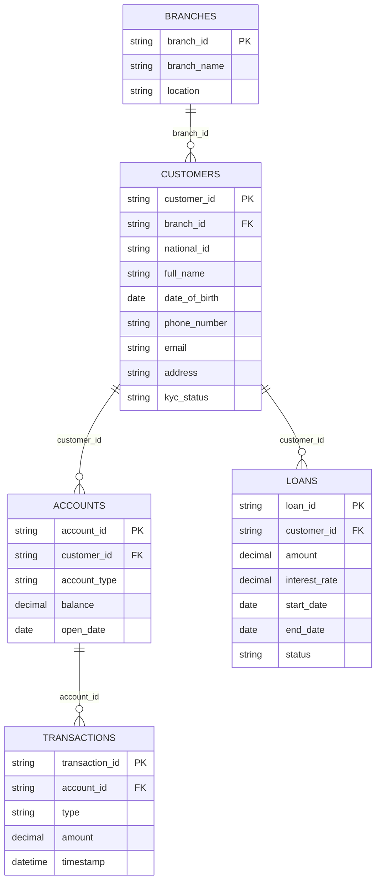
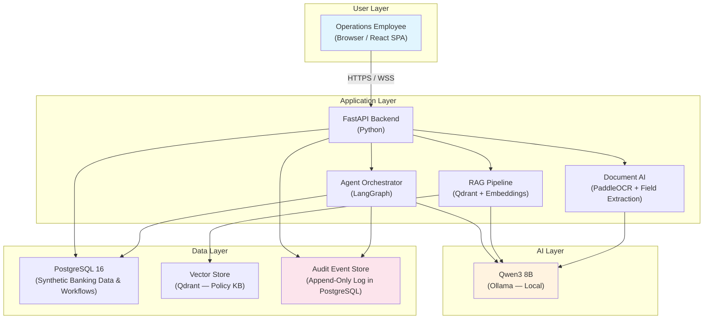

# NileOps V4 — Project Assessment

> **Document Version:** 1.0  
> **Date:** 2026-11-07  
> **Status:** Pre-Implementation Assessment  
> **Classification:** Internal — Engineering

---

## Table of Contents

1. [Executive Summary](#1-executive-summary)
2. [Source Document Analysis](#2-source-document-analysis)
3. [Gap Analysis](#3-gap-analysis)
4. [Data Assessment](#4-data-assessment)
5. [Technical Environment Assessment](#5-technical-environment-assessment)
6. [Risk Assessment](#6-risk-assessment)
7. [Inconsistencies Found](#7-inconsistencies-found)
8. [Opportunities for Improvement](#8-opportunities-for-improvement)
9. [Recommendations](#9-recommendations)
10. [Scope Confirmation](#10-scope-confirmation)

---

## 1. Executive Summary

**NileOps** is an AI-powered digital banking operations platform designed as a Minimum Viable Product (MVP) to demonstrate how artificial intelligence can assist banking operations employees and retail customers in Egyptian banks and fintech companies. Operating under the working placeholder identity of **NileOps Demo Bank**, the platform simulates authentic Egyptian retail banking journeys, Arabic-first UX, EGP currency conventions, and local banking services while maintaining strict intellectual-property boundaries (no affiliation with, endorsement by, or imitation of the National Bank of Egypt or any commercial bank).

The platform operates exclusively on **synthetic data in a local sandbox environment** — it has no connection to any live core banking system, does not make final credit or compliance decisions, and escalates sensitive or uncertain cases to authorized human employees across five standardized canonical roles: `admin`, `operations_officer`, `customer_service`, `compliance_reviewer`, and `branch_manager`.

### Dual-Portal Experience
1. **Customer Portal:** Arabic-first (with Egyptian vernacular & English support, RTL/LTR), retail product inquiry, account opening guidance, card/transfer policies, simulated complaint submission, and authenticated customer account views.
2. **Employee Portal:** Operations dashboard, Customer Service AI Copilot, authorized customer 360 lookup, KYC case review, policy governance approval queue (`DRAFT → APPROVED`), and branch workflow management.

### Purpose

Automate and accelerate routine banking tasks — KYC verification, account opening guidance, card requests, complaint routing, and policy assistance — while maintaining full human oversight, policy approval governance, and an immutable audit trail.

### Target Audience

| Audience | Relationship |
|---|---|
| Egyptian commercial banks | Primary target market |
| Egyptian fintech companies | Secondary target market |
| Banking operations employees | End users of the platform |
| Compliance & risk officers | Oversight and audit consumers |
| Portfolio reviewers / investors | Assessment audience for the MVP demo |

### Core Value Proposition

Reduce manual processing time for routine banking operations while enforcing compliance guardrails, demonstrating measurable KPIs (straight-through rate, document accuracy, escalation precision), and maintaining a 100% auditable decision trail.

---

## 2. Source Document Analysis

### 2.1 PDF Handbook (19-page "AI Project Handbook" — Arabic)

The PDF serves as the **project charter and technical specification**. It defines scope, architecture, team structure, timeline, and KPIs.

**What the PDF specifies clearly:**

| Area | Detail |
|---|---|
| MVP Functional Scope | KYC data updates, simulated account opening, simulated card requests, complaint routing |
| Technology Stack | Document AI / OCR, LLM, Agent Orchestration, RAG, Workflow Engine, Human-in-the-Loop, Audit Trail |
| Team Structure | 5 defined roles across the project |
| Timeline | 8-week roadmap |
| Sandbox Constraint | All operations on synthetic data; no real core banking integration |
| Human Oversight | Sensitive/uncertain cases escalate to authorized human employees |
| Decision Boundary | Platform does NOT make final credit or compliance decisions |
| Regulatory Context | Egyptian Personal Data Protection Law 151/2020, CBE information security requirements, KYC/CDD |
| Identified Risks | OCR misreading, prompt injection, LLM hallucination, poor Arabic language accuracy |

**Proposed KPI Targets (not confirmed — aspirational):**

| KPI | Proposed Target |
|---|---|
| Straight-Through Rate (STP) | ≥ 60% |
| Document Field Extraction — Macro F1 | ≥ 90% |
| Exception Recall | ≥ 95% |
| Escalation Accuracy | ≥ 95% |
| RAG Grounded Answer Rate | ≥ 90% |
| Abstention Correctness | ≥ 90% |
| Audit Trail Completeness | 100% |
| End-to-End Task Success | ≥ 95% |

> [!IMPORTANT]
> These KPI targets are **proposed**, not validated against baseline measurements. Several targets (e.g., 95% E2E success, 90% F1 on Arabic OCR) are aggressive for an MVP with an 8B parameter local model. They must be treated as aspirational until baseline benchmarks are established.

### 2.2 Excel Workbook (`bank_data_sample_Ammar Elgazar.xlsx`)

The Excel file provides a **schema reference and sample data structure** across 6 sheets.

**Sheet Inventory:**

| Sheet | Rows (data only) | Purpose |
|---|---|---|
| Schema_Notes | — | Describes the relational schema and field definitions |
| Customers | 3 | Customer master data with KYC fields |
| Accounts | 3 | Account records linked to customers |
| Transactions | 4 | Transaction history linked to accounts |
| Loans | 2 | Loan records linked to customers |
| Branches | 2 | Branch reference data |

**What the Excel provides:**
- A clear relational schema with primary/foreign key relationships
- Field-level definitions including data types and constraints
- A minimal but structurally complete sample across all entities

**What the Excel does NOT provide:**
- Sufficient volume for meaningful testing (3 customers is not a test dataset)
- Edge cases, error conditions, or adversarial data patterns
- Arabic-language content for OCR/NLP testing
- Document images (national IDs, forms) for Document AI pipeline testing

---

## 3. Gap Analysis

This section identifies what the original specifications define versus what is actually needed to build a functional MVP.

### 3.1 Specification Gaps

| Area | Specified | Missing | Impact |
|---|---|---|---|
| **API Design** | Not specified | REST/GraphQL endpoint definitions, request/response schemas, auth model | Cannot build frontend-backend integration without this |
| **Frontend / UI** | Not specified | UI framework choice, screen inventory, UX flows, responsive requirements | No user-facing interface defined |
| **Database Engine** | Not specified | RDBMS vs document store, connection pooling, migration strategy | Schema exists but no persistence layer chosen |
| **LLM Integration Details** | "LLM" mentioned generically | Model selection rationale, prompt templates, context window strategy, token budget | Critical for Arabic performance tuning |
| **RAG Architecture** | "RAG" mentioned | Vector store choice, embedding model, chunk strategy, retrieval pipeline, knowledge base content | Cannot build grounded Q&A without this |
| **Agent Orchestration** | "Agent orchestration" mentioned | Framework choice (LangGraph, CrewAI, custom), agent definitions, tool inventory, state management | Core architectural decision unmade |
| **Workflow Engine** | "Workflow engine" mentioned | State machine definitions, transition rules, timeout handling, retry logic | Operational workflows undefined |
| **OCR/Document AI Pipeline** | "Document AI/OCR" mentioned | Arabic OCR model selection, preprocessing pipeline, field extraction rules, confidence thresholds | Key differentiator unimplemented |
| **Human-in-the-Loop** | Concept defined | Escalation trigger rules, review UI, approval workflow, SLA definitions | HITL mechanism unspecified |
| **Audit Trail** | 100% completeness target | Storage format, retention policy, query interface, immutability mechanism | Compliance-critical but undesigned |
| **Authentication / Authorization** | Not specified | User roles, session management, access control matrix | Security-critical gap |
| **Deployment Architecture** | Not specified | Containerization, CI/CD, environment management, scaling model | No deployment story |
| **Testing Strategy** | Not specified | Unit/integration/E2E test plans, test data generation, coverage targets | Quality assurance undefined |
| **Arabic Language Support** | Risk identified (poor accuracy) | Arabic NLP pipeline, tokenization strategy, bilingual UI, RTL support | Core market requirement unaddressed |

### 3.2 Process Gaps

| Process | Status | Required |
|---|---|---|
| KYC Data Update flow | Named in scope | Step-by-step workflow definition with decision points |
| Account Opening flow | Named as "simulated" | Simulation boundaries, required fields, validation rules |
| Card Request flow | Named as "simulated" | Card types, eligibility rules, request lifecycle |
| Complaint Routing flow | Named in scope | Routing taxonomy, priority rules, SLA definitions |

---

## 4. Data Assessment

### 4.1 Schema Analysis

The Excel workbook defines a clean, normalized relational schema:

**Schema quality:** The schema is structurally sound — proper PK/FK relationships, reasonable field choices, and clear entity boundaries. It is adequate as a **reference model** for synthetic data generation.

### 4.2 Data Volume Assessment

| Entity | Provided | Minimum for MVP Testing | Recommended for Demo |
|---|---|---|---|
| Customers | 3 | 50 | 200–500 |
| Accounts | 3 | 75 | 300–750 |
| Transactions | 4 | 500 | 2,000–5,000 |
| Loans | 2 | 30 | 100–200 |
| Branches | 2 | 5 | 10–15 |

> [!CAUTION]
> The Excel file contains personal-looking information (names, national IDs, dates of birth, phone numbers, email addresses). This data **MUST NOT** be used in any part of the system — not in code, not in tests, not in documentation examples. All data used in NileOps must be **entirely synthetic**, generated programmatically with no resemblance to real individuals.

### 4.3 Synthetic Data Requirements

To support the MVP scope, the following synthetic data must be generated:

1. **Customer master data** — Arabic and transliterated names, valid-format Egyptian national IDs (14-digit, structurally valid but fake), Egyptian phone numbers (+20 format), Cairo/Giza/Alexandria addresses in Arabic, KYC statuses across all states (verified, pending, expired, rejected)
2. **Account data** — Multiple account types (current, savings, salary), realistic balance distributions, date ranges spanning 2–3 years
3. **Transaction data** — Diverse transaction types (deposit, withdrawal, transfer, payment), realistic amounts and frequencies, temporal patterns (salary cycles, bill payments)
4. **Loan data** — Varied loan products, different statuses (active, paid, defaulted, restructured), realistic interest rates for Egyptian market
5. **Branch data** — Egyptian city/governorate coverage, realistic branch naming conventions
6. **Document images** — Synthetic Egyptian national ID card images for OCR testing, synthetic bank forms and applications in Arabic, synthetic complaint letters/emails in Arabic

---

## 5. Technical Environment Assessment

### 5.1 Available Infrastructure

| Component | Status | Version / Detail |
|---|---|---|
| **Operating System** | ✅ Available | Windows |
| **Python** | ✅ Available | 3.11.9 |
| **Ollama** | ✅ Available | Running with `qwen3:8b` model |
| **LLM (Local)** | ✅ Available | Qwen3 8B parameter model via Ollama |
| **Git** | ✅ Available | Project is under version control |
| **Workspace** | ✅ Available | `c:\AI\NileOps_V4` |

### 5.2 Missing Infrastructure

| Component | Status | Required For | Priority |
|---|---|---|---|
| **Docker** | ❌ Not installed | Containerized deployment, service isolation, reproducible builds | High |
| **Node.js** | ❌ Not installed | Frontend development (if React/Vue/Next.js chosen), toolchain (npm/yarn) | High (if web UI) |
| **Database Engine** | ❌ Not installed | Data persistence — PostgreSQL 16 (via Docker) | High |
| **Vector Store** | ❌ Not installed | RAG pipeline — ChromaDB, FAISS, or Qdrant | High |
| **Redis / Message Queue** | ❌ Not installed | Task queue, caching, session management | Medium |
| **OCR Engine** | ❌ Not installed | Document AI pipeline — Tesseract, EasyOCR, or PaddleOCR with Arabic support | High |

### 5.3 LLM Capability Assessment

**Model:** Qwen3 8B (via Ollama, quantized)

| Capability | Expected Performance | Risk Level |
|---|---|---|
| English text generation | Good | Low |
| Arabic text generation | Moderate | Medium |
| Arabic text comprehension | Moderate | Medium |
| Structured output (JSON) | Good with prompting | Low–Medium |
| Document field extraction | Moderate | Medium |
| Complex reasoning chains | Limited at 8B scale | High |
| Code generation | Moderate | Medium |
| Long context handling | Depends on quantization / context window config | Medium |

> [!WARNING]
> An 8B parameter model is a meaningful constraint. Tasks requiring deep multi-step reasoning, reliable Arabic NLP, or consistent structured output at high accuracy may hit the model's capability ceiling. KPI targets (90%+ F1, 95%+ recall) may be difficult to achieve without prompt engineering investment, fine-tuning, or selective use of larger cloud models for critical paths.

---

## 6. Risk Assessment

### 6.1 Technical Risks

| # | Risk | Likelihood | Impact | Mitigation |
|---|---|---|---|---|
| T1 | **Arabic OCR accuracy insufficient** — Arabic is morphologically complex; most open-source OCR engines underperform on Arabic script, especially with varied fonts or handwriting | High | High | Evaluate PaddleOCR (best Arabic support), implement confidence-threshold routing to human review, build a structured test suite with Arabic document variants |
| T2 | **LLM hallucination in banking context** — 8B model generating plausible but incorrect banking information (account numbers, balances, policy details) | High | Critical | Enforce RAG-grounded responses only, implement citation verification, add abstention logic ("I don't have enough information"), never let LLM generate authoritative financial data |
| T3 | **Prompt injection attacks** — Malicious input in customer documents or complaint text manipulating LLM behavior | Medium | Critical | Input sanitization layer, prompt/response separation, output validation against expected schema, monitoring for anomalous outputs |
| T4 | **8B model capability ceiling** — Model too small for reliable multi-step agent orchestration with consistent structured output | Medium | High | Decompose complex tasks into simpler sub-tasks, use constrained generation (JSON mode), implement fallback/retry logic, consider cloud model API for critical paths |
| T5 | **Context window exhaustion** — Banking documents + conversation history + system prompts exceeding model context window | Medium | Medium | Implement context management strategy, summarize conversation history, chunk documents intelligently |
| T6 | **No Docker means deployment fragility** — Without containerization, environment reproducibility is at risk | High | Medium | Install Docker early, define Dockerfiles for all services, use docker-compose for local orchestration |

### 6.2 Data Risks

| # | Risk | Likelihood | Impact | Mitigation |
|---|---|---|---|---|
| D1 | **Accidental use of sample personal data** — Excel data containing personal-looking information leaking into codebase or tests | Medium | Critical | Delete or quarantine original Excel data immediately after schema extraction, generate all test data synthetically, add CI checks for PII patterns |
| D2 | **Synthetic data not representative** — Generated data too uniform or unrealistic, failing to exercise edge cases | Medium | Medium | Define data distribution profiles based on Egyptian banking norms, include deliberate edge cases (missing fields, Arabic/English mixed, expired KYC) |
| D3 | **Insufficient data volume for meaningful KPI measurement** — 3 rows cannot validate 90%+ accuracy claims | High | High | Generate minimum 200 customers with full relational graph, create 100+ document images for OCR benchmarking |

### 6.3 Scope Risks

| # | Risk | Likelihood | Impact | Mitigation |
|---|---|---|---|---|
| S1 | **Scope creep beyond MVP** — Pressure to add real core banking integration, live data, or production-grade compliance before MVP validation | Medium | High | Enforce sandbox boundary in all documentation and code, add explicit "SIMULATED" labels in UI, define clear MVP exit criteria |
| S2 | **8-week timeline too aggressive** — Full-stack AI platform with OCR + LLM + RAG + agents + HITL + audit trail in 8 weeks | High | High | Ruthlessly prioritize: build one complete vertical (KYC update) first, then extend horizontally; accept reduced KPI targets for MVP |
| S3 | **KPI targets unachievable at MVP stage** — 90%+ F1, 95%+ recall with an 8B model on Arabic banking documents | High | Medium | Treat KPIs as directional targets, establish baselines first, report actual vs. target transparently |

---

## 7. Inconsistencies Found

The following inconsistencies were identified between the source documents and the actual technical environment:

### 7.1 Model Name Mismatch

| Source Says | Reality | Resolution |
|---|---|---|
| "Qwen3.5 8B" referenced in documentation | **Qwen3.5 does not exist** as a released model. The installed model is `qwen3:8b` (Qwen3 8B) via Ollama. | All documentation and code must reference `qwen3:8b`. This is not a downgrade — there is no "3.5" variant to downgrade from. |

> [!NOTE]
> The Qwen model family versioning is: Qwen, Qwen1.5, Qwen2, Qwen2.5, Qwen3. There is no "Qwen3.5" release as of the assessment date. The `qwen3:8b` model available via Ollama is the correct and current model.

### 7.2 Infrastructure Assumptions vs. Reality

| Assumption (Implied by PDF) | Reality | Action Required |
|---|---|---|
| Containerized deployment feasible | Docker is NOT installed | Install Docker Desktop for Windows |
| Web-based UI implied by platform nature | Node.js is NOT installed | Install Node.js LTS for React 18 + TypeScript + Vite frontend build |
| Database available for data persistence | No database engine installed | Deploy PostgreSQL 16 container via Docker Compose |

### 7.3 KPI vs. Capability Tension

| KPI | Target | Feasibility with qwen3:8b | Notes |
|---|---|---|---|
| Document Field Macro F1 | ≥ 90% | **Uncertain** | Depends heavily on OCR quality upstream of LLM; Arabic document extraction at 90% F1 with 8B model is aggressive |
| Exception Recall | ≥ 95% | **Uncertain** | Requires the model to catch 95% of all anomalies — high bar for 8B model |
| RAG Grounded Answer Rate | ≥ 90% | **Achievable** with good retrieval | More dependent on retrieval quality than model size |
| E2E Task Success | ≥ 95% | **Unlikely at MVP** | Compound probability across OCR → extraction → validation → routing means errors multiply |

---

## 8. Opportunities for Improvement

Beyond the original specification, the following enhancements would strengthen the MVP:

### 8.1 Architecture Improvements

1. **Event-Driven Audit Trail** — Instead of simple logging, implement an append-only event store (event sourcing pattern). Every state change is an immutable event. This provides 100% audit completeness by design, not by discipline.

2. **Confidence-Scored Routing** — Every AI decision should carry a confidence score. Decisions below threshold route to human review automatically. This makes the Human-in-the-Loop mechanism data-driven rather than rule-based.

3. **Bilingual Architecture from Day One** — Design all prompts, UI strings, and data models to support Arabic and English natively. Retrofitting bilingual support is significantly more expensive.

4. **Observability Stack** — Instrument the LLM pipeline with token usage tracking, latency monitoring, and output quality scoring from the start. Essential for KPI measurement and cost projection.

### 8.2 Demo & Portfolio Value

1. **Live Dashboard** — Real-time visualization of STP rate, escalation queue, and document processing pipeline. High visual impact for portfolio reviewers.

2. **Scenario Replay** — Ability to replay a complete customer journey (document upload → OCR → extraction → validation → approval) with full audit trail visualization. Demonstrates the platform's value proposition in under 2 minutes.

3. **Adversarial Test Suite** — Include deliberate edge cases: blurry documents, incomplete forms, prompt injection attempts, Arabic dialect variations. Demonstrates robustness and security awareness.

4. **Comparative Benchmarks** — Show processing time and accuracy with AI assistance vs. estimated manual processing baseline. Quantifies the value proposition.

---

## 9. Recommendations

Prioritized decisions and actions required before implementation can begin.

### Priority 1 — Decisions Required Immediately

| # | Decision | Options | Recommendation | Rationale |
|---|---|---|---|---|
| R1 | **Frontend Framework** | (a) React 18 + TypeScript + Vite + Tailwind (b) Streamlit (c) Plain HTML/JS | **(a) React 18 + TypeScript + Vite + Tailwind** | Enterprise digital banking aesthetic, responsive design, Arabic RTL/English LTR native support, reusable components |
| R2 | **Database Engine** | (a) PostgreSQL 16 (b) SQLite (c) MySQL | **(a) PostgreSQL 16** | Robust relational model, JSONB indexing, ACID transactions, Alembic migrations, enterprise production alignment |
| R3 | **Agent Orchestration Framework** | (a) LangGraph (b) CrewAI (c) Custom Python | **(a) LangGraph** | Best structured agent framework, explicit tool allowlists, human-in-the-loop checkpoints, active community |
| R4 | **Vector Store for RAG** | (a) Qdrant (b) ChromaDB (c) FAISS | **(a) Qdrant** | High-performance dedicated vector engine, metadata filtering, payload management, local Docker integration |
| R5 | **OCR Engine** | (a) Tesseract (b) EasyOCR (c) PaddleOCR | **(c) PaddleOCR** | Best Arabic script support, actively maintained, good accuracy on printed Arabic, Python SDK |

### Priority 2 — Infrastructure Setup

| # | Action | Effort | Blocking |
|---|---|---|---|
| R6 | Install Docker Desktop for Windows | 30 min | Containerized deployment |
| R7 | Set up Python virtual environment with dependency management (Poetry or pip-tools) | 1 hr | All development |
| R8 | Generate synthetic dataset (200+ customers, full relational graph) | 4–8 hrs | All testing and demo |
| R9 | Generate synthetic Arabic document images for OCR testing | 4–8 hrs | Document AI pipeline |
| R10 | Establish baseline KPI measurements with current model | 8–16 hrs | KPI target validation |

### Priority 3 — Architecture Decisions

| # | Decision | Recommendation |
|---|---|---|
| R11 | Define KYC update workflow state machine (the first vertical) | Map complete state diagram with all decision points, escalation triggers, and timeout rules |
| R12 | Design prompt template library | Create versioned, tested prompt templates for each agent role with Arabic and English variants |
| R13 | Define audit event schema | Design immutable event format before writing any business logic |
| R14 | Establish API contract | Define internal service boundaries and API contracts even for monolith MVP — eases future decomposition |

---

## 10. Scope Confirmation

### 10.1 Confirmed MVP Scope

Based on the source document analysis, gap analysis, and technical environment assessment, the following scope is confirmed for NileOps V4 MVP:

**In Scope:**

| Feature | Scope Boundary |
|---|---|
| **KYC Data Update** | Full vertical: document upload → OCR extraction → field validation → human review (if needed) → data update → audit log |
| **Simulated Account Opening** | Form-based flow with AI-assisted field population, validation rules, simulated approval — no real account created |
| **Simulated Card Request** | Request form with eligibility check against synthetic data, simulated fulfillment — no real card issued |
| **Complaint Routing** | NLP-based complaint classification and routing to appropriate department/queue with priority scoring |
| **Human-in-the-Loop** | Escalation UI for cases below confidence threshold, with approve/reject/modify actions |
| **Audit Trail** | Immutable log of every AI decision, human action, and state transition |
| **RAG-Based Q&A** | Policy/procedure queries grounded in uploaded banking knowledge base documents |

**Explicitly Out of Scope:**

| Exclusion | Reason |
|---|---|
| Real core banking integration | Sandbox MVP only |
| Real customer data processing | Synthetic data only — regulatory and ethical requirement |
| Final credit decisions | Platform assists, does not decide |
| Final compliance decisions | Platform flags, human decides |
| Production deployment | MVP is a demonstration environment |
| Mobile application | Web-only for MVP |
| Multi-tenancy | Single-bank demo configuration |
| Real-time transaction processing | Batch/on-demand only |

### 10.2 MVP Success Criteria

The MVP will be considered successful if it demonstrates:

1. **One complete vertical flow** — KYC data update from document upload to audit trail entry, including at least one human review escalation
2. **Measurable KPIs** — Baseline measurements established for all 8 KPIs, with transparent reporting of actual vs. target
3. **Arabic language handling** — At minimum, Arabic document OCR and Arabic complaint text classification functioning at a reportable accuracy level
4. **Audit completeness** — 100% of AI decisions and human actions logged with timestamps, inputs, outputs, and confidence scores
5. **Security posture** — Input sanitization, prompt injection resistance demonstrated, no PII in codebase

### 10.3 Architectural Constraints

> [!IMPORTANT]
> All components run locally. The LLM (`qwen3:8b`) runs via Ollama on the local machine. There are no external API calls to cloud AI services. This is both a constraint (performance limited by local hardware) and a feature (data never leaves the machine — important for banking data sensitivity narrative).

---

## Appendix A — Decision Log

| Date | Decision | Rationale | Decided By |
|---|---|---|---|
| 2026-11-07 | Use `qwen3:8b` (not "Qwen3.5") | Qwen3.5 does not exist; qwen3:8b is the available model | Engineering assessment |
| 2026-11-07 | All data must be synthetic | Excel sample contains personal-looking data; regulatory requirement | Engineering assessment |
| 2026-11-07 | MVP targets are aspirational | KPI targets need baseline validation before commitment | Engineering assessment |
| 2026-11-07 | Fictional Bank: **NileOps Demo Bank** | Credible Egyptian banking experience without infringing on NBE trademarks | Project Owner Decision |
| 2026-11-07 | Dual-Portal Architecture | Distinct Customer Portal and Employee Portal sharing approved KB under RBAC | Project Owner Decision |
| 2026-11-07 | Policy Approval State Machine | `DRAFT → PENDING_APPROVAL → APPROVED → INDEXED`; mandatory separation of duties | Project Owner Decision |
| 2026-11-07 | Standardize 5 Canonical Roles | `admin`, `operations_officer`, `customer_service`, `compliance_reviewer`, `branch_manager` | Project Owner Decision |
| 2026-11-07 | Dynamic Embedding Dimension Discovery | Avoid hardcoding 384/768; discover dimension at model startup | Project Owner Decision |

## Appendix B — Open Questions Status

| # | Question | Status | Resolution |
|---|---|:---:|---|
| Q1 | Is local-only LLM a hard constraint? | Closed | Confirmed local-only via Ollama (`qwen3:8b`) for complete data privacy. |
| Q2 | What specific policies populate RAG KB? | Closed | 12 synthetic policy domains approved for NileOps Demo Bank. |
| Q3 | Should UI be Arabic-first or bilingual? | Closed | Arabic-first with Egyptian vernacular and English support, full RTL/LTR. |
| Q4 | What is the target hardware spec? | Open | Local developer workstation (16-32GB RAM, multi-core CPU, optional CUDA). |
| Q5 | Are there Egyptian ID formats to guide testing? | Closed | National ID Validation Spec v1.2.4 established with safe synthetic fixtures. |

---

*This assessment is a living document. It should be updated as decisions are made and gaps are closed.*
